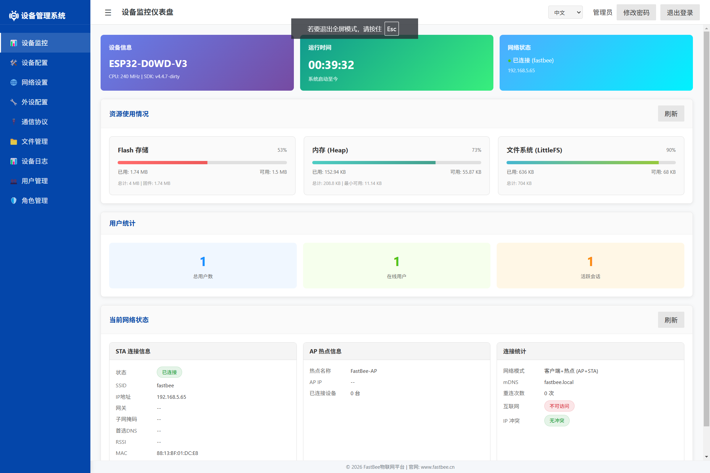
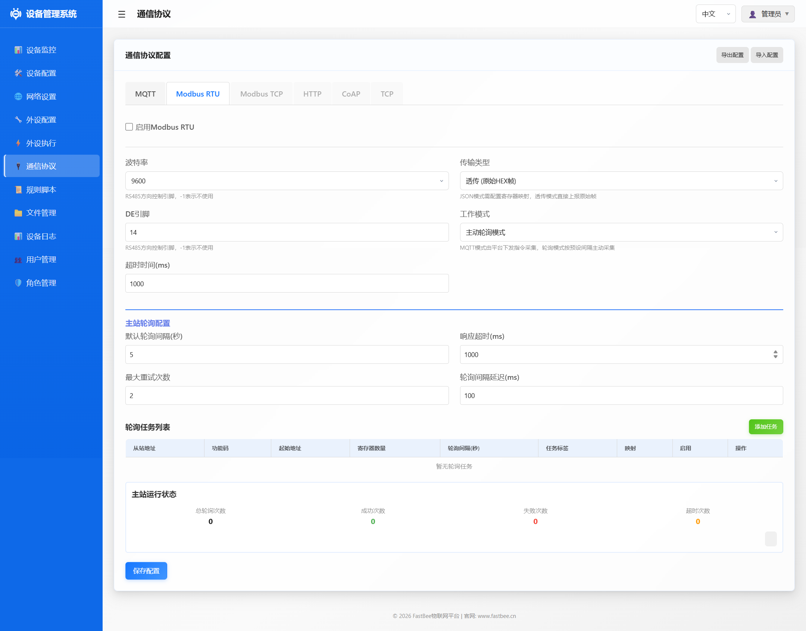
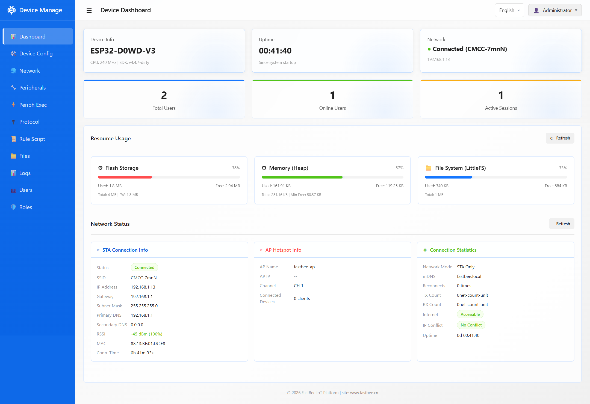
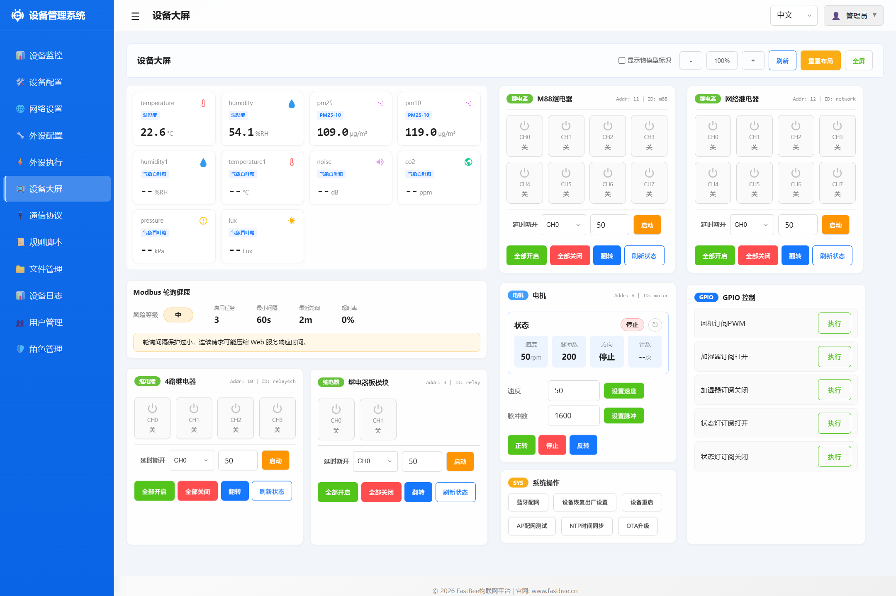
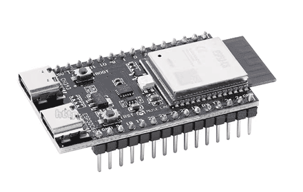
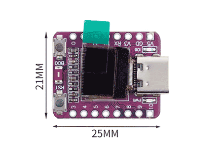
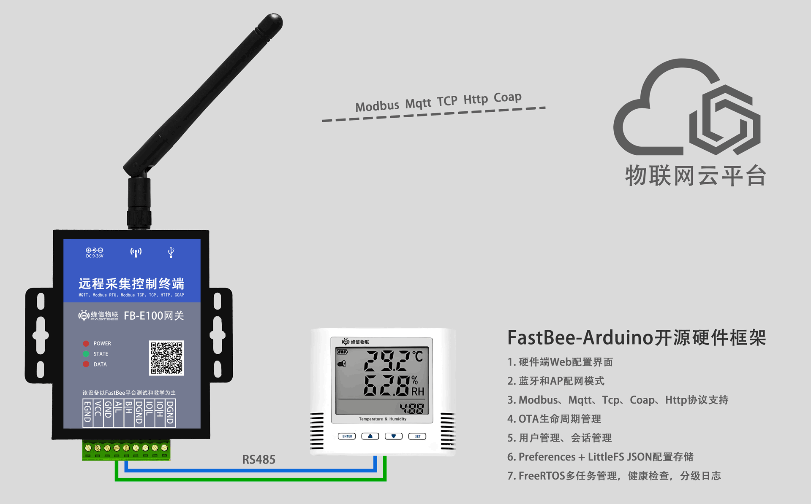
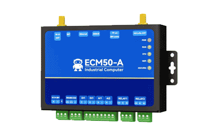
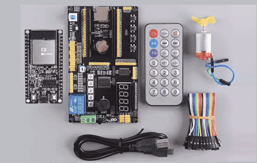
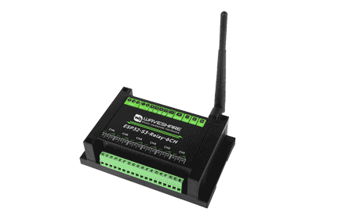

# FastBee-Arduino

> 面向 ESP32 系列的零代码 Web 物联网固件。烧录后通过浏览器完成配网、外设、协议和自动化规则配置。

[](LICENSE)

源码仓库：[gitee.com/beecue/fastbee-arduino](https://gitee.com/beecue/fastbee-arduino)
自动化门禁：[`.github/workflows/ci.yml`](.github/workflows/ci.yml)

## 能做什么

- **浏览器管理**：本地 Web 控制台提供设备状态、网络、外设、协议、日志和配置备份。
- **多种联网**：所有发布环境支持 WiFi AP/STA；部分 ESP32/ESP32-S3 环境还支持 W5500 以太网和 EC801E-CN 4G，需对应硬件并在运行时启用。
- **外设接入**：GPIO、ADC/PWM、DHT、DS18B20、AHT20、SHT31、BH1750、BMP280、MPU6050、OLED、LCD1602、TM1637、NeoPixel、舵机、步进电机、RFID、红外、433MHz RF、Modbus 设备等。
- **本地自动化**：平台、定时、事件、轮询 4 类触发器；动作覆盖 GPIO、PWM/DAC、传感器读取、Modbus、显示、电机、脚本和事件上报。
- **设备维护**：认证与会话、健康监控、低内存保护、SSE 实时推送、配置导入导出，以及带 A/B 分区设备的 OTA。

当前发布固件的设备通信协议为 **MQTT/MQTTS 和 Modbus RTU 主站**。Modbus RTU 主站与 IoT 平台之间支持 **JSON 结构化数据** 和 **原始 HEX 帧透传** 两种双向数据格式，由协议配置中的 `modbusRtu.transferType` 运行时切换（`0=JSON`，`1=透传`）：JSON 模式按寄存器映射上报 `[{"id","value"}]` 并解析平台下行写指令；透传模式上报校验通过的原始 ADU 帧，平台也可直接下发 HEX/二进制 RTU 帧读写从站。设备 Web 管理、HTTP NTP 和 HTTP OTA 不等同于通用 HTTP 上报协议；原始 TCP、Modbus TCP、CoAP 和通用 HTTP 客户端不属于当前发布能力。

## 工作方式


固件采用统一架构：发布环境共享 `unified_flags` 功能基线，OTA、以太网、4G、红外等硬件相关能力再由各环境覆盖或裁剪；运行时由 `features.json` 和 `FeatureBudget` 决定是否启用。“已编译”不等于“已启用”。

## 支持的构建环境

构建环境以 [`platformio.ini`](platformio.ini) 为准；发布合并固件清单由 FastBee-doc 的 `src/device/fim/manifest.json` 维护：

| 环境 | 芯片 | Flash | PSRAM | OTA | 用途 |
| --- | --- | ---: | ---: | :---: | --- |
| `esp32-F4R0` | ESP32 | 4MB | 无 | 否 | 4MB 通用节点，默认环境 |
| `esp32-F8R0` | ESP32 | 8MB | 无 | 是 | ESP32-WROOM 8MB OTA 节点 |
| `esp32-F8R8` | ESP32 | 8MB | 8MB | 是 | ESP32-WROVER 网关/缓存节点 |
| `esp32c3-F4R0` | ESP32-C3 | 4MB | 无 | 否 | 低成本 WiFi 节点 |
| `esp32c6-F4R0` | ESP32-C6 | 4MB | 无 | 否 | WiFi 6 低成本节点 |
| `esp32c6-F8R0` | ESP32-C6 | 8MB | 无 | 是 | WiFi 6 OTA 节点 |
| `esp32s3-F8R0` | ESP32-S3 | 8MB | 无 | 是 | S3 无 PSRAM OTA 节点 |
| `esp32s3-F8R8` | ESP32-S3 | 8MB | 8MB | 是 | S3 主力开发/控制器 |
| `esp32s3-F16R8` | ESP32-S3 | 16MB | 8MB | 是 | 大容量网关/控制器 |

以上 9 个环境均属于正式发布矩阵；环境名中的 `F` 表示 Flash 容量，`R` 表示 PSRAM 容量，`R0` 代表无 PSRAM。标准命名不再使用 `F8R4`，`R8` 统一表示 8MB PSRAM；4MB PSRAM 仅作为自定义厂商配置保留。

4MB 环境使用单 app 分区，因此不提供 OTA；8MB/16MB 环境使用 `app0/app1` A/B 分区。`esp32-F4R0`、`esp32c3-F4R0`、`esp32c6-F4R0` 和 `esp32c6-F8R0` 不编译以太网与 4G；其他环境仍需对应硬件和运行时开关。编译/用户开关查看 `/api/features/status`，最终运行状态查看 `/api/system/status`。

[自动生成的构建环境与 Web 能力矩阵](docs/generated-build-capabilities.md) 从当前配置生成，并由现有静态门禁检测过期；其中宏和资源选择不代表实物验证或运行时已初始化。

## 快速开始

### 1. 在线烧录

打开 [在线烧录工具](https://fastbee.cn/doc/device/deploy/esp32-flasher.html)，选择与芯片、Flash、PSRAM 完全匹配的合并固件，地址保持 `0x0`。如果自动复位失败，按一次 `EN/RST`；部分开发板需要按住 `BOOT` 后再开始烧录。

### 2. 从源码编译和烧录

前置依赖：Node.js 20+ 和 PlatformIO（VS Code 插件或 PlatformIO Core 命令行）。全新克隆不含生成好的 `data/www/*.gz`，构建时会用 `terser` 等本地依赖自动生成 Web 资源，因此先在项目根目录执行 `npm ci`：

```powershell
# 首次克隆或 package-lock.json 变更后：安装 Web 构建依赖
npm ci

# 构建、生成 Web 资源、上传 LittleFS 和固件（连接开发板后执行）
powershell -ExecutionPolicy Bypass -File scripts\deploy.ps1 -Env <env> -Port <serial-port>

# 只构建，不烧录
powershell -ExecutionPolicy Bypass -File scripts\deploy.ps1 -Env esp32s3-F8R8 -BuildOnly
```

常用参数：`-Env` 选择环境，`-Port` 指定串口，`-Monitor` 烧录后打开串口，`-SkipFs`/`-SkipFirmware` 跳过某一部分，`-SkipWeb` 跳过 Web 资源生成。也可以直接使用 `pio run -e <环境>`，但发布时必须同时更新 LittleFS 与固件。注意上传 LittleFS 会重写整个文件系统分区；升级已配置的设备时使用 `-SkipFs` 保留配置，或先在 Web 控制台导出备份。

### 3. 首次配置

1. 设备启动后会进入 AP 模式；`apSSID` 为空时热点名为 `设备名-芯片ID前6位`，恢复出厂设置后的固定名称为 `fastbee-ap`，密码均为 `admin123`。
2. 手机或电脑连接热点，访问 `http://192.168.4.1`。
3. 使用 `admin / admin123` 登录，立即修改密码。
4. 在“网络配置”中填写 WiFi，保存后设备切换到 STA；之后可通过路由器 IP 或 `http://fastbee.local` 访问。
5. 在“功能配置”中按需启用功能，再添加外设、配置 MQTT/Modbus 和外设执行规则。

## 功能配置原则

`features.json` 保存全部功能的用户期望状态；Web 服务和本地域名服务出厂默认启用，其他可选功能默认关闭。旧版稀疏配置会在首次加载时保留已有选择并自动补全一次。功能生效至少需要满足：

<table>
  <tr>
    <td></td>
    <td></td>
  </tr>
  <tr>
    <td></td>
    <td></td>
  </tr>
</table>

## 案例展示

以下是 FastBee-Arduino 在不同芯片和硬件平台上的实际应用案例。

<table>
<tr>
<td align="center" width="33%">
<a href="https://fastbee.cn/doc/device/examples/esp32c6-blink-quickstart.html"></a>
<br/><a href="https://fastbee.cn/doc/device/examples/esp32c6-blink-quickstart.html"><b>ESP32-C6 控制全彩LED灯入门</b></a>
<br/><sub>使用 ESP32-C6 开发板，5分钟内完成固件烧录和 LED 闪烁测试，体验零代码快速入门流程。</sub>
</td>
<td align="center" width="33%">
<a href="https://fastbee.cn/doc/device/examples/esp32c3-temperature-humidity.html"></a>
<br/><a href="https://fastbee.cn/doc/device/examples/esp32c3-temperature-humidity.html"><b>ESP32-C3 监测温湿并显示</b></a>
<br/><sub>通过 DHT11 传感器采集环境温湿度，OLED 屏实时显示，超限自动触发报警规则。</sub>
</td>
<td align="center" width="33%">
<a href="https://fastbee.cn/doc/device/examples/hardware-showcase.html"></a>
<br/><a href="https://fastbee.cn/doc/device/examples/hardware-showcase.html"><b>ESP32 实现 Modbus 监测和控制</b></a>
<br/><sub>ESP32 物联网终端通过RS485接口采集 Modbus RTU 从站数据，实现工业传感器监测和控制。</sub>
</td>
</tr>
<tr>
<td align="center" width="33%">
<a href="https://fastbee.cn/doc/device/examples/ecm50a-networking.html"></a>
<br/><a href="https://fastbee.cn/doc/device/examples/ecm50a-networking.html"><b>ECM50-A 以太网/4G/WiFi联网..</b></a>
<br/><sub>基于 ESP32-S3 芯片的 ECM50-A 工业设备，支持 4G 蜂窝、以太网 W5500 和 WiFi 三种联网方式自动切换。</sub>
</td>
<td align="center" width="33%">
<a href="https://fastbee.cn/doc/device/examples/puzhong-esp32-test.html"></a>
<br/><a href="https://fastbee.cn/doc/device/examples/puzhong-esp32-test.html"><b>ESP32普中开发板各项功能测试</b></a>
<br/><sub>使用普中 ESP32 开发板全面测试 GPIO、ADC、PWM、I2C、SPI、UART、显示屏等外设功能。</sub>
</td>
<td align="center" width="33%">
<a href="https://fastbee.cn/doc/device/examples/waveshare-esp32s3.html"></a>
<br/><a href="https://fastbee.cn/doc/device/examples/waveshare-esp32s3.html"><b>ESP32-S3 微雪工业继电器</b></a>
<br/><sub>WaveShare ESP32-S3 开发板适配，覆盖 WiFi、传感器采集、显示屏驱动和 MQTT 上报等。</sub>
</td>
</tr>
</table>

更多案例请查看 [示例教程](https://fastbee.cn/doc/device/examples/) 目录。

## 预定义环境

完整且唯一的当前发布表见前文[支持的构建环境](#支持的构建环境)，由 `platformio.ini` 与构建矩阵门禁共同核对，不再按 Lite/Standard/Full 划分。

1. 同时核对芯片、实际 Flash/PSRAM 容量及总线模式；不能仅凭“带 PSRAM”选择固件。2MB/4MB PSRAM 模组不能被当作 R8 配置。
2. 当前 4MB 环境为单 app 分区，不支持 OTA；8MB/16MB canonical 环境为 A/B 分区。自定义分区仍需单独核验，不能只按容量推断 OTA。
3. 整板屏幕、扩展器、接线及供电不由环境名证明兼容；RGB 触屏需要对应专用构建，canonical S3 镜像不是替代品。
4. 自定义厂商环境须单独维护板卡、Flash/PSRAM、功能与分区约束，不自动计入九个正式发布目标。

> 功能对比详表与分区表见 [版本对比](https://fastbee.cn/doc/device/getting-started/edition-comparison.html)。

## 功能生效条件

```text
compiled（编译进固件）
  AND userEnabled（用户已启用）
  AND budgetPassed（启动内存预算通过）
  AND NOT runtimeDisabled（运行期未被保护机制停用）
```

需要网络或父功能的模块还要等待网络就绪并满足依赖。常见依赖：MQTTS 依赖 MQTT；命令脚本依赖规则脚本；GB2312 字库依赖 LCD。以太网需要 W5500，4G 需要 EC801E-CN，BLE 配网目前未作为发布能力提供。外设引脚仍需遵守芯片保留引脚和电气规格，Web 的“引脚校验”只能检查固件已知规则。

“设备配置”等基础菜单始终显示；设备大屏、规则脚本、设备日志和用户管理等可选菜单只在对应功能实际处于 `active` 状态时显示。功能未编译、未启用、预算未通过或运行期被停用时，相关可选菜单会隐藏。

## 配置文件

运行时配置位于 LittleFS `/config/`：

| 文件 | 内容 |
| --- | --- |
| `device.json` | 设备 ID、名称、NTP、时区、日志级别 |
| `network.json` | WiFi AP/STA、静态 IP、自定义本地域名、以太网和 4G 参数 |
| `protocol.json` | MQTT、MQTTS、Modbus RTU 参数 |
| `peripherals.json` | 外设类型、引脚和参数 |
| `periph_exec.json` | 触发器、条件和动作规则 |
| `features.json` | 全部运行时功能的用户期望状态 |
| `rule_scripts.json` | 可选规则脚本 |
| `users.json` / `auth.json` | 用户、密码哈希和认证策略 |

建议使用 Web 的配置导出/导入功能备份，不要把真实密码和令牌提交到代码仓库。

五台测试设备的可提交样例、配置格式、串口映射和部署方法统一维护在 [`docs/README.md`](docs/README.md)。每台设备使用独立配置，不能跨设备互换。公开样例必须清空设备身份、WiFi STA、MQTT 和认证凭据；被 Git 忽略的 `.device-config-backups/` 只用于本机临时恢复，不得发布，长期备份应移到加密存储。

`data/config/` 只用于无设备身份、无 STA/MQTT 凭据且默认不启动外设和规则的工厂模板，不能用作真机配置备份。`npm test` 会检查这一边界。

## API 入口

除特别标注外，API 需要登录后由设备下发的 HttpOnly `sessionId` Cookie（Cookie 名称可在安全配置中自定义，设备同时兼容 `session`）；`GET /api/health` 和 `GET /api/system/capabilities` 免认证，分别用于探活和能力探测。

| 模块 | 入口 |
| --- | --- |
| 认证 | `/api/auth/login`、`/logout`、`/session`、`/change-password` |
| 系统/健康 | `/api/system/info`、`/status`、`/health`、`/metrics`、`/capabilities`、`/restart` |
| 网络 | `/api/wifi/*`、`/api/network/config`、`/api/network/status` |
| 设备/配置 | `/api/device/*`、`/api/config`、`/api/config/transfer/*` |
| 外设 | `/api/peripherals/*` |
| 自动化 | `/api/periph-exec/*`、`/api/rule-script*`（规则脚本启用后） |
| 协议 | `/api/protocol/*`、`/api/mqtt/*`、`/api/modbus/*` |
| OTA | `/api/ota/*`（仅 8MB/16MB A/B 分区环境） |
| 功能/SSE | `/api/features/*`、`/api/events` |

完整字段和示例见设备端 [API 接口参考](https://fastbee.cn/doc/device/dev/api-reference.html)。

## 项目结构

```text
src/core/          核心框架、外设管理、规则引擎
src/network/       WiFi、Web、网络适配器和 API 路由
src/protocols/     MQTT、Modbus RTU
src/peripherals/   传感器、显示、RF/RFID 等驱动
src/screen/        屏幕运行时、面板管理和 RGB/SPI 显示后端
src/security/      认证、用户和密码哈希
src/systems/       配置、日志、健康监控和任务服务
src/utils/         文件、JSON、字符串和时间等通用工具
include/           与 src/ 按同名模块对应的头文件
web-src/           Web 前端源码
data/config/       LittleFS 默认配置
data/www/          自动生成的 gzip-only Web 发布资源（不要直接编辑）
partitions/        4MB/8MB/16MB 分区表
scripts/           构建、部署和测试脚本
test/              native、设备 API 和浏览器测试
```

## 文档与开发

- [仓库内五设备配置样例与部署说明](docs/README.md)
- [设备端文档首页](https://fastbee.cn/doc/device/)
- [快速开始](https://fastbee.cn/doc/device/getting-started/quick-start.html)
- [用户操作手册](https://fastbee.cn/doc/device/getting-started/user-manual.html)
- [外设参考](https://fastbee.cn/doc/device/peripherals/)
- [MQTT 与 Modbus](https://fastbee.cn/doc/device/protocols/)
- [OTA 升级](https://fastbee.cn/doc/device/deploy/ota-upgrade.html)
- [构建配置与分区](https://fastbee.cn/doc/device/dev/build-config.html)

## 本地验证与设备测试

提交前按改动范围选择测试。`npm test` 是日常快速门禁；涉及 C++、构建参数、依赖或分区时还必须运行后两层，不能用主机测试替代固件编译。

| 范围 | 命令 | 适用场景 |
| --- | --- | --- |
| 快速主机门禁 | `npm test` | 文档、Web、配置、脚本和源码契约 |
| C++ native 回归 | `npm run test:regression` | 核心逻辑、内存治理、外设和协议改动 |
| 指定固件环境 | `npm run test:firmware -- <环境>` | 芯片宏、库、分区或驱动改动 |
| 浏览器用例收集 | `npm run test:e2e:collect` | 确认全部 Playwright 用例可解析，不连接设备 |

GitHub Actions 会继续执行 native 回归、9 个发布环境的固件与 LittleFS 构建，以及 Web 发布资源检查；真机冒烟和浏览器测试必须显式提供设备 STA 地址。

```powershell
# 静态、native、9 环境构建和合并产物校验
powershell -ExecutionPolicy Bypass -Command ".\scripts\test-all.ps1 -Checks static,native,build,artifacts"

# 设备 API 冒烟和完整 Web 页面巡检（将地址替换为设备 STA IP）
powershell -ExecutionPolicy Bypass -File scripts\smoke-test-device.ps1 -BaseUrl http://<device-ip> -Profile unified -RequireNetworkConnected
powershell -ExecutionPolicy Bypass -File scripts\device-web-smoke.ps1 -BaseUrl http://<device-ip> -Rounds 2 -DelayMs 1000 -TimeoutSec 15 -MaxElapsedMs 5000 -ReportPath test\reports\web-smoke.csv

# 五设备测试台：复制示例并替换实验室地址、串口和可选本地域名后再执行
powershell -ExecutionPolicy Bypass -File scripts\run-device-fleet-tests.ps1 -DeviceConfig <local-fleet-config.json> -BrowserTests:$false
```

4MB 无 PSRAM 设备在高并发请求下可能触发 `503` 低内存保护；页面巡检应保留请求间隔并结合 `/api/system/metrics` 观察趋势。上述主机门禁验证源码、构建和固件产物，不代替设备上的 LittleFS 内容、配置迁移和重启恢复检查。详细步骤见 [测试与版本验证](https://fastbee.cn/doc/device/deploy/testing.html) 和 [发布检查清单](https://fastbee.cn/doc/device/deploy/stability-release-checklist.html)。

## 许可证

本项目采用 [AGPL-3.0](LICENSE) 许可证。
