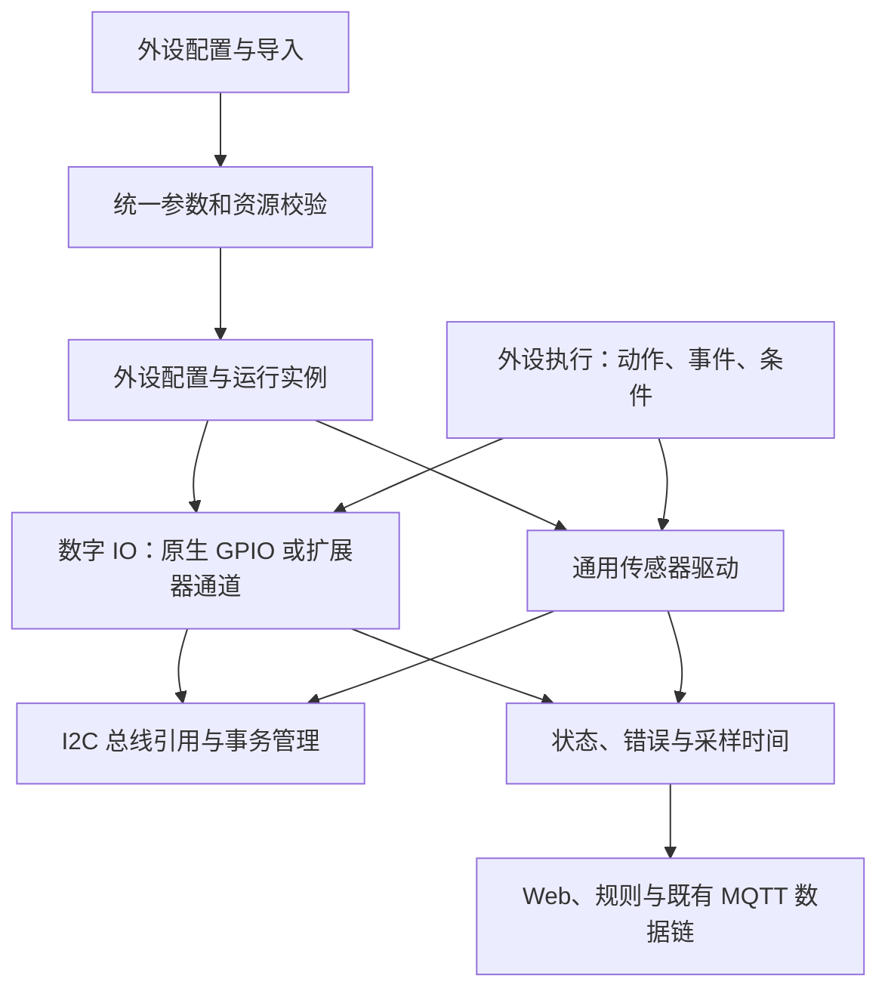
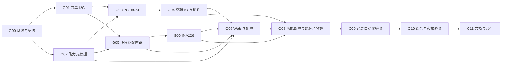

# FastBee 通用外设能力扩展计划

版本：本地实施记录 v2.0 ｜ 日期：2026-09-17 ｜ 状态：首批实现已落地，最终回归与编译结果收集中

本计划以当前 FastBee-Arduino 工作区为基础，目标是拓展固件的通用能力，让更多模块通过现有的 **“功能配置 → 外设配置 → 外设执行 → 状态、规则与数据上报”** 使用。功能按能力分类，模块按驱动型号选择，引脚和总线按实际接线配置，面向当前支持的各类开发板复用。

用户已授权按首批范围实施，并要求完善测试代码、无需部署到设备。首批已接入共享 I²C、PCF8574、逻辑数字 IO、七个传感器注册名、功能门控和 Web 配置/执行链。本文保留原设计与验收目标作为追溯依据，实际实现与本地结果以第 12 节及 [兼容性记录](generic-i2c-peripherals/compatibility.md) 为准。当前基线为包含其他并行任务改动的未提交工作区，不代表已发布版本。

本次修订：进一步明确按通用能力组织功能、驱动和配置，将较高内存占用能力纳入现有“功能配置”，补充开关分组、按需初始化、禁用后的资源处理、依赖和状态显示。首版沿用“保存并重启生效”；运行时关闭减少动态 RAM 占用，固件中的代码和静态内存仍需编译裁剪才能减少。

**建议审核顺序：先看第 1～3 节确认范围和使用方式，第 5.5 节确认功能开关，再看第 7～10 节确认分工、投入与验收。**

## 1. 建议结论

建议实施一个规模受控的通用扩展版本，首批交付三项能力：

1. **通用 IO 扩展器接入。** 一颗扩展器可以配置出多个输入、输出外设，复用已有开关、翻转、低速闪烁、输入事件和规则条件；第一版只增加 PCF8574 一个驱动。
2. **打通现有 I²C 传感器的配置和执行链。** 已有驱动通过统一的型号、参数和通道描述进入外设配置，执行规则只选择外设和测量通道，不再重复填写接线。
3. **新增 INA226 电压、电流、功率采集。** 提供当前通用温湿度、光照等能力以外的测量类型，接入现有传感器读取、阈值联动和 FastBee MQTT 数据链。

为使上述三项稳定共存，配套补齐共享 I²C 生命周期、能力校验、错误状态、跨芯片资源预检和配置兼容。内存开销较大的能力按功能分组启用，只有功能已启用且有对应外设时才创建实例、缓冲和任务。只改动这些能力实际经过的链路，不开展全固件框架重写。

| 审核项 | 本计划建议 |
| --- | --- |
| 主要入口 | 在现有功能配置、外设配置和外设执行中完成使用闭环 |
| 功能配置 | IO 扩展、I²C 传感器及后续彩屏/SD 记录按需启用；新增功能默认关闭，沿用保存并重启生效 |
| 首个 IO 扩展驱动 | PCF8574；8 个逻辑通道，按芯片实际能力开放输入与输出 |
| 首个新增测量驱动 | INA226；电压、电流、功率三个通道 |
| 已有驱动处理 | 补齐 AHT20、BH1750、BMP280、MPU6050、SHT30、SHT31 的通用配置链，保留旧入口兼容 |
| 可选后续项 | LM75B、第二种 IO 扩展芯片、RTC 时间服务、SD 数据记录、基础 SPI TFT |
| 支持范围 | 当前 ESP32 / ESP32-C3 / ESP32-C6 / ESP32-S3 固件环境；按引脚、总线和容量开放 |
| 投入估算 | 首批约 15.5～24.5 人日；3 个开发单元加 1 个集成单元，约 10～15 个工作日，另留持续运行观察时间 |
| 当前决策性质 | 供用户审核的推荐范围；可选包没有被计入首批承诺 |

“尽可能适配所有开发板”在这里指：**相同驱动与执行动作可跨现有支持芯片复用，用户配置实际接线和模块参数。** 未有对应驱动、芯片支持或足够资源的硬件，不能只靠填写引脚自动获得支持；也不保证所有可选功能可在每块板上同时运行。

### 1.1 通用性作为交付标准

- **功能配置按能力分组**：显示 IO 扩展、I²C 采集、基础彩屏、数据记录等功能；具体芯片型号放在外设配置中选择，开关不绑定某块成品板。
- **接线由用户配置**：驱动不硬编码开发板名称、固定引脚、固定输入/输出数量或专属上电顺序；依据所选芯片和实例能力校验。
- **执行只引用逻辑外设和能力**：规则通过稳定外设 ID、动作和测量通道工作。更换开发板时调整目标环境与接线；更换同能力模块时调整驱动和通道绑定，尽量保留规则。
- **后续模块可增量接入**：同类模块优先只增加驱动、元数据和行为测试，复用总线管理、配置表单、执行入口和状态模型；确有新的动作语义时再扩展公共能力。

PCF8574 和 INA226 是首批验证上述机制的参考驱动，不是板型绑定条件。样例按“模块与能力”组织，沿用当前通用构建环境；本计划不产出特定开发板的独立固件、固定接线包或专属功能页面。

## 2. 功能选择与可行性评估

### 2.1 首批建议纳入

| 能力 | 当前情况 | 可行性与通用价值 | 首批边界 |
| --- | --- | --- | --- |
| 共享 I²C 与设备引用 | 已有 I²C 外设和资源规划，但多个驱动仍直接初始化全局 Wire | 可实现；是多种外设共存的必要条件 | 统一参与首批组合的 I²C 使用者；不顺带重写 SPI/UART |
| IO 扩展器父设备与逻辑通道 | 原生数字 IO 和动作已有，尚无通用扩展器后端 | 可实现；少量 MCU 引脚扩展出更多输入/输出 | 一个父设备共享驱动，子通道继续使用数字输入/输出类型 |
| PCF8574 | LCD1602 内部有对该类芯片的使用，尚非通用 IO 外设 | 可实现；驱动规模小，适合验证完整配置和执行链 | 数字输入/输出、极性、轮询去抖；不开放 PWM、呼吸或高速脉冲 |
| 通用传感器型号与通道元数据 | 注册了 6 个型号名；通用配置的后端白名单仍主要限制 BMP280/MPU6050 | 可实现；优先把已有代码变成用户可配置能力 | 配置、API、动作选择器使用同一份型号/参数/通道定义 |
| INA226 | 有通用传感器接口，尚无本项目驱动 | 可实现；增加电源和负载监测 | 结构化校准参数；共享一次采样的三个读数；不当作硬件保护电路 |
| 既有规则与 MQTT 接入 | 已有传感器读取、输入事件、GPIO 动作和 FastBee 上报 | 可复用，但需补齐目标能力校验与失效状态 | 延用现有平台协议、触发器和动作，不另建规则系统 |
| 跨板配置与容量校验 | 有 ChipConfig、BoardProfile 和资源规划基础，覆盖并不完整 | 可实现；决定换板后能否继续用同一套规则 | 依据编译芯片和实际资源校验，具体板型约束作为附加限制 |

PCF8574 是准双向 IO，不等同于 ESP32 原生推挽 GPIO；上电状态、总线速度和可用电气模式需进入驱动能力描述。首批选择它是为了用一个较小驱动打通通用扩展链，不意味着为所有模块推荐相同芯片。[TI 官方产品资料](https://www.ti.com/product/PCF8574)

INA226 可通过 I²C 读取电压、电流和功率，实际换算依赖分流电阻及校准参数；不能照搬某块成品板的电阻值或量程。[TI 官方产品资料](https://www.ti.com/product/INA226)

### 2.2 独立可选包

| 编号 | 能力 | 选择理由与实施边界 | 追加估算 |
| --- | --- | --- | --- |
| O01 | LM75B 温度 | 驱动较小，但已有多种温度来源；有对应模块再做。明确 LM75B 变体，验证带符号温度和分辨率，不宣称兼容所有 LM75 系列 | 0.5～1 人日 |
| O02 | 第二种 IO 扩展器 | 有明确模块需求时，在 AW9523B、MCP23017 等中选一种；复用父设备/子通道模型。型号、修订及勘误先核对，不同时加入全部驱动 | 每种约 1～2 人日 |
| O03 | 通用 RTC 时间服务 | 先让已有 DS1302 接入系统时钟和日历定时，再按实际应用选择一种 I²C RTC；共用时钟接口及时间规则 | DS1302 闭环 1.5～3 人日；新芯片另估 |
| O04 | SD 数据记录动作 | 复用已有 SD 配置和文件服务，增加受限追加记录、队列与轮转；不含 SD OTA、媒体或大文件平台 | 2～3 人日 |
| O05 | 基础 SPI TFT | 首选一个确定控制器，例如 ST7789，支持文字、数值、清屏及基础样式；参数化尺寸/偏移/旋转，使用小缓冲 | 2～4 人日；仅基础显示和既有总线共存 |

O01 的芯片格式以 [NXP LM75B 数据手册](https://www.nxp.com/docs/en/data-sheet/LM75B.pdf) 为准。O02、O05 的确切模块和库在该工作包启动时锁定；这些估算不包含采购等待、复杂中文字体或应用界面设计。

内存开销较高本身不作为放弃功能的理由：O04/O05 一旦选择开发，应交付独立的功能配置开关，用户按需启用，关闭后不创建专属记录队列、显示缓冲或任务。“可选开发”与“已实现但默认禁用”分开标记；功能开关不能将尚未开发的驱动变成可用能力。可选包估算包含接入首批已建好的门控和预算机制，不包含第二套启停框架。

未来若有更多模拟量或独立 PWM 通道需求，再评估外置 ADC/PWM 芯片。首批只保留可增加驱动的接口，不实现空壳类型或不可用选项。

### 2.3 本计划不纳入的内容

| 项目 | 本次处理 |
| --- | --- |
| EZData、Home Assistant / MQTT Discovery | 不实现；使用当前 FastBee 配置、规则和 MQTT 链路 |
| 特定开发板的构建环境、固定通道映射、整板启动序列 | 不纳入；使用当前通用构建环境和可配置外设 |
| Modbus 从站及特定设备寄存器表 | 不纳入；已有 Modbus 主站只做相关回归 |
| CAN / TWAI | 暂缓。本项目另有通用设备屏幕计划涉及 CAN 数据展示，若实施应共用一个后端，避免重复建设 |
| 特定设备的菜单、配网体验和演示复刻 | 不纳入；通用定时/输入联动由现有外设执行规则表达 |
| LVGL、RGB 480×480 面板、触摸界面、天气和第三方场景 | 归通用设备屏幕计划，不进入本计划的基础显示工作包 |
| SD OTA、另建 OTA 协议、任意原始寄存器脚本 | 不实现；不作为本次扩展的前置条件 |
| AC/PoE、特定底座和专用扩展附件 | 不做硬件整机适配；只在未来明确模块需求时评估 |

已有 [旧专板与三屏评估计划](smart-panel-and-waveshare-touch-lcd-4-plan.md) 是历史独立评审文档，不代表其中功能已经实现。当前设备屏幕实施以 [通用屏幕与触摸交互扩展计划](generic-screen-panel-extension-plan.md) 为准；本计划仅与其协调外设 ID、数据通道、失效状态和公共总线接口。

## 3. 用户完成配置后如何使用

以下是拟实现的页面交互，字段名用于说明设计，不是当前可导入的配置文件。

使用前在“功能配置”启用需要的功能组，按现有流程保存并重启，然后进入外设配置和外设执行。相关表单显示“功能未启用”时提供到功能配置的入口；关闭功能保留外设及规则配置，重新启用后无需重建。高占用功能不随某个表单的打开而自动启用。

### 3.1 增加输入与输出

1. 在“外设配置”添加或选择 I²C 总线，填写当前开发板的 SDA/SCL，首批示例采用 100 kHz。
2. 添加“IO 扩展器”，选择 PCF8574、总线和实际硬件地址。页面显示可用通道 P0～P7 与通讯状态。
3. 添加“数字输出”，将“信号来源”选择为该扩展器的某个通道，设置名称、有效极性及启动时的逻辑状态。其他通道可配置成数字输入并设置去抖。
4. 在“外设执行”选择这个输出外设，使用已有开、关、翻转或低速闪烁；输入外设可作为条件或按键事件来源。
5. 查看执行结果和外设状态。扩展器掉线时显示不可用，失败写入不会显示为已成功控制。

示例：`io_ext_1` 为父设备，`switch_1` 使用 P0，`input_1` 使用 P1；规则引用 `switch_1` 和 `input_1`。更换开发板后，优先调整总线接线，保持逻辑 ID 和规则关系。

“继电器开关”需要实际匹配的驱动模块。扩展器输出状态只证明 IO 命令/电平信息，不证明继电器触点或负载已动作；有反馈输入时另建反馈条件。固件启动默认值也不能消除芯片上电至初始化之间的物理电平差异。

### 3.2 增加测量与联动

1. 在“外设配置”添加“通用传感器”，选择 INA226、总线和地址，按模块规格填写分流电阻及预期最大电流。
2. 页面列出 `voltage`、`current`、`power` 及单位，并显示实际采样周期、最近有效值、时间和错误。
3. 在“外设执行”选择“传感器读取”，目标为刚才的传感器，通道选择“电流”；触发方式沿用已有定时或轮询。
4. 配置阈值条件，联动另一个数字输出，或将结果映射到已有 FastBee 物模型属性。三项测量可分别建立读取/映射规则，共用有效采样。
5. 未完成校准、离线或超时的读数不能按正常的 0 A 参与阈值判断；平台无法表达质量字段时，至少不发送伪造有效值，并保留本机错误状态。

温湿度、光照等已有驱动采用相同交互，显示各自支持的通道。新增型号只应增加驱动与参数定义，通常无需增加一个专属执行动作或页面。

### 3.3 表单与状态约定

| 页面位置 | 拟增加/完善的内容 | 验收重点 |
| --- | --- | --- |
| 功能配置 | 按功能组启停、预估内存、依赖、已保存/待生效/实际运行状态 | 保存未生效时不宣称已释放内存；停用不删除外设和规则 |
| 外设配置：I²C | 可复用总线、实际引脚、频率、占用设备 | 不让多个设备分别重建同一条物理总线 |
| 外设配置：IO 扩展器 | 型号、地址、通道使用情况、状态 | 已被占用的通道不可重复选用；无需填写寄存器 |
| 外设配置：数字 IO | 原生 GPIO / 扩展器来源切换、通道、极性、初值/去抖 | 原生 GPIO 旧配置默认保持原语义；扩展器通道不填写 MCU GPIO |
| 外设配置：传感器 | 型号、结构化参数、通道/单位预览 | 前后端用相同能力描述；不显示未编译的驱动 |
| 外设执行 | 基于目标能力过滤动作；按目标列出采集通道 | 导入/API 绕过页面后也必须进行同等后端校验 |
| 状态与错误 | 运行、禁用、离线、读数过期、参数错误、资源不足 | 旧值可供排查，但必须显示更新时间和失效状态 |

保留现有预检、错误阻止保存和警告后的再次保存行为；不另加一个通用“风险确认”复选框。依赖缺失的规则应显示具体目标，不应静默替换或删除。

## 4. 已核实的工程基础与缺口

本节依据当前代码，而非仅依据厂商示例。行号可能随现有并行工作变化，实施时以符号和调用路径为准。

| 位置 | 已确认情况 | 计划改动 |
| --- | --- | --- |
| [PeripheralTypes.h](../include/core/PeripheralTypes.h)、[PeripheralConfig.h](../include/core/PeripheralConfig.h) | 有 I²C、数字输入/输出、SENSOR_GENERIC 等类型；配置包含物理 `pins`，类型默认引脚数也偏向 MCU GPIO | 新增扩展器父类型；数字 IO 增加可选逻辑来源。现有类型/动作编号不重排，保留编号不挪用 |
| [PeripheralManager.cpp](../src/core/PeripheralManager.cpp) | `readGpioStateLocked`、`writeGpioStateLocked`、热路径和翻转主要按 MCU pin 处理 | 在查主引脚前分派到数字 IO 后端，统一字符串及其他调用入口 |
| [PeripheralManagerIo.cpp](../src/core/PeripheralManagerIo.cpp)、[PeriphExecScheduler.cpp](../src/core/PeriphExecScheduler.cpp) | 轮询可按外设 ID 读取；原生中断队列仍以 pin 为中心 | 首版扩展器用批量轮询；不直接套用 MCU 中断路径 |
| [PeriphExecExecutor.cpp](../src/core/PeriphExecExecutor.cpp) | 动作通常按目标 ID 调用 PM；数字采集和部分翻转路径会把未知状态当低电平 | 修正未知值处理；不把通讯故障转成有效 0，也不在未知后自动翻转为高 |
| [PeriphExecManager.cpp](../src/core/PeriphExecManager.cpp) | 动作匹配主要按类型；显示 24～26 主要接受 TM1637，27 为 OLED | 首批按数字 IO 能力过滤；可选 TFT 另扩展目标分派，不能称当前已支持 |
| [ISensorDriver.h](../include/core/interfaces/ISensorDriver.h)、[DriverRegistry.h](../include/core/DriverRegistry.h) | 已有生命周期、通道名/单位，`SensorReading` 最多 4 个值；注册容量 8，目前 6 个注册名 | 元数据进入配置校验与 UI；INA226 三通道复用现有读数结构；核验注册失败处理 |
| [SensorDriverCache.h](../include/core/SensorDriverCache.h)、[SensorDriverCache.cpp](../src/core/SensorDriverCache.cpp) | 实际缓存容量 6，缓存的是驱动实例；`readChannel` 仍会发起读取 | 增加有界采样复用和过期判断；实例淘汰不能释放其他设备仍使用的总线 |
| [PeripheralRouteHandler.cpp](../src/network/handlers/PeripheralRouteHandler.cpp) | 路由解析、类型描述和 PM 配置验证存在 BMP280/MPU6050 固定名单 | 同步替换名单和默认地址逻辑；只改注册表不构成完整支持 |
| [peripheral-save.js](../web-src/modules/runtime/peripheral-save.js)、[periph-exec-sensor.js](../web-src/modules/runtime/periph-exec-sensor.js) | 表单有部分总线字段，执行侧仍有固定类别/通道映射 | 核验字段实际持久化；以型号/通道能力驱动界面，兼容历史动作参数 |
| [PeripheralResourcePlanner.cpp](../src/core/PeripheralResourcePlanner.cpp)、[ChipConfig.h](../include/core/ChipConfig.h)、[BoardProfile.cpp](../src/core/BoardProfile.cpp) | 有引脚和资源判断，具体板级支持偏向普中 ESP32/C6 | 增加芯片能力的通用预检入口，不让 S3/C3 错用其他板默认映射 |
| [RuntimeFeatureManager.h](../include/core/RuntimeFeatureManager.h)、[RuntimeFeatureManager.cpp](../src/core/RuntimeFeatureManager.cpp)、[FeatureBudget.h](../include/core/FeatureBudget.h) | 已有编译能力、用户开关、预算及运行降级状态；`i2cSensors`、`lcd`、`ds1302` 等功能项已存在；部分附属项隐藏并跟随主项 | 复用注册、持久化、组合项和预算；新增能力不能只隐藏菜单；32 项功能表/位掩码及 32 项预算拒绝表容量已对齐 |
| [FeatureRouteHandler.cpp](../src/network/handlers/FeatureRouteHandler.cpp)、[feature-config.js](../web-src/modules/runtime/feature-config.js) | `features/config` 保存并提示重启；页面使用 `features/apply` 保存后调度重启 | 新能力沿用已有流程，补充待生效状态与实例真实运行状态，不默认承诺热切换 |

源码中的 CAN 枚举、RTC/SD 的 Web 操作，或官方示例里的驱动，都不能直接视为已通过“外设执行”可用。每项新增能力必须走完表单、解析、保存、初始化、执行、状态和重启恢复。

## 5. 最小架构与兼容设计

### 5.1 使用已有入口和稳定 ID

保留既有 `/api/peripherals/types`、`resources`、`preflight`、`read`、`write` 和外设执行入口，按需要扩展返回字段与校验。驱动能力优先由既有类型接口描述，不先建设第二套设备管理 API。

下面是拟议字段语义，G00 冻结最终名称、版本及序列化方式。页面已有 `busPeripheralId` 等字段，需验证完整链路后优先复用，避免再增同义字段。

| 对象 | 关键语义 | 兼容与限制 |
| --- | --- | --- |
| I²C 总线 | 控制器、SDA/SCL、频率 | 复用现有 I²C 外设；旧传感器的直接接线映射为兼容总线引用 |
| 扩展器父设备 | 型号、总线引用、地址、批量采样周期 | 第一版 PCF8574 不要求 IRQ/RESET 配置；其他型号有需求时扩展 |
| 数字 IO 子通道 | `ioSource`、`providerId`、`channel`、有效极性、初值/去抖 | 缺省 `ioSource` 为原生 GPIO；逻辑通道 `pinCount=0`，不伪造 GPIO 编号 |
| 通用传感器 | 驱动名、总线引用、地址、采样周期、受限型号参数 | 接线和校准只在外设中保存一份；参数类型、范围、默认值由后端确认 |
| 执行动作 | `targetPeriphId` 或既有传感器目标 ID、`channelField`、`dataField` | 通道与上报属性分开；不把驱动通道名当平台物模型 ID |

序列化可用嵌套字段，运行态优先使用有界、紧凑结构。`PeripheralConfig.params` 是 union：不能因新增一种驱动给每个外设附带大型 JSON、动态参数包或大数组；G00/G08 比较 `sizeof` 与最大配置数量对应的总内存。

旧数字 IO、传感器和规则无需手工全部重建。缺省字段走兼容路径；同时给出“引用总线”和独立引脚但不一致的配置应拒绝。旧动作中重复的接线参数只能通过明确的兼容迁移规则处理，不能覆盖目标外设的现行配置。

导入时先对完整集合做依赖和能力预检，再应用配置；保留现有备份/恢复路径。父设备不能引用子通道、不能形成循环；禁用父设备使子设备不可用，删除仍被引用的父设备要列出引用并拒绝。批量更新不应中途把输出启用到未经校验的状态。

### 5.2 共享 I²C 的边界

首版重点是**一条物理总线上多个设备可靠共存**。每个编译目标默认开放已验证的控制器实例；第二条硬件总线只有完成该目标的实例注入与共存验证后才开放，不因某芯片存在第二控制器就自动宣称支持。

总线管理最少负责：

- 物理总线身份与唯一拥有者、初始化、引用计数、事务互斥、有限超时；最后一个使用者退出后才允许结束总线。
- 旧的相同 SDA/SCL 配置归一到同一物理总线；频率不一致时给出明确预检结果。PCF8574 首批组合统一选 100 kHz，拒绝不兼容的固定频率组合，不静默修改其他外设配置。
- 资源分别登记为 MCU 引脚、总线地址、扩展器通道。地址冲突按解析后的物理总线与地址判断；子通道只占父设备通道，不重复占地址。
- AHT20/BH1750/BMP280/MPU6050/SHT30/SHT31、通用 I²C 路径及参与共存测试的 OLED/LCD1602 等统一使用拥有者。扫描/恢复也不能擅自 `Wire.end/begin`；尚未迁移的路径需明确禁止冲突组合。
- 传感器转换等待不长时间持有总线锁；不在中断、系统 Ticker 或 Web 请求回调中执行不可控等待。复用现有工作队列/调度任务。

LCD1602 若占用了某个 PCF8574 地址，该芯片已归显示驱动所有，不能再添加为通用扩展器。释放一个传感器缓存或恢复 OLED，均不得复位其他设备或改变扩展器输出。禁用/删除子输出时，首版将本通道置为其已配置的启动逻辑状态，再释放通道占用；通讯失败则记录物理状态未确认。其他通道继续保持原输出影子，不允许因单通道变化重置整片。

### 5.3 数字 IO 与动作能力

拟增加一个小型数字 IO 后端接口，只承载读取、写入、能力查询、状态与必要的批量采样；原生 GPIO 是一个实现，扩展器通道是另一个实现。父设备只有一个芯片实例，不为每个子通道创建总线、互斥或独立 FreeRTOS 任务。

| 动作/行为 | 原生 GPIO | 首版扩展器逻辑通道 |
| --- | --- | --- |
| 数字读取、条件判断 | 复用 | 批量采样快照 + 新鲜度校验 |
| 开/关、反相电平、翻转 | 复用 | 按有效极性映射；翻转前必须有可信状态 |
| 闪烁 | 保持当前语义 | 受限低速版本，通过工作队列写入 |
| 单击/长按/按下/释放等输入事件 | 复用 | 用既有事件状态机消费去抖快照，逐项验证 |
| PWM、呼吸、DAC、蜂鸣、步进脉冲 | 按原目标能力 | 拒绝；不得只因类型为数字 IO 就允许执行 |
| 高速计数、精确脉宽、保证捕获短脉冲 | 按既有实现边界 | 不支持，后续有需求再设计中断/计数方案 |
| 脚本 `GPIO <pin>` | 仍表示 MCU 物理引脚 | 不改变语义；扩展器经以外设 ID 为目标的命令调用 |

PCF8574 的准双向特性需要在驱动中正确处理输入释放和输出锁存。维护“输出命令影子值”和“实际读取快照”，不能把输入采样值直接回写成整字节输出；不同通道的并发写入由同一父设备串行更新。上拉/下拉模式只有在芯片确有该能力时才开放，不能冒充原生 GPIO 的可配置上下拉。[PCF8574 数据手册](https://www.ti.com/lit/ds/symlink/pcf8574.pdf)

首版采用父设备批量轮询，建议默认 20 ms、输入去抖默认 40 ms，作为待测的起始配置。按钮的有效/空闲电平由逻辑绑定和后端能力确定，不继续只由 MCU 的 PULL_UP/FLOATING 模式推断；例如释放为高、按下拉低的输入应正确触发按下、释放和长按。有效极性与反相动作的转换只在约定层发生一次，并保持旧原生 GPIO 动作语义。扩展器 INT 引脚可留到后续；未来也只能唤醒采样任务，不能把它当作某一路输入或在 ISR 内操作 I²C。

错误语义必须同时覆盖 PM、执行器、Web 读写和规则条件：

1. 未初始化、超时和过期读数返回明确状态；最后可信值可留作诊断，但不能作为当前有效值。
2. 未知状态下拒绝翻转，读数失败不生成低电平、不生成虚假输入边沿。
3. 写入失败必须返回失败；扩展器失联时不承诺执行“关闭输出”，因为物理器件可能仍保持原状态。
4. 首次启用父设备，或确实进入失联状态后的恢复，重新应用所有已配置通道的启动状态，并重新建立输入基线；不补发断线期间积压的开关/闪烁，不凭空生成恢复边沿。新增一个通道、改名或未达到失联判定的一次读错后成功，不触发全片初始化。更复杂的恢复策略另行评审。

### 5.4 传感器与数据契约

首批复用 `ISensorDriver`、注册表、缓存与动作 19。驱动描述至少包含：稳定驱动名、总线类型、地址约束、参数字段、通道名/单位、最短采样周期和编译可用性；UI、路由和 PM 读取同一来源。

现有 6 个注册名称中包含 SHT30/SHT31 两个名称。新增 INA226 后预计占 7 个注册槽，若再选 LM75B 则占满当前 8 个槽；应明确别名和容量策略，注册失败不能静默忽略。6 个实例缓存与型号注册数量是不同限制，不应一起无条件扩大。

`SensorDriverCache` 的实例复用之外，增加有界的读数快照及配置版本/采样时间。INA226 的三个通道在同一有效采样周期内取同一组结果；驱动按转换完成状态或受控触发采样取得一致数据，过期才采样，失败返回失效。更换地址、校准或驱动后必须失效旧实例及快照，不能沿用旧单位或旧换算。

INA226 参数由用户填写已知的分流电阻与测量目标，驱动推导合法校准范围。需要验证零值、非有限值、超量程、带符号电流、转换时间和单位；平均次数/转换时间可先提供少量受限档位，不要求用户编辑寄存器。测量误差按模块分流电阻与仪表误差设定验收范围，不直接采用芯片精度作为模块整体精度。[INA226 数据手册](https://www.ti.com/lit/ds/symlink/ina226.pdf)

`channelField` 表示驱动测量通道，例如 `current`；`dataField` 表示已有数据上报属性映射。Web 显示、阈值条件和 MQTT 必须保持单位一致，不能重复缩放。平台属性是否存在由现有物模型配置决定，本次不自动修改平台产品模型。

### 5.5 功能配置、按需内存与跨板预检

#### 开关如何分组

统一复用 `RuntimeFeatureManager`、`/config/features.json`、`FeatureBudgetRegistry` 和现有功能配置页面，不增加第二套开关存储。按用户可理解的完整能力分组；紧密关联的内部能力跟随一个可见主开关，不按通道或每一种小型传感器增加开关。

| 功能配置中的项目 | 功能键与范围 | 启用时按需分配 | 禁用生效后的处理 |
| --- | --- | --- | --- |
| IO 扩展器 | 拟新增 `ioExpander`；父设备驱动、逻辑通道、采样和输出动作作为一组 | 仅为已启用且配置有效的父设备创建实例/快照，通道共用 | 停止采样和周期输出，释放本组实例及总线引用；保留配置；实际输出状态按第 5.3 节处理 |
| I²C 传感器 | 复用 `i2cSensors`，涵盖本计划接入的已有型号、INA226 及可选 LM75B | 按实际配置创建驱动及有界样本缓存，无传感器时不分配整套实例 | 保存仅改变意图并显示 `pendingRestart`；重启应用关闭后不创建驱动/缓存、不采样；原生 GPIO、其他总线用户和非本组传感器继续按各自开关运行 |
| 基础 SPI 彩屏 | O05 实施时拟新增 `spiTft`；显示后端与刷新缓冲一个开关 | 按屏幕参数分配分块缓冲、字体工作缓存及刷新资源 | 停止刷新、按已配置状态处理背光，释放专属缓冲/任务及 SPI 引用；现有 OLED/LCD 项不被连带关闭 |
| SD 数据记录 | O04 实施时拟新增 `sdDataLog`；采集记录队列、追加文件和轮转一个开关 | 有有效记录配置时创建有界队列/工作缓冲并打开所需文件 | 有限时间排空或报告未写记录数，关闭本组文件、释放队列和卡引用；其他 SD 使用者和卡上数据保留 |
| RTC 时间服务 | O03 优先复用 `ds1302`；时间桥接随已选 RTC 能力启停，新后端再确定兼容主项 | 实际配置 RTC 时创建驱动和校时资源 | 停止 RTC 同步并释放驱动；保留配置，不因禁用 RTC 清零当前系统时间 |
| 共享总线与内部依赖 | 不增加用户可见总开关；由实际使用者引用计数驱动 | 首个使用者启用时初始化 | 最后一个使用者退出才释放，关闭 I²C 传感器不能停掉仍使用该总线的 IO 扩展器 |

`ioExpander` 已在本轮实现；`spiTft`、`sdDataLog` 是独立可选包的拟议字段，不代表已实现。未选择开发的可选包不显示为可用功能。新增功能在新配置中默认关闭；已有功能保留用户原有取值，迁移时不因新增驱动重置 `i2cSensors` 等开关。字库等主要消耗 Flash 的资源单独标清资源口径，不声称关闭后释放了固件空间。

#### 启停与配置保留

首版沿用现有“保存并重启生效”。只保存配置时显示待生效；不能因为修改了 `userEnabled` 就报告旧实例已销毁或当前 RAM 已回收。即时热启停可在以后单独加入，不作为本轮交付前置。

1. **启用前检查**：根据编译能力、当前实例数、依赖及内存预算判断。预估显示常驻和峰值开销及统计口径；初始化时再次核验可用内存和最大连续块，不能只看一个静态估算。
2. **按需初始化**：功能开关表示允许使用，具体外设的启用状态决定是否创建实例。未配置外设时不分配全量缓冲；初始化失败清理已分配资源，显示失败原因，不伪装运行。
3. **禁用应用**：配置持久化成功后，在应用/重启流程中停止接收本功能新任务，取消周期任务并有界收尾；首版以重启后的未初始化状态作为禁用完成与内存释放的判据。IO 按启动状态收尾，写入失败显示物理状态未确认；SD 队列超时不能无限阻止重启。
4. **保留配置**：停用后保留外设、通道绑定和规则，显示“功能已禁用”；允许查看和编辑有效的停用配置，直接读硬件、执行、脚本/MQTT/定时触发均返回一致的不可执行原因。不能只隐藏页面，也不能暗中重新初始化驱动。
5. **重新启用**：使用已保存配置重新检查资源并初始化，规则从下一个合法触发时机继续，不补发停用期间积压的动作或记录。保存失败保持原配置和运行状态。

同一功能在页面只显示一个主开关，必要的兼容附属键由后端同步并统一计算资源；共享内存不重复计入多个功能。父功能停用或因资源不足未运行时，其依赖不能仅凭自己 `userEnabled=true` 继续执行；其他无依赖功能保持独立。

#### 状态和内存边界

状态至少区分“固件未编入”“用户关闭”“已保存待重启”“功能允许使用但无已启用外设”“实际运行”“依赖未满足”“内存不足/初始化失败”。沿用已有 `compiled`、`userEnabled`、`active` 和降级原因字段，补充必要的待生效及实例状态；当前 `active` 的门控结果不能单独当作某颗外设初始化成功的证明。

用户希望启用、当前是否允许运行、驱动是否真正就绪分别记录。预算拒绝或临时降级保留用户意图与原因，不偷偷把持久化开关改为关闭，也不任意关闭其他现有功能来腾内存。未编译或不满足硬件条件的项解释原因，不显示可以成功启用的假开关。

| 资源 | 功能开关能够做到的事 | 实施要求 |
| --- | --- | --- |
| 动态 RAM / PSRAM | 禁用后不创建或释放驱动实例、缓冲、队列、专属任务 | 高开销对象延迟分配，避免静态单例构造时就占满内存；共享资源按引用释放 |
| 静态 RAM | 普通运行开关不会移除已编译的全局数组/固定对象 | 新增大对象尽量按需创建；必要的常驻元数据计入关闭状态预算 |
| Flash / 固件文件 | 运行开关不会移除已链接代码、字库和资源 | 继续使用已有构建档位/编译宏控制体积；4 MB 等容量档位仍必须满足原分区限制 |

#### 跨板预检

通用芯片能力需要覆盖实际 GPIO 范围、输入输出限制、可用总线控制器、Flash/PSRAM/USB 等保留资源。具体 BoardProfile 继续提供板上占用与接线限制；无法识别具体板型时，应显示“依据芯片检查，板上额外占用需核对”，不能套用普中接线。

本计划不为兼容某块板而全局解锁保留引脚，也不新建厂商板型数据库。少数必须有上电使能、专用复位时序或固定资源例外的整板，仍需未来单独适配。

## 6. 可选工作包怎样接入现有系统

### O03：RTC 时间服务

已有 DS1302 可以读写时间，但每日定时依赖系统 `getLocalTime`。拟通过外设配置选择有效时钟源、配置启动校时/NTP 回写策略，并让既有规则使用系统时间。需要区分未校准、掉电失效、时区和时间回拨，不为 RTC 新建一套日历规则。

若提供“读取时间/设置时间/同步系统时钟”的外设执行命令，应给现有调用外设入口增加明确分派和参数校验；当前动作 10 并不自动支持 RTC。时间戳不塞进 `float values[4]`；新 I²C RTC 按确切型号实现，RX8130、PCF8563、PCF85063 不当作相同芯片。

### O04：SD 数据记录

用户配置现有 SD 外设后，在外设执行中选择受限的“追加数据记录”，绑定已采集字段，形成定时采集到 CSV/JSONL 的闭环。命令可通过现有动作 10 的受限参数扩展，但必须新增真正的 SD 分派实现；页面出现选项不算完成。

该工作包交付时同时提供第 5.5 节的“SD 数据记录”开关，默认关闭。它控制记录器的运行和内存，不替代已有 SD 外设的挂载/文件操作；停用记录器不能卸载其他使用者仍在访问的卡。

现有 [SDCardManager.h](../include/peripherals/SDCardManager.h) 有 16 KiB 级文件接口上限，持续记录需要有界追加/流接口、固定目录、单条限长、异步队列、轮转、满卡/拔卡处理。不得以无限增长的内存字符串拼接文件，也不因挂载失败自动格式化用户卡。

### O05：基础 SPI TFT

配置控制器、总线/CS/DC/RESET、尺寸、偏移、旋转及背光，扩展已有文字/数值/清屏动作的目标支持。SPI 资源必须与现有 SD/RFID 等共存；不把 SPI 重构强加给首批仅 I²C 的交付。

该工作包交付时同时提供第 5.5 节的“基础 SPI 彩屏”开关，默认关闭；没有已启用的屏幕配置时不分配显示缓冲，停用后显示动作明确不可执行，重新启用使用已保存的屏幕参数。

当前 [LCDManager.cpp](../src/peripherals/LCDManager.cpp) 的 SPI 分支不完整，`PeripheralConfig` 的 LCD 宽高字段为 `uint8_t`，无法正确承载 320 像素等尺寸。该可选包需兼容扩展字段、增加显示后端和动作目标匹配，并设定分块缓冲和刷新上限。不引入 LVGL/完整面板菜单；若与设备屏幕任务共享后端，只实现和计工一次。

## 7. 可直接分工的首批任务

以下表格保留原工作包、完成条件和人工投入估算；本轮执行状态见第 12 节。A 负责核心/IO，B 负责传感器，C 负责 Web/配置，Q 负责集成/验证。G10 中实物验证按用户要求不在本轮执行，不能用编译或主机替身测试代替。

| ID | 任务与负责人 | 合入/验收前置 | 交付物与完成条件 | 人日 |
| --- | --- | --- | --- | --- |
| G00 | 基线与契约，Q + A/B/C | 无 | 保存包含现有改动的有效基线；冻结字段/编号、能力与错误语义、功能分组/依赖/启停契约、首批模块、接口替身及容量目标；不覆盖其他在做工作 | 0.5～1 |
| G01 | I²C 生命周期与资源，A | G00 | 总线拥有者、引用/互斥、地址资源；接入首批相关 Wire 使用路径；相同总线并发及释放测试通过 | 2～3 |
| G02 | 驱动/能力元数据，B + Q | G00 | 通用型号/参数/通道/单位/最短周期描述；UI/API 可查询；同类新增驱动复用表单和执行；未编译和非法参数可识别；保留旧类型与动作编号 | 1～1.5 |
| G03 | 扩展器父设备 + PCF8574，A | G01、G02 | 独立驱动、批量读写、输出影子、通道能力；输入释放与并发写单元向量通过；只实现一个首发驱动 | 1～1.5 |
| G04 | 逻辑数字 IO 与执行桥接，A | G03 | 数字 IO 来源、PM 全入口、事件/条件/低速闪烁；未知状态修正；不支持动作在 API 与执行时均拒绝 | 2～3 |
| G05 | 现有传感器配置闭环，B | G01、G02 | 六个注册名的配置/持久化/执行链；固定名单替换、旧参数兼容、总线注入、有界采样复用 | 1～2 |
| G06 | INA226 驱动与校准，B | G05 | 型号元数据、结构化校准、三通道、单位/时间/故障；计算向量与模块参考测量一致 | 1～1.5 |
| G07 | Web/API/导入导出，C | G02；综合验收需 G04、G05、G06 | 外设页面新增选择器和状态；功能配置增加主开关/依赖/待生效提示；预检、导入导出、重启后展示一致；桌面和移动端完整使用闭环 | 2～3 |
| G08 | 功能配置与跨芯片资源，Q + A/C | G01、G02；综合验收需 G04、G06、G07 | 注册/预算/持久化、按需初始化及禁用收尾；各调用入口门控；32 项功能表与位掩码、32 项拒绝表容量核验；四类芯片预检、配置相关内存估算及实测 | 1.5～2.5 |
| G09 | 跨层自动化验证，C + Q | G00 后可准备；完成需 G04～G08 | 配置迁移、能力绕过、驱动失败/并发、失效值、功能开关与依赖、离线浏览器闭环；按第 9 节覆盖关键行为 | 1～1.5 |
| G10 | 综合联调与实物验收，Q + A/B | G08、G09 | 现有环境构建、两类代表板实物共存/断线/重启验证、24 h 运行报告；未实测环境单独标记 | 2～3 |
| G11 | 交付文档与配置样例，Q | G10 | 按通用模块组织的无凭据样例、接线/校准说明、跨板迁移与兼容矩阵、配置回退说明及结果证据 | 0.5～1 |

**合计：15.5～24.5 人日。** 相比 v1.0，在 G08 增加 0.5～1 人日落实功能配置、启停和内存验证。不含可选包、采购等待、修复与本计划无关的既有问题。模块资料/实物可及时取得且接口按时冻结时，3 个开发单元 + 1 个集成单元的日历工期建议安排 10～15 个工作日，24 h 持续运行按实际排期覆盖或追加，不能用简单除以人数代替关键路径。

### 7.1 并行边界

| 单元 | 可独立修改的主体 | 共用文件约定 |
| --- | --- | --- |
| A：总线与 IO | 拟新增总线/扩展器后端文件，数字 IO 接入补丁 | G01/G04 时由 A 负责 PM/资源规划公共区，B/C 提供接口需求与补丁 |
| B：传感器 | 各传感器驱动、注册描述、缓存采样逻辑 | 修改注册/配置公共头前与 Q 冻结结构；不与 A 同时改 PM 同一区域 |
| C：Web 与交互 | 外设/执行相关 JS、表单片段、浏览器用例 | 路由公共字段由 Q 统一合入；不各自增加不同的型号白名单 |
| Q：集成 | 配置公共头/编号、共用路由、RuntimeFeatureManager/预算注册集成、构建矩阵、验证报告 | 确认一次只有一个人负责公共文件的当前改动，按接口依赖合入 |

建议分支前缀 `codex/peripheral-*`。当前工作树已有大量未提交改动；建立隔离工作副本前必须带入并核对本次依赖的有效基线，不能从 HEAD 创建副本后假定工作区新功能都已存在。

契约冻结后，驱动、页面和测试替身可并行。当前单机的 PlatformIO/部署辅助脚本存在按全局进程清理的行为，同一 Windows 主机上的固件构建由 Q 串行执行；独立工作目录本身不能解决进程互杀。Web 产物目录、串口和同一块实物也分别保持唯一使用者。

### 7.2 阶段交付与依赖

图中为完成依赖；G07 页面、G09 用例可以提前准备。

| 里程碑 | 可审核结果 | 进入下一阶段的要求 |
| --- | --- | --- |
| M0：契约完成 | 字段、能力、错误状态、样例交互和容量边界 | 不同单元可用相同替身开发 |
| M1：传感器闭环 | 已有型号 + INA226 从配置到读取/联动可用 | 采样、单位、失败值与总线共存通过 |
| M2：通用 IO 闭环 | 一个扩展器的多通道配置、开关与输入事件 | 通道隔离、启动/掉线/恢复策略和动作能力校验通过 |
| M3：首批交付 | M1/M2 同时运行、兼容矩阵和完整证据 | 核心测试通过，所有未实测/可选项明确列出 |

M1/M2 可并行推进；任一里程碑都可以独立审阅。O01～O05 不阻塞首批交付，也不因为被写在本计划中而自动启动。

## 8. 兼容环境与资源目标

### 8.1 沿用现有构建环境

| 芯片 | 当前环境 | 首批验证要求 |
| --- | --- | --- |
| ESP32 | `esp32-F4R0`、`esp32-F8R0`、`esp32-F8R8` | 编译、能力/配置校验；可选一个实际容量档位作为实物代表板 |
| ESP32-C3 | `esp32c3-F4R0` | 编译、引脚/总线/内存受限场景；优先作为无 PSRAM 代表板之一 |
| ESP32-C6 | `esp32c6-F4R0`、`esp32c6-F8R0` | 编译、芯片能力与现有板型约束一致；不得套其他芯片控制器数 |
| ESP32-S3 | `esp32s3-F8R0`、`esp32s3-F8R8`、`esp32s3-F16R8` | 编译、无 PSRAM 与有 PSRAM 档位区分；优先作为另一实物代表板 |

首批最低实物组合为 **一个无 PSRAM 目标 + 另一个不同芯片家族目标**，各接 PCF8574 与 INA226。其余目标有硬件则补实测，没有硬件只标“编译/预检通过”，不填“真机已支持”。验证报告记录具体模块地址、电压/接线条件、固件哈希及版本。

### 8.2 初始容量与性能验收目标

以下为待验证的工程目标，不是当前测量结果。G00 固定测试负载，G08 输出差值及实际可用上限；若某小容量环境不满足，应明确调整能力或负载并记录，不静默禁用用户已配置功能。

| 指标 | 首批目标/规则 |
| --- | --- |
| 最小混合配置 | 一条 I²C、一个 PCF8574、8 个逻辑 IO、一个 INA226、一个已有 I²C 传感器；Web + 现有 MQTT + 规则同时运行 |
| 实例关系 | 每颗扩展器一个驱动/快照，多通道复用；每个传感器多通道复用一个实例/有效样本 |
| 调度方式 | 复用现有 worker；不为每通道创建任务，不无限排队；频率/队列参数有上限 |
| IO 延迟 | 台架无故障时，默认配置下输入稳定到规则结果、命令到总线写入各 p95 ≤ 100 ms；以可测事件时间戳/仪器记录，不能从芯片速度推断 |
| 输入能力 | 默认 20 ms 采样、40 ms 去抖；验收脉冲宽度至少覆盖完整采样与去抖窗口；不保证捕获更短脉冲 |
| 闪烁 | 首版单相位最短建议 200 ms；停止、父设备禁用或掉线时取消未执行周期 |
| 测量采样 | INA226 默认 1 s；实际下限受转换/平均配置约束；三通道请求不导致同周期重复采样 |
| 失效发现 | IO 连续 3 次采样失败或快照超过 3 个采样周期即判失效；传感器新鲜度默认不超过 2 个采样周期，超时策略由 G00 固定 |
| 资源测量 | 记录关闭功能的新增常驻开销、最小混合配置的堆/最大连续块/任务栈/队列峰值；候选目标为关闭时新增 RAM ≤ 1 KiB、最小混合配置额外内部 RAM ≤ 12 KiB |
| 功能禁用的内存回收 | 禁用生效后不保留专属显示/记录/采样缓冲、队列和任务；使用相同背景功能、相同启动稳定点对比内存，允许已登记的固定元数据和共享资源保留 |
| 反复启停 | 首批 IO 扩展/I²C 采集至少各完成 10 轮保存、重启、恢复配置的循环；无额外重复实例、失效引用或同一稳定点的持续内存下降；可选包实施后同样验收 |
| Flash 与网络 | 每个当前环境的固件必须装入其既有应用分区；保留该环境原有网络和升级能力；资源不足时给出真实可用范围 |
| 持续运行 | 24 h 混合负载中 0 次非预期重启、0 次配置外的输出动作、0 次失效值被当正常值联动；统计错误恢复和内存趋势 |

资源目标是项目预算建议，与硬件数据手册无关；实现前后使用相同功能配置比较。不能用关闭 MQTT、去掉已有规则或换成更大内存板来代表受限环境通过。

## 9. 验收矩阵与验证方式

### 9.1 首批必测场景

| ID | 场景 | 合格结果 |
| --- | --- | --- |
| V01 | 旧配置与旧规则导入、保存、重启 | 原生 GPIO、传感器和动作 ID 语义保持；已有字段不丢失 |
| V02 | 新外设从表单创建到执行 | 无原始 JSON/寄存器操作；状态、参数、动作目标可核对 |
| V03 | 总线/地址/通道冲突 | 同物理总线重复地址、重复通道、LCD1602 与通用 PCF8574 抢同芯片被拒绝 |
| V04 | 父/子设备增删、禁用与参数更新 | 子设备准确不可用；引用存在时父设备删除被拒；更新后旧快照失效；单通道变更不重置其他输出 |
| V05 | 八通道混合输入输出及并发写 | 输入变化不污染输出影子；不同通道互不覆盖；极性和初值正确 |
| V06 | 读写 NACK、超时、设备失联 | 不返回有效 0，不在未知状态翻转，不伪造成功或输入边沿 |
| V07 | 输出启动与通讯恢复 | 复位/上电行为记录清楚；进入失联后的恢复应用已约定状态，不重放积压命令；改名/普通读取成功不重置输出 |
| V08 | 按键事件与低速闪烁 | 释放为高、按下拉低的输入基线及反相正确；去抖、单击/双击/长按等所开放事件逐项正确；停止/禁用能终止周期动作 |
| V09 | 非法动作与绕过前端 | 对扩展器提交 PWM/呼吸等，保存和运行后端都拒绝；裸 GPIO 脚本仍只操作 MCU GPIO |
| V10 | 已有六个注册名的通用配置 | 各型号正确解析/持久化/选通道；行为向量通过；实物缺失项注明未实测 |
| V11 | INA226 校准和测量 | 正/零/负电流及异常参数计算正确；至少 3 个已知负载点比对，误差门限按模块和参考仪器固定 |
| V12 | 多通道读取与缓存压力 | 同周期三个读数来自同一有效样本；达到 6 实例缓存边界/淘汰时无悬空引用、无总线误释放 |
| V13 | 多 I²C 用户并发及释放 | IO + 测量 + 已有传感器共存；加入实际使用的显示/扫描后仍一致；未支持组合明确拦截 |
| V14 | 规则/MQTT 数据链 | 通道与属性 ID 不混淆、单位不重复缩放、阈值和定时正常；断网后本地规则继续，恢复不伪造采样 |
| V15 | 跨芯片预检与功能关闭 | 四类芯片能力正确；非法引脚、未编译驱动、资源不足被拒，功能关闭后状态和资源释放一致 |
| V16 | 桌面与移动端交互 | 至少 1280 px 与 390 px 宽度完成添加/编辑/执行/错误查看；无横向溢出，旧表单仍可使用 |
| V17 | 九个环境构建与产物容量 | 各环境分别记录构建结果、Flash/静态 RAM 变化；没有新厂商专用环境 |
| V18 | 两类实物 + 24 h 混合负载 | 达到第 8 节目标，保留状态/错误统计和测量证据；未测内容不计为通过 |
| V19 | 功能开关保存、生效与配置保留 | 新增项默认关闭，旧取值保留；保存失败不改变运行；只保存显示待生效；禁用生效后 API/规则/脚本/MQTT 不可绕过，重启再启用无需重建外设 |
| V20 | 功能依赖及实际状态 | 关闭传感器功能不关闭共用总线的 IO；父项未运行时附属项不执行；预算拒绝不改写用户开关；无外设/初始化失败不显示为外设已就绪 |
| V21 | 内存释放与重复启停 | 按第 8 节完成 10 轮循环，比较同等稳定状态；无专属缓冲/队列残留或重复实例。O04/O05 实施时增加关闭记录器保留卡访问、关闭 TFT 保留其他 SPI 用户的验证 |
| V22 | 跨板与通用配置复用 | 同一套模块及逻辑规则在两类代表板上，仅调整构建目标、必要接线及资源参数后可用；规则引用和功能开关与板型无关，未引入专属 API/菜单 |

测试应验证行为和状态变化，避免只匹配源码字符串或“表单存在”。总线替身用于 NACK、超时、并发和生命周期测试；不能代替实际接线、电气和负载测量。

### 9.2 实施阶段验证顺序

1. 相关单元/契约测试：资源判定、IO 字节操作、校准换算、缓存新鲜度、未知状态和旧配置兼容。
2. 离线浏览器检查：配置到执行的完整交互、后端失败状态、桌面/移动端布局；UI 替身不作为设备成功证据。
3. 当前环境串行构建，检查分区和内存差异，再运行与改动相关的现有回归。
4. 指定实物上的模块及混合验证，最后进行持续运行；物理输出使用可观察的测试负载。

项目已有 `npm test`、`npm run test:native`、`npm run test:e2e:offline` 与 `npm run test:firmware` 等入口。本轮运行主机、离线浏览器及固件编译检查，结果逐项登记；不运行设备上传、刷写、实物接线或持续运行测试。其中固件构建/检查入口不能替代实物验收。

### 9.3 结果记录与回退

每项记录任务/测试 ID、基线和固件哈希、编译环境、配置摘要、实物型号、结果与证据位置；状态统一为“未开始 / 开发中 / 本地通过 / 实物通过 / 阻塞”，避免把编译成功写成全部完成。

配置迁移前保留原配置；固件回退需与对应配置备份配套，旧固件无法识别的新字段不能靠忽略字段实现可靠回退。新增样例不包含设备身份、WiFi、MQTT 或认证凭据，也不覆盖仓库现有五套设备样例。

## 10. 交付清单与审核建议

首批完成应交付：

- 一套可复用的 IO 扩展器接入机制及 PCF8574 驱动，完整经过外设配置/执行/状态链。
- 已有 I²C 驱动的统一配置能力，以及 INA226 三通道采集、校准和现有规则/MQTT 集成。
- 共享 I²C、能力校验、失效语义、跨芯片预检及旧配置兼容所需的实际改动。
- 现有功能配置中的分组开关、资源估算和真实状态；新增能力默认关闭，按需创建实例，禁用生效后保留配置并释放专属动态资源。
- 不带凭据的模块配置样例、接线/校准说明、支持环境和容量矩阵、测试证据及回退说明。

本轮执行 **G00～G11 的本地实现与验证部分**；O01～O05 保留为独立可选工作，不作为本轮完成声明。CAN、厂商云、Home Assistant、Modbus 从站和整板专属功能不进入首批。工作区中的独立屏幕面板任务不计入本计划交付范围，其公共接口变化只做必要兼容。

首发模块的默认建议为 PCF8574 与 INA226。实施前记录实际模块型号/地址、所选开发板和分流电阻参数；若现有实物更适合另一扩展器，可替换 G03 的一个驱动并重估其单项工作量，通用架构和范围不随之扩成整板适配。

## 11. 资料与证据边界

| 资料 | 本计划用途 |
| --- | --- |
| [TI PCF8574](https://www.ti.com/product/PCF8574) | 准双向 IO、可用模式及速度等硬件边界 |
| [TI INA226](https://www.ti.com/product/INA226) | 电压/电流/功率、校准和转换参数 |
| [NXP LM75B](https://www.nxp.com/docs/en/data-sheet/LM75B.pdf) | 可选温度驱动的具体变体格式 |
| 第 4 节所列当前项目源码 | 判定已实现路径、配置/动作缺口及真实改动位置 |

功能优先级、抽象方式、工期和资源阈值为本次工程建议。官方芯片能力和本地静态代码审查都不能替代跨板实物验收。

## 12. 本地实施记录

本轮仅执行本地工作。未操作实物接线、刷写或部署设备，未开展 24 小时设备运行、十轮真实重启、模块测量精度或真实平台链路验收。下表的“本地完成”只表示实现和相应主机证据，不表示满足原计划中的所有现场指标。

| 工作包 | 当前本地状态 | 已落地内容 / 剩余验证 |
| --- | --- | --- |
| G00 | 契约已落地 | 保留既有编号；扩展器父子关系、配置字段、能力与错误状态已统一。发布提交及最终产物哈希需与构建记录关联 |
| G01 | 本地完成 | 递归共享总线、16 个租约槽、事务互斥、引脚/频率冲突、延迟释放；实体总线共存未测 |
| G02 | 本地完成 | AHT20、BH1750、BMP280、MPU6050、SHT30、SHT31、INA226 共七个注册名，统一地址、参数、单位及通道元数据 |
| G03 | 本地完成 | PCF8574 输出影子、输入释放、错误/恢复、通道隔离和父设备安全收尾；实体电平与负载未测 |
| G04 | 本地完成 | 逻辑高低/翻转、受限低速闪烁、输入快照/事件、未知状态和动作能力阻断 |
| G05 | 本地完成 | 六个既有传感器名完整配置与持久化、六实例缓存、共享采样、失败冷却和重新初始化、旧配置结果失效 |
| G06 | 本地完成 | INA226 校准、正负零值、量程、转换时间、ID/超时/复位及 V/A/W 一致性向量；仪表比对未测 |
| G07 | 本地完成 | 表单/API/持久化、分页扫描、功能状态、执行通道、桌面和移动布局、迟到响应隔离 |
| G08 | 本地完成 | 默认关闭、按需实例和容量/预算门控；动态堆差值、真实延迟与重启循环未测 |
| G09 | 本地完成，完整主机入口待收尾 | 真实 C++ 行为替身、并发/失效、路由往返、样例契约和离线浏览器 |
| G10 | 编译结果待回填 | 九个通用环境逐项编译；实物验收不在本轮执行 |
| G11 | 文档和样例已交付 | [使用说明](generic-i2c-peripherals/README.md)、默认停用且无凭据的配置/规则样例、兼容矩阵；最终计数随回归同步 |

当前本地证据：Native 2364/2364；完整单元测试 493 项（492 通过，Windows 符号链接用例 1 项跳过）；完整 Web 离线 122/122，覆盖四类目标配置、桌面及手机。固件编译、资源用量和最终日志统一记录于 [兼容性与验收记录](generic-i2c-peripherals/compatibility.md)。

实现边界：20 ms 是维护任务调度间隔，8 ms 是 IO 轮询协作预算，单次有界 I²C 事务或回调仍可能跨过预算，不能宣称硬实时上限。读取失败立即使当前样本失效；连续失败达到恢复条件后才执行输出恢复。默认输入去抖回退为 40 ms，样例显式选择 50 ms。安全输出收尾覆盖功能停用、外设清理及受控 `SystemRebooter` / `FastBeeFramework.shutdown()` 路径，遗留直接 `ESP.restart()`、看门狗和掉电不保证经过收尾。

容量边界：运行时关闭功能可以避免按需分配 RAM，但不能缩小已编译代码的 Flash。经典 `esp32-F4R0` 使用编译开关关闭独立屏幕面板/UI和远程资源三个可选包，以保留原有 Web、MQTT、规则及本次通用 I²C/IO 能力并装入原应用分区；其他八个环境保留这些可选包。目标实际容量以最终编译矩阵为准。
