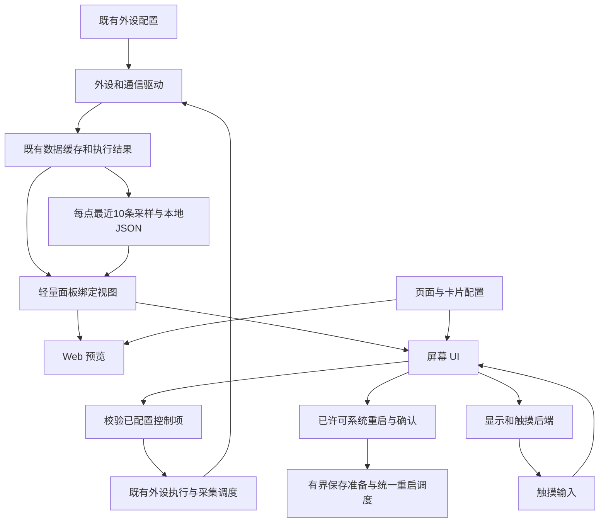

# FastBee 通用屏幕与触摸交互扩展计划

版本：通用方案 v2.6 ｜ 更新：2026-09-22 ｜ 状态：已进入实施与验证阶段

本方案依据最新需求重新确定范围，替代此前围绕具体开发板、固定三屏和整板适配的实施建议。目标是扩展现有固件的通用能力：复用外设配置、外设执行、数据缓存及协议通信，让可选触摸屏能够显示信息、操作开关和触发场景。

本文件保留经讨论确定的设计范围。用户随后已授权实现、补充测试、部署四类设备并同步设备文档，实际交付与验证状态见[实施与验证记录](screen-panel-implementation-report.md)，不得将计划中的验收项自动视为已通过。v2.4 在通用布局、程序背景、可视化天气和 NTP 时间基础上，加入明确的数据绑定、Web 拖拽、基础图表、每点最近 10 条采样的本地 JSON 持久化、设备大屏能力复用和可选设备重启按钮；v2.5 把 RGB 实屏自动漂移、横竖卷边问题纳入独立稳定性工作包；v2.6 同步 RGB 构建失败和四机最新只读 Web 基线，继续以厂商 Rev4 资料和官方示例为可复现基线。默认仍为通用首页。

### 当前执行快照（2026-09-22）

产品保持一个统一固件架构，按实际芯片目标构建；不同芯片的 BIN 不能互刷。功能默认状态通过配置文件控制，硬件/编译能力和运行时资源校验仍须满足。设备屏幕仅面向 ESP32-S3；普通 ESP32、C3 和 C6 继续提供各自支持的 Web、采集、协议和外设执行能力，不新增屏幕支持。

当前核对的地址为 COM15 `192.168.5.18`、COM4 `192.168.5.50`、COM8 `192.168.5.52`、COM16 `192.168.5.51`，DHCP 地址可能变化。普通三台已写入校验 canonical r3 应用与匹配 Web，分别保留 10、9、11 个非 `www` 文件；COM8 已写入 RGB r3 应用，旧 Web 与整个现场文件系统保留。COM15/C3 新版各通过 HTTP 9/9、桌面/手机菜单 14/14；COM16 虽顺序 HTTP 13/13，完整浏览器仍有低内存 503、超时及静态资源截断。COM8 曾短时恢复访问和约 10 秒采样，但仍有湿度 stale、重启历史读取超时，并在约 25 秒被动串口观察中出现 11 次 Power-on reset；复位原因未确定，不能宣称四台 Web 均可稳定访问。

旧 `artifacts/screen-soak-20260920` 和 `artifacts/touch-soak-20260920-r2` 两组监测均已停止，实测窗口分别约 2.583 和 1.781 小时，未完成 24 小时验收，跟进自动化已暂停；C3 的 503、降载、请求错误及触屏原始 SSE 记录保留。COM16 未参与这轮，不能把三台结果写成四台结果。采集修复已进入 COM8 RGB r3：Web 3.5 秒前台让位被 3 秒轮询持续续期的主因已定位，在 PSRAM 可用、内部空闲至少 30 KiB、最大块至少 8 KiB且无严重压力时保留采集，无 PSRAM 仍让位。14/14 本地定向测试通过，实机两分钟两通道各更新 12 点但湿度一次 stale，未整体通过；实体显示/交互和四机独立 24/72 小时仍待验收。完整本地 Native 2,371/2,371、contracts、隔离 static/meta 已通过，各次源码快照边界见实施记录，不能替代实物或长稳。最新部署/运行证据以[实施记录顶部](screen-panel-implementation-report.md)为准。

### 历史执行基线（2026-09-20，不是当前版本与地址）

以下构建、地址和验收数字均为 9 月 20 日历史基线；本节中的“当前”“最近”“最新”只表示当时记录窗口，不表示 9 月 22 日运行状态，也不能当作本轮新增修改的全量回归。

最近完整主机回归为 Host 662 项中 661 通过、1 项因 Windows 符号链接权限跳过；Native C++ 2,371/2,371，完整离线浏览器矩阵上一轮基线为 140/140。后续网络依赖路径、天气联网调度和只读验收脚本修正另有定向回归：`r19-final-focused-host.log` 35/35，主样式实际生效检查 3/3；手机预览新增专项和既有面板专项均通过。Web 实际发布门禁为 314.9/315.0 KiB，屏幕懒加载资源 31/31 KiB；保留现场文件的部署 helper 合同 57/57。不同阶段测试分别保留，不把旧的完整矩阵当作后续修改的全量重跑，更不能替代实体或长期验收。

当前成功写入版本按设备区分：COM15 为 canonical r8 与匹配 Web，COM4/COM16 为 canonical r7，COM8 为触摸 r19 应用与 r8 Web，均有写后校验记录。r19 保持用户曾确认短时稳定的 16 行 bounce、RGB 时序和已有 SDK，构建报告为 `sourceStable=true`、`sdkRecompiled=false`。它修复了独立依赖目录漏应用网络补丁，以及天气在开机未联网时误消耗完整刷新周期的问题。COM8 冷启动约 13.6 秒自动取得真实天气，后续 NTP、SHT30 与两条十点历史组合检查通过；现场配置、密钥、历史、恢复 app0 均保留。旧 r12/r13/r14 构建记录仅为历史，不再代表当前构建状态。

最新带主样式实际加载和布局断言的真实浏览器报告为 `artifacts/r8-COM15-web-styles/report.json`、`artifacts/r7-COM4-web-styles/report.json`，各 14 个桌面/手机页面通过，地址分别为 `192.168.5.22`、`192.168.5.34`。COM8 后续 r8 Web 保留式写入已完成（`artifacts/final-deploy-20260920-r8/COM8-r19-web-continue-write.json`，`written=true`、`verified=true`），`.33` 的 5/5 HTTP、桌面/手机共 24/24 菜单、主样式 1,594 条规则和只读数据链均通过；历史内容长度不匹配、缺 CSS、写入失败窗口仍保留，不能抹除。COM16 `.32` 的最新完整菜单窗口仍出现低内存 503，属于资源风险而非流畅通过。首轮两机长稳监测只完成 1 个周期（实际窗口 0 小时）：S3 无错误，C3 出现 2 次 503、4 次 HTTP/请求错误和 2 条 console error，该监测现已停止，未达到 24 小时且保留失败结论。四机 Web 流畅性、最新触摸固件的实体交互及 24/72 小时稳定性尚未整体验收。

建议先审核第 1～4 节的产品范围与使用流程，再看第 5～10 节的复用和实现边界；资源与实施安排见第 11～13 节。验收所用显示/触摸组合、第三方平台和来源细节在相应实施工作包开始前确定，不影响本计划审核，也不写入通用页面模型。

## 1. 核心方案

菜单名称确定为 **“设备屏幕”**，放在“外设执行”之后。它比“智能面板”或“屏幕面板”更准确：既包含本地显示和触摸，也包含亮度、息屏、提示音等设备能力；无需出现“天气配置”“场景平台”等专属顶层菜单。内部功能键和 API 命名继续使用 `screenPanel`，避免破坏现有配置兼容。

固件中的三个入口各司其职：

| 入口 | 用户在这里配置什么 | 举例 |
| --- | --- | --- |
| 外设配置 | 设备、总线、显示设备及后续远程资源 | 温湿度传感器、Modbus 设备、屏幕/触摸、MQTT 远程开关 |
| 外设执行 | 如何采集、执行和取得结果 | 定时读温度、设置开关、发送远程动作、执行一组场景动作 |
| 设备屏幕 | 将哪些已有数据和控制放到屏幕上 | 把温度、灯开关和“离家”按钮放在同一页 |

面板只负责选择、展示和交互。数据源和执行能力不依赖屏幕：新增的远程读取/控制也能供原有规则、数据上报和其他管理页面使用。

首版推荐 **一个可选面板、一个通用首页、模板与拖拽两种排版、可选择的内容组件**。数据、开关、动作保持现有业务含义；数据可展示为数值、状态、仪表、柱状图或最近 10 点折线图，时钟/日期、信息栏、页面入口和系统重启按需添加。用户可选择设备大屏已有的兼容数据/操作，放在合适位置，自由增删和排序页面。天气、传感器和场景均是可选来源，不固定业务页数。

界面采用“内置模板 + 绑定已有数据/操作 + 可选拖拽调整”的方式。默认背景和常见装饰由代码绘制，主题共享样式；图片只作为后续可选资源。普通用户选模板即可使用，需要个性化布局时在 Web 预览画布内拖动位置、调整大小，不需要制作图片、编写绘图代码或手填坐标。

视觉目标是美观、简洁、易读易点：统一配色、图标和间距，重要信息优先，默认少装饰。配置能力服务于清晰展示，不把所有选项和所有数据同时堆到触摸屏上；具体规范见第 4.11 节。

“通用”指统一配置及复用能力，并不意味着一份固件无需驱动就兼容所有屏幕，或配置一个网址就兼容所有平台。物理屏幕按驱动/资源开放；远程协议按实际实现开放。

## 2. 对旧计划的调整

| 旧计划方向 | 本次采用的方向 |
| --- | --- |
| 以特定开发板整板适配为目标 | 以通用显示驱动与触摸驱动为目标，硬件组合仅是可选验证样本 |
| 固定 480×480、天气/数据/控制三屏 | 分辨率由屏幕能力决定；页面可增删、命名、排序和混合内容 |
| 天气、第三方平台是面板专用模块 | 作为外设/通信/执行层可复用的数据与操作能力 |
| 为面板另建完整实体目录、动作中心与连接器体系 | 从现有外设和执行结果提供轻量查询与受限调用，缺什么补什么 |
| 整板 CAN、RTC、SD、蜂鸣器、电池都进入面板交付 | 只有显示与触摸的必需适配进入核心；其他通用外设按独立需求扩展 |
| 每次围绕特定硬件选择整套功能 | 页面内容与物理驱动解耦，用户只配置实际需要的信息和操作 |
| 固定 Flash/PSRAM 档位作为前提 | 按分辨率、绘制方式、Flash 分区和空闲内存做准入 |
| 将漂亮界面等同于整屏背景图片 | 共享主题、原生绘制、少量图标实现常用视觉效果，图片按需扩展 |

保留旧计划中仍然必要的部分：单一 UI 任务、总线资源预检、按需启用、真实状态回读、离线降级、配置持久化和构建裁剪。旧计划里的示例配置从未作为本次功能写入设备，无需为未落地的旧 schema 制作迁移程序。

## 3. 首版范围与使用方式

### 3.1 首版应完成什么

- 在“外设配置”中选择一种已支持的显示设备及可选触摸；通过预设隐藏大部分底层参数。
- 在“设备屏幕”中从通用首页开始，按需选择布局模板、增删页面；添加数据、开关、动作三类卡片并预览。
- 提供轻量主题、程序绘制背景、大小卡片以及可选时钟/组合信息，让参考图中的常见界面无需整屏图片即可配置。
- 提供 Web 拖拽/缩放、明确的数据与控制绑定、基础图表，以及可从设备大屏候选中选择的兼容组件。
- 为启用记录的采集点位分别保存最近 10 条有效数值采样，落入本地 JSON；恢复后可展示最近记录，不将历史值当作实时状态。
- 提供可选系统功能按钮，首版纳入设备重启，并复用现有延迟重启流程与必要的保存/触摸确认。
- 读取当前已有采集结果；触摸调用已配置且允许手动使用的操作，结果沿用现有执行链。
- 至少打通一个有明确命令和回读约定的远程开关/场景通道，证明远程控制闭环。
- 在功能配置中按需启用；关闭后，原有采集、规则和协议按自己的配置继续工作。
- 选择一套明确硬件验证显示、触摸和资源占用，验证范围只覆盖所用驱动，不扩为整板所有功能。

首版包含有边界的 Web 画布编辑：拖动、缩放、网格吸附和对齐，保存为设备端布局参数；包含有限种类的基础图表及每点 10 条记录。无限画布、任意控件重叠/图层编排、用户脚本式 UI、多块物理屏幕、视频/音乐、复杂多轴图表编辑器和长期历史数据库留作后续扩展。图片上传、远程壁纸下载、任意 SVG/HTML 渲染也不属于本轮范围。程序绘制仍由固件内置实现，用户通过简单配置与拖拽完成布局。

### 3.2 三个典型使用场景

| 目标 | 用户操作 | 固件复用关系 |
| --- | --- | --- |
| 显示温度与 Modbus 电量 | 已有采集规则 → 添加两个“数据”卡 → 选择对应项目 → 保存 | 同一采样和缓存继续供规则/上报使用，面板不另起轮询 |
| 触摸控制远程灯 | 配置远程资源和控制 → 添加“开关”卡 → 选择灯 → 保存 | 开/关命令与回读在执行层定义，卡片不填写 Topic/HTTP 报文 |
| 放一个“离家”按钮 | 在外设执行定义允许手动执行的动作组 → 添加“动作”卡 | 复用既有顺序/异步执行和结果，不新造一套场景引擎 |

天气列为按需扩展：优先提供心知天气模板，也允许配置其他兼容的天气 API。读取结果既可作为普通数据字段，也可绑定“可视化天气”展示预设，放在任意页，不需要新建必选天气页。同样，未来新增 CAN 驱动后，其解析字段可作为数据卡来源，而无需修改页面引擎。

## 4. Web 页面设计：简单配置，直接可用

### 4.1 两个 Tab

| Tab | 页面内容 | 主要操作 |
| --- | --- | --- |
| 预览 | 页面管理、组件库、画布预览与编辑、选中卡片属性、保存并应用；同一画布显示运行数据和草稿差异 | 切页、添加/删除/拖拽/缩放卡片、绑定来源或操作、撤销、保存；Web 预览不执行真实动作 |
| 配置 | 显示设备、主题/背景、默认亮度、自动息屏、系统操作许可、最近记录，以及数据/控制来源配置入口 | 修改全局设置、查看能力与应用状态、前往外设配置/外设执行/通信协议 |

进入页面后直接显示“预览 / 配置”两个 Tab，不再保留占据首屏的大标题、说明卡或重复工具栏。驱动参数在“外设配置”，采集和操作在“外设执行”，设备屏幕页只提供来源选择和前往对应设置的链接，不复制完整协议表单。天气来源可在配置 Tab 内使用第 4.10 节的精简入口，复用共享来源/采集保存流程。亮度、息屏和蜂鸣器按后端真实能力出现；不支持的项目显示为不可用说明或隐藏，不能保留看似可操作的假控件。

```text
[预览] [配置]

预览： [首页] [车间] [+ 页面]       [撤销] [保存并应用]
       [数据] [图表] [控制] [系统]
       ┌────────── 设备画布 ──────────┐  选中卡片
       │ 温度    大厅灯    离家       │  名称 / 绑定
       │      可拖拽、缩放、吸附      │  外观 / 确认
       └──────────────────────────────┘  删除

配置： 显示设备 / 主题与背景 / 默认页面
       亮度 / 自动息屏 / 操作许可 / 最近记录
       外设配置 / 外设执行 / 天气与远程来源入口
```

上图名称只是配置示意，不自动创建设备、规则或控制。首次进入且尚无配置时，在前端草稿中提供一个名为“首页”的空页面，默认混合卡片布局、深色主题和纯色背景，用户保存后才持久化。空页面显示添加内容的空态，不显示虚构数值。页面可删除或改名，重命名不改变其内部 ID；“天气 / 采集 / 控制”仅是可自定义的命名示例。

### 4.2 添加卡片只需要三步

1. 从“数据 / 图表 / 控制 / 系统”内容库选择展示组件；普通数据、开关和动作仍按原有业务语义绑定。
2. 选择已有项目，例如“室内传感器 · 温度”或“大灯控制”。
3. 使用自动带出的名称，必要时修改，再点击完成。

用户默认不需要填写 ID、JSON、数据路径、寄存器、Topic、版本令牌或动作参数。普通卡片沿用以上三步；组合信息卡只需按需多选辅助字段，“可视化天气”作为数据展示预设可直接选择已有天气来源。精度、图标、卡片尺寸及动作确认放在“更多设置”，不作为必填项；自定义天气 API 的字段适配在来源表单中一次完成。

| 组件 | 普通设置 | 显示和交互 |
| --- | --- | --- |
| 数据 | 选择数据，名称自动带出；可选单位/小数位，或加入少量辅助字段 | 单值、状态行或组合信息；各字段显示真实质量/过期状态，不可点击写值 |
| 开关 | 选择已配置开关，自动关联状态及开/关操作 | 只有明确开/关映射和真实回读时才作为开关；支持等待与未知状态 |
| 动作 | 选择允许手动执行的操作，自动带出名称 | 适合场景和一次性命令；显示执行中与结果，可选二次确认 |

三类业务卡片的含义不随主题改变。大小磁贴只是外观，不能让数据卡自动获得写权限；没有回读能力的命令可以作为动作按钮，不能以一个本地布尔变量假装成真实远程开关。基础图表属于数据展示，系统功能属于独立受限入口，均不把任意字符串当作执行脚本。数据组件可以显示短文本，但不增加独立任意 HTML/图片组件。

### 4.3 页面和排版

- 页面支持新增、重命名、排序、设为首页、删除；同页可混放三种业务卡片及可选展示元素。
- 模板只决定排版区域、卡片默认外观和初始显示选项，内容始终绑定现有来源/操作。模板应用后仍是通用页面模型，不生成隐藏采集规则或专属业务页面类型。
- 默认共用网格排版，支持“小 / 宽 / 大”等尺寸预设；切换“拖拽调整”后可移动、缩放并吸附对齐，参见第 4.13 节。普通用户不用手填坐标。名称最多两行，数值按宽度适配；实机根据最小点击区域确定每页容量。
- 只有一页时不显示多余翻页控件；多页左右滑动，Web 提供页签/箭头/键盘切换。滑动不循环，按钮点击与滑动互斥。
- 上限来自固件能力和显示尺寸，并由设备能力返回；当前系统保护上限为 8 页、总计 24 卡。低资源组合可下调，实际每页卡位按尺寸与可读性确定。公开 Rev4 模板默认生成 5 页、22 卡，但用户可以自由增删，模板页数不是固定业务结构。
- 超出当前屏幕容量时提示“当前页已满，请添加页面”，不静默删卡、无限缩小字体或自动迁移用户布局。
- 更换屏幕/旋转后先预览容量变化；若布局放不下，要求调整后再应用，不能凭“通用”强行挤满小屏。
- 更换模板保留卡片 ID、绑定和顺序，在草稿中重新排版；放不下时提示调整，不清空内容或自动执行操作。主题切换只影响外观，默认不触发数据重新采样。

页面上限是资源保护值，不是固定的业务页数。无需把天气、传感器和远程控制分开；用户可以只用一页，或按房间、设备组和工作场景分组。

### 4.4 来源不存在和往返配置

来源选择器显示外设/规则名称，并解释不可用原因。没有可读项目时提供“去外设配置 / 去设置采集”，没有控制时提供“去外设执行”。跳转前保留非秘密草稿及当前卡片编辑位置，保存/取消后可返回面板并刷新候选列表。

已有来源的“添加到面板”只保存引用，不自动创建采集任务或执行规则。若用户显式选择“新建天气来源”，按第 4.10 节展示并保存共享来源与所需采集设置；普通加卡、切模板和删卡不触发这个流程，避免重复生成隐藏规则或误删共享来源。

允许提供一次性的“快速添加已有数据”：用户勾选已有只读项目后生成卡片，不自动加入开关/场景，不自动绑定未知设备。来源创建、试执行和保存遵循已有页面的验证与权限流程。

### 4.5 常见状态的产品文案

| 场景 | 用户看到的内容 |
| --- | --- |
| 有草稿未保存 | 未保存；离开页面提醒保留/放弃，跳转配置来源时自动暂存本地草稿 |
| 已保存且成功应用 | 已保存并应用 |
| 功能关闭 | 面板未启用；可提前编辑配置，提供功能配置入口 |
| 硬件变化需重启 | 已保存，重启后生效；仍显示当前运行状态 |
| 初始化失败 | 显示具体原因及“前往屏幕配置”，菜单保留 |
| 来源短时离线 | 保留最后值并标时间；开关状态未知，不显示为“关” |
| 来源被删除或变更 | 来源不可用；保留卡片，可重新选择或删除 |
| 另一窗口保存了配置 | 配置已在其他窗口更新；保留草稿，提示重新加载后核对 |

revision、catalog 等内部字段只用于接口和调试，不放到默认产品流程里。预览始终标“仅预览”；草稿不能伪装成物理屏幕正在显示的画面。

### 4.6 参考界面转为通用模板

用户提供的四张图用于确定布局和视觉层次，不作为开发板适配任务，也不意味着固件已拥有图中所有业务功能。首版建议以下四种布局共享同一套卡片、样式和网格实现：

| 布局模板 | 页面结构 | 可配置内容与参考关系 |
| --- | --- | --- |
| 混合卡片 `mixed-grid` | 自动排列数据、开关和动作，作为默认首页 | 任意已配置来源，可只用一页，也可按房间/用途增加页面 |
| 信息首页 `info-home` | 可选大时钟/日期、主信息、紧凑状态栏和快捷操作区 | 对应参考图 1、2；天气可换为设备状态，快捷操作可绑定开关/场景 |
| 大小磁贴 `tile-grid` | 一个或多个大卡与小卡组合，提供有限尺寸预设 | 对应参考图 4；所有卡片仍复用数据/开关/动作语义，可加本地页面入口 |
| 信息详情 `data-detail` | 主数值、辅助字段及有限分组 | 对应参考图 3；既可显示当前/明日天气，也可显示设备温度、电量和运行状态 |

这四项是布局选择，不是四个固定屏幕，也不是四套独立 UI 程序。信息首页可关闭时钟/快捷区，详情页不要求有天气来源；预报、空气质量等字段只有在采集/远程适配提供后才能绑定。磁贴上的“通讯录/对讲”等文字只参考其入口样式，本计划不因此加入通讯录或语音对讲。

组合信息属于数据卡的显示形式：建议首版一张卡最多一个主字段和三个辅助字段，超出时另加一张卡。每个字段保存独立来源引用和质量状态，不在页面层计算协议字段或重新请求网络；容量核算同时计入字段数和实际控件数，不能只按卡片数绕过限额。

图标可固定选择；来源提供规范化布尔/枚举状态时，可用有限内置映射切换图标。天气等第三方原始编码由来源适配层归一化，未知值显示通用图标和有效文字，不依赖页面中的专用网络请求或脚本。

时钟直接读取固件已经通过 NTP 同步的系统时间，并使用既有时区设置。当前 `FastBeeFramework.cpp` 已有 `configTzTime()` 初始化路径，面板复用该机制及时间有效性状态，默认按分钟变化更新显示。未完成同步时显示“时间未同步”；本次启动内已同步后短时断网，系统时钟继续走时，必要时提示最近同步时间，不能因断网立即清空时钟。重启后尚无有效时间时不把旧时间冒充当前时间。面板不另建 NTP 客户端、不在每次刷新时请求校时，也不要求专用 RTC。

本地页面导航只引用已有 pageId，由 UI 内部切页，不进入外设执行器；目标页被删除时保留失效提示、禁用入口并支持重新选择。

### 4.7 背景与主题：程序绘制优先

背景不需要图片文件。开发时用图形库已有矩形、圆角、直线、圆/弧和样式能力绘制；用户在 Web 中选择预设，无需提交代码。首版背景全部可用程序绘制，复杂照片/插画壁纸留作后续可选扩展。

| 视觉内容 | 推荐实现 | 体积与使用策略 |
| --- | --- | --- |
| 纯色背景 | 填充主题背景色 | 默认方式，无整屏位图资源，绘制成本低 |
| 简单渐变 | 两色水平/垂直渐变，由内置样式绘制 | 只保存颜色/方向等参数；低资源档可回退纯色 |
| 几何装饰 | 少量圆、线、弧和色块，按页面比例放置 | 固定数量和范围，不做粒子、动态模糊或无限图形列表 |
| 卡片与按钮 | 圆角、边框、状态颜色，必要时有限渐变 | 全页共享样式，默认不用大面积阴影/透明层 |
| 常见图标 | 简单图元、裁剪后的符号字体，必要时小尺寸单色位图 | 同一图标复用并按主题着色，不为每种颜色存一套图片 |
| 复杂插画/照片 | 后续可选静态资源包 | 独立核算资源、解码和缓存成本，不作为首版/基础构建依赖 |

首版提供深色、浅色和强调色方案，使用同一组间距、字号层级、圆角和状态颜色定义。Web 默认只显示主题、背景预设和布局选择；自选强调色、卡片尺寸、图标等收进“更多设置”。主题不能用颜色代替“开/关、等待、离线”等文字或符号，也不能让装饰覆盖触摸区域。

“代码绘制”指调用共享图元和样式，不是把整屏图片转成 C 数组；后者仍保存像素数据，并不会因为文件扩展名变为 `.c` 就减少二进制体积。也不为生成背景额外建立一张全屏 Canvas；优先直接使用图形库现有绘制缓冲和裁剪机制。具体 Flash/RAM 差异见第 11.4 节。

### 4.8 制作流程与预览一致性

开发阶段先确定一套通用字号、色彩、间距、图标和四种布局，再用图形组件实现共享模板。视觉设计工具可作为开发辅助手段，模板必须接受通用来源/控制引用，不能把示例设备、天气城市或固定尺寸写死在导出页面中。使用阶段为“选模板 → 选数据/操作 → 按需拖动/调整大小 → 预览并保存”。

Web 用 HTML/CSS 表达同一套模板参数和样式定义，物理屏幕用图形库渲染；不在设备运行浏览器，也不把网页截图传到屏幕。两端共享模板 ID、尺寸规则、内容顺序、文字约束、状态语义和能力列表。浏览器字体抗锯齿不作为像素级一致承诺，实屏须核验截断、换行、触摸区域和分页。

预览按所选显示设备报告的宽高、方向和资源能力展示。没有可用后端时可用明确标注的草稿尺寸编辑，不表示硬件已支持。换设备后继续保留布局和数据引用，重新核对容量与可用样式；不兼容项在预览中说明，并要求调整后再应用。

### 4.9 可视化天气展示

天气 API 返回的 JSON 只供固件解析。触摸屏和 Web 天气预览呈现天气图形及数值卡片，不把原始 JSON、字段路径或整段响应文本当作最终界面。气温、城市和更新时间仍以易读文字辅助图形表达。

| 显示形式 | 画面内容 | 通用复用方式 |
| --- | --- | --- |
| 紧凑天气卡 | 太阳/月亮、云、雨雪等图标，大号温度、城市和简短天气描述 | 可放入任意混合页/磁贴页，与本地数据和开关并排 |
| 天气详情 | 大图标/温度、可选高低温、湿度/风力等辅助项 | 复用组合信息布局；缺失字段有明确状态，不显示假数值 |
| 短期预报 | 按日期排列的天气图标和高低温，初期最多 3 天 | 复用有上限的数据分组；实况和预报可以来自同一次或独立采集 |

天气图形优先用有限图元、线条和裁剪符号绘制，复用第 4.7 节主题；例如圆和短线构成太阳、圆与圆角形状构成云、短线/符号表示雨雪。不依赖下载供应商图标或整屏天气背景，也不要求动画。需要昼夜区分时使用来源提供的标识；无法判断时使用中性图标。未知天气代码保留有效描述并显示通用图标，不错误归类为晴天。

“可视化天气”是数据卡的展示预设，业务类型仍为数据，既可用心知天气，也可使用映射为相同字段的其他 API。它不改变三类业务卡片的执行语义。专用天气预设按已知字段和最多 3 天预报独立限额；所有可见字段、图形和内部控件仍计入页面容量，普通组合信息卡保持第 4.6 节的一主三辅限制。

未选择的辅助项不占位；已经选择但接口不提供、无权限或暂时失效的项目显示“--”及可读状态，不填 0，也不把预报湿度当成实时湿度。布局放不下时要求调整选项/页面，不能静默删除字段。短期离线保留最近有效天气及更新时间，标明数据已过期；没有预报来源时提示“暂无预报数据”。

### 4.10 配置天气 API：预设与自定义

在“设备屏幕 → 配置”中可选择已有天气来源，或前往“新建/编辑天气来源”。这是共享远程资源表单的精简入口，保存到外设/通信与外设执行的既有扩展配置中；`screen_panel.json` 只保存来源引用和显示选项。

| 配置项 | 普通使用方式 |
| --- | --- |
| 天气来源 | 心知天气 / 自定义天气 API / 选择已有来源 |
| 实况 API 地址 | 心知预填官方 HTTPS 地址；其他接口可直接填写地址，URL 非秘密参数可保留 |
| 预报 API 地址 | 可选；接口已经同时返回实况/预报时复用同一请求，无需重复填写或采集 |
| 位置 | 城市名称/城市 ID，必要时展开经纬度；心知预设负责参数编码 |
| 认证 | API Key；自定义接口可选无认证、查询参数或请求头方式，敏感值单独保存 |
| 刷新周期 | 提供 15/30/60 分钟等选项，实况默认建议 30 分钟、独立预报 60 分钟；同一接口返回两者时复用一个周期，依据服务配额校验 |
| 显示内容 | 实况、短期预报、辅助信息；仅显示已映射和可用的选项 |
| 更多设置 | 自定义字段对应、单位和天气代码映射；心知模板自动带出 |

接口地址可配置，但不同服务的响应结构通常不同。心知模板预填接口、参数和字段映射；更换为兼容代理地址可沿用映射，更换为其他结构时选择自定义并重新映射。不能仅根据 URL 判定任意天气 API 都兼容。

自定义首期支持 HTTPS GET + JSON，绑定温度、天气代码/描述、城市、更新时间和可选预报数组等字段。字段通过脱敏测试结果中的候选路径选择；需要时才展开有限路径编辑，不让普通用户手写 JSON 或执行解析脚本。至少映射温度及一种可识别的天气状态；代码含义需要一次映射为通用晴/云/雨/雪等状态，未知值采用通用图标。复杂签名、OAuth 或私有格式以后通过共享适配器扩展，不以“支持自定义地址”宣称已经覆盖。

“保存来源”明确列出将保存的共享来源和定时采集设置，由用户确认启用；一个来源复用一个对应采集安排，不为每张天气卡重复创建。保存后“测试读取”复用既有外设执行的授权/试运行流程，并计入调用配额，返回映射后的可视化预览与脱敏字段候选；打开预览或切页只读缓存。已有来源变更影响所有引用它的页面，应在保存时说明；删除面板卡片不删除来源/采集。

API Key 不回显到面板配置/普通导出，不拼进前端可读的完整请求 URL 或日志；用户粘贴包含密钥的地址时，应在保存阶段识别并拆出敏感参数。固件后端负责请求和缓存，浏览器展示结果，不直接带密钥调用第三方。未启用天气来源时，不发天气请求，也不要求填写城市或密钥。

### 4.11 视觉与交互规范：美观简洁

界面以统一样式和信息层次取得完成度，默认使用轻量绘制效果。参考图用于借鉴大时钟、天气图形和卡片布局，首版形成一套一致的设计，不拼接多种图标/按钮风格。

| 项目 | 默认规范 | 验收关注点 |
| --- | --- | --- |
| 配色 | 深色与浅色两套基础主题，统一强调色；背景低饱和，卡片层次清楚 | 无彩虹式满屏磁贴；当前操作/真实状态有明确对比，文字可辨识 |
| 信息层次 | 每页一个主要视觉重点，字号保持主值、标题、辅助信息三层 | 时钟/温度/主数据易读，单位和时间为辅助；长标题不挤压关键数值 |
| 间距与形状 | 模板共用页边距、卡片间距、内边距和圆角规则，按可用尺寸适配 | 对齐、留白一致；不为塞满内容无限缩小文字或点击区域 |
| 图标 | 统一线宽/轮廓风格，程序绘制或精简符号；状态含义稳定 | 天气图标易识别，未知状态有中性图形；不混用低清图片和复杂拟物图标 |
| 天气 | 天气图形配大号温度、城市/短描述，辅助项和预报按需展开为独立区域 | 初始视线能找到天气与温度；不显示接口响应、字段名或冗长文本 |
| 控制 | 图标加短名称；开/关、执行中、离线/未知有文字或符号反馈 | 触摸后有即时反馈，真实完成仍以回读/结果为准；不只靠颜色判断 |
| 导航 | 多页才显示简短页名或分页点，操作位置一致；按需提供页面入口 | 翻页与按钮不会误触；首触唤醒和手势语义一致 |
| 动效与装饰 | 默认静态纯色/轻渐变，按压反馈简短；切页过渡仅在资源允许时使用 | 没有常驻粒子、闪烁背景、大范围模糊或遮挡内容的装饰 |
| 异常状态 | 保留内容位置，用小型状态标记/短句提示过期、离线和失败 | 不反复弹窗遮挡页面，不把旧值画成新值，不把未知开关画成关闭 |

默认首页仅承载用户选定的重要信息；更多项目通过新增页面或详情展示，不预先塞入天气、所有传感器和所有开关。主题切换不会改变动作含义，背景/强调色设置不能破坏最小可读对比；不合适的组合在预览中限制或提示调整。

Web 配置也遵循相同取舍：常用项直接显示，高级字段折叠；提供模板缩略预览、显示内容勾选和顺序调整。首期不暴露几十项字体嘻嘻嘻嘻嘻嘻嘻嘻嘻嘻嘻嘻嘻嘻嘻嘻嘻嘻嘻嘻嘻嘻嘻嘻嘻嘻嘻嘻嘻嘻嘻嘻嘻嘻嘻嘻tttttttttttttttttttttttttttttttttttttttttttt9hg94fd33333333333明确标为演示，不保存成设备数据。

交付需对照实屏与 Web 预览检查正常、长名称、数据缺失、离线、开关等待/未知等画面，并检查至少两种逻辑尺寸和方向下的留白/溢出/触摸区域。支持范围以实测后端为准；视觉验收不能只凭一张正常状态截图通过。本规范纳入 P2/P3/P5 的实现和验收，基础画布编辑归入 P2，设备端布局与基础图表归入 P3，天气专有展示纳入 W1；不另外建设独立的通用 UI 设计器产品。

### 4.12 数据绑定与组件选择

用户先选“显示什么”，再选“怎样显示”。来源候选按采集设备、远程资源、系统状态分组，使用已有名称、字段与单位；内部以稳定 sourceRef 关联，重命名不破坏绑定。同一来源可用于多个组件，复用一次采集和一份最新值/最近记录。

| 来源与具体字段 | 可选展示 | 接入条件 |
| --- | --- | --- |
| 温度、湿度、光照、气压等传感器通道 | 数值、仪表、进度、最近 10 点折线 | 已编译驱动、配置采集且返回有效数值 |
| 电压、电流、功率及其他工程量 | 数值、仪表、当前值柱状对比、最近 10 点折线 | 使用采集层完成比例/偏移后的值及单位 |
| 已解析 Modbus 寄存器字段 | 数值、图表或状态指示 | 复用字段映射；原始 HEX/字节帧不能直接当数值绘图 |
| GPIO/数字输入、设备/网络连接状态 | 指示灯、状态图标、短文字 | 需要明确布尔/枚举含义，未知状态与关闭区分 |
| 已定义本地/远程开关和场景 | 开关、动作按钮 | 复用真实回读与受限执行，不能把发送成功当设备已动作 |
| 系统时间、运行时长、网络信号、空闲内存等已有系统信息 | 时钟、数值、进度或状态卡 | 复用系统状态提供者，不为显示调用采集规则或反复校时 |
| 已适配天气 API 的规范字段 | 图形天气、预报及普通数据卡 | 按 W1 接入；预报数组不是设备历史采样 |
| 后续 CAN 或其他总线解析字段 | 与现有同类型字段使用相同组件 | 对应驱动/解析链完成后开放，类型枚举不代表数据已可用 |

普通配置只需要来源、展示方式和名称；仪表/进度可设置合理的量程，柱状图可选择少量同单位来源，折线图选择“最近 10 次采样”。后台校验类型、单位、可用性和来源定义版本；优先使用类型化数值，兼容字符串读数时须严格验证有限数值，不把空串/错误文本转为 0。

来源离线时允许保存已有引用，组件显示最后值和过期状态；没有任何有效值时显示空态。恢复的历史记录只用于趋势，不能替代实时值、触发执行规则或改变开关状态。更换来源、校准比例或单位语义时，核对/重建对应趋势，不能把不同工程量拼接成同一条线。

### 4.13 Web 拖拽与有边界的画布

两个 Tab 保持不变。“预览”内提供页面管理、模板排版、组件库和拖拽调整，并同时展示已保存/草稿效果及应用状态；“配置”只放显示设备、主题/背景、亮度、息屏、操作许可、最近记录和来源入口。拖拽发生在浏览器，设备只保存经过校验的布局参数并渲染，不承担完整设计器运行。

- 支持从内容库添加组件、拖动位置、调整大小、网格吸附、对齐提示、删除及草稿撤销/恢复；普通模板仍可一键排版。
- 画布对应一页实际可用显示区域，不是无限网页。保存逻辑参考尺寸与组件 x/y/w/h；浏览器缩放只影响编辑视图，不改变设备坐标。不同显示尺寸/方向需预览适配并重新校验，禁止直接照搬浏览器像素。
- 组件有最小文字和点击区域要求。首版禁止可交互组件重叠或超出可见区域；数据组件也不能遮住按钮。占位冲突时保留原位置并提示，装饰图元不参与点击命中。
- 拖拽编辑时开关、动作、系统重启均只可选中，不可执行；保存并应用也不触发动作。物理屏幕初期仅展示和操作，不提供触屏编辑布局。
- 窄屏 Web 可放大画布并用组件列表、上移/下移和尺寸预设完成相同配置，不强迫用户精确拖动小手柄。离页草稿、撤销和来源设置往返沿用已有机制。
- 模板切换/重新排版保留组件 ID 与来源引用，提示位置将改变；取消恢复原布局。控件数量、画布边界与字体限制仍由能力描述决定。

当前设备大屏已有 `device-control/layout.js` 的拖动/缩放逻辑，但其 x/y/w/h 存在浏览器 `localStorage`，最小尺寸也面向网页。可提取交互算法和手势清理逻辑，改为面板尺寸/触摸校验和设备持久化；不能照搬 `localStorage` 作为物理面板的唯一配置，也不改变旧设备大屏现有布局。

### 4.14 基础图表与最近 10 点趋势

| 组件 | 数据要求 | 首版边界 |
| --- | --- | --- |
| 数值卡、状态图标 | 单项当前值或状态 | 显示单位、质量和必要更新时间 |
| 仪表/进度条 | 当前数值及量程 | 超量程有标识，不能通过截断伪装正常；没有历史也能使用 |
| 当前值柱状图 | 少量可比较、同单位数值 | 初期最多 4 个来源，显示各自更新时间；不同单位分图 |
| 最近 10 点折线图 | 单点位最近至多 10 条有效数值采样 | 首期一图一条线，无补零、插值或平滑伪造；多个图可分别绑定不同点位 |

折线显示最近采样顺序，NTP 时间有效且可比较时可显示真实采样时间；未同步/跨启动时间无法对应时使用采样序号或分段显示。图名使用“最近 10 次采样”，不承诺固定分钟数，因为实际时间范围由采集周期决定。仅有 1 条时显示单点，空记录显示“暂无采样记录”；失败或断采区域不连出虚假的连续趋势。

每个点位各保留 10 条，不是整个设备共 10 条，也不是每张图重复保存 10 条。第 11 条有效新采样进入后淘汰该点位最旧记录。新采样值即使与上次相同也保留；重复读取同一缓存、页面刷新、SSE 重发和多组件订阅不能生成新记录。记录机制及本地 JSON 见第 7.6 节。

图表配置只提供标题、来源、单位/精度、量程/自动范围及有限颜色选项。首期不加入多轴、无限曲线、长期统计或复杂公式编辑；这些不影响基础图表、仪表与可视化天气的实现。

### 4.15 设备大屏内容复用

内容库增加“已有设备控制/监测”来源分组，用户勾选所需项目，选择目标页面后放置或拖动。共享的是已有来源、控制描述和执行能力，HTML 页面整体不搬进固件，旧设备大屏布局也不自动覆盖面板。

| 当前 Web 中的能力 | 设备屏幕中的形式 | 复用约束 |
| --- | --- | --- |
| 设备大屏传感器/Modbus 监测项 | 数值、状态、仪表、基础图表 | 提取单个字段，保留名称/单位和质量；不复制采集任务 |
| GPIO/继电器/Modbus 明确开关 | 可放置的开关卡 | 明确开/关命令与状态回读后开放 |
| 普通动作和已配置场景 | 可放置的动作按钮 | 沿用手动范围、固定参数和结果；不自动开放大屏中的全部脚本/系统命令 |
| 有明确目标值的普通设值操作 | 已配置预设值动作按钮 | 初期复用受限固定值；完整 PID/PWM/电机参数面板按组件能力另行扩展 |
| 系统/网络监测页面已有信息 | 运行时长、IP/连接状态、信号、内存等信息卡 | 与设备大屏的控制项分别取自现有提供者，不虚构不存在的指标 |

当前 `/api/periph-exec/controls` 受 `deviceControl` 门控，且部分分类按规则首动作推断。应提取独立的内部候选/状态查询供两个显示入口复用，保留原 Web 路由门控；不能要求面板必须开启设备大屏，也不能因为某按钮在大屏出现就直接放行其全部动作。

首期从设备屏幕内容库选择已有项目即可；在旧设备大屏加“添加到设备屏幕”可以作为同一选择流程的快捷入口，仍先选择页面/位置并保存布局。两个入口共享来源和状态，各自保留自己的排版。

### 4.16 可放置的系统功能

“系统”内容组提供时钟、设备/网络信息，以及可选的“设置到指定亮度”“立即息屏”“蜂鸣器短响”和“设备重启”按钮。系统按钮可放在任意符合最小触摸面积的位置；亮度动作只接受配置时保存的 1～100 固定值（灭屏使用独立息屏动作），息屏后的第一触只唤醒，蜂鸣器只短响且异常路径自动关闭。重启默认不自动添加，配置时必须显式开启“允许设备屏幕重启”。

系统操作与普通外设动作分开：组件只保存固件白名单内的固定系统功能 ID 和必要的有界参数，不接受 URL、任意命令或脚本。配置保存沿用已有登录/权限校验；设备端再次检查面板启用、后端能力、操作许可和当前可执行状态。恢复出厂、OTA、文件删除、持续鸣响及任意系统脚本不会因加入系统按钮而一并开放。

Wi-Fi 首版只提供连接状态卡，不提供物理屏配网或屏幕内的 Web 网络配置跳转。物理屏不输入、保存或显示 Wi-Fi 密码，也不直接在屏幕任务中同步调用网络重启；需要修改网络时使用现有 Web 网络设置页。现有网络切换包含延迟、对象重建和安全 AP 回退，后续若需要本地配网，应新增主循环队列化流程并单独完成凭据输入、失败回退和断网恢复验收。

实际触摸流程为“点击重启 → 明确的确认/取消 → 有界保存准备 → 显示即将重启 → 统一延迟重启”。确认框说明通信会短暂中断；息屏首触、滑动、拖拽、预览和布局应用均不能触发重启。执行中禁止重复提交；OTA/关键写入期间反馈暂不可用，不能用重启打断提交。

复用 `SystemRebooter::scheduleReboot(..., RestartReason::USER_COMMAND)` 的内部流程，不在绘图回调直接 `ESP.restart()` 或向设备自身发 HTTP。现有调度实现允许更新重启时间，面板入口需明确处理已安排状态，避免连续点击反复推迟。重启前对最近采样记录与已保存配置做有时限的落盘；写入失败时提示最新记录未保存，允许取消或明确选择仍重启，不把失败标成已保存，也不保存尚未提交的 Web 草稿。

## 5. 当前固件中可以直接复用的部分

以下结论基于 2026-09-17 当前工作区只读检查，不代表新增触摸功能已经实现。

| 现有能力 | 当前证据 | 推荐复用方式 / 需要补足 |
| --- | --- | --- |
| 外设定义与配置 | `PeripheralConfig`、`PeripheralManager` 及外设页面 | 新显示设备/远程资源仍走既有配置、保存、资源检查和名称体系 |
| 数据源描述 | 外设执行列表已产生 `sensorSources`，含 periphId/field/label/unit | 提取为轻量公共查询；不要在面板另存一份来源定义 |
| 传感器结果缓存 | `PeriphExecManager::SensorReadCache`、单项 `lookupSensorCache()` | 现有缓存只有最新值；新增每点 10 条记录的旁路消费者，补类型/质量而不改变旧查询语义 |
| Modbus 采集及分发 | `ProtocolManager::dispatchModbusData()` 与执行器采集路径 | 从已解析/分发结果获取快照，保留 MQTT、SSE 和规则处理 |
| 手动和异步执行 | `runOnce()`、operationId、最近结果、工作池 | 面板通过受限内部入口提交，复用执行和结果，不创建第二套调度器 |
| 控制项汇总 | 现有 `/api/periph-exec/controls` 和设备大屏使用控制项 | 提取独立内部查询，保留原路由门控，过滤可供面板使用的项目 |
| 设备大屏布局 | `device-control/layout.js` 现有拖动/缩放及 localStorage 保存 | 复用交互，补有限画布、缩放换算、布局校验和设备端持久化 |
| 系统信息与重启 | SystemRouteHandler 的 info/status/restart、SystemRebooter | 信息只读绑定；重启使用独立许可/确认与内部延迟调度，补历史落盘准备 |
| JSON 落盘机制 | ConfigStorage 临时文件校验、替换与上一代回退 | 提取复用文件原语；历史有独立写入节奏，不能误用配置防抖导致无限不落盘 |
| 网络/MQTT | `ProtocolManager`、`MQTTClient`，已有发送/回调基础 | 补通用远程资源的命令与状态映射；已有脚本发布不等于完整远程开关 |
| 小屏数据显示 | `LCDManager` 支持 U8g2，已有 SensorDisplayEntry | 保留旧设备兼容；共享结果概念，新增彩屏运行层，不替换旧小屏驱动 |
| NTP 和系统时间 | `FastBeeFramework.cpp` 读取 timezone 并调用 `configTzTime()` | 时钟读取现有同步结果/时区，复用校时生命周期，不新建面板专用校时任务 |
| 功能配置与资源档位 | RuntimeFeatureManager、ResourceProfile、ChipConfig | 增加一项设备屏幕功能，按后端和内存准入，兼容现有功能行为 |
| Web、鉴权和保存 | 现有页面生命周期、SSE、请求调度、ConfigStorage | 原样复用基础设施，只补面板必要页面和配置接口 |

当前 CAN 有类型枚举，但不能据此认定存在完整通用 CAN 采集链。通用 HTTP 拉取、状态映射和第三方控制也不能只凭协议枚举或一个 MQTT 脚本动作认定已支持；缺口放在通信/外设执行层补齐。

一个具体复用边界：当前 ScriptEngine 的 MQTT 命令记录发送结果，但脚本整体返回成功不能证明远程设备收到或执行成功。新远程动作应复用底层通信能力并补齐失败传播/回读，不将脚本完成状态直接显示成开关状态或场景完成。

## 6. 最小增量架构



新增内容控制在以下范围：

1. **屏幕运行模块**：页面、共享模板/主题、卡片、绑定查询、触摸事件及运行状态，可由一个 ScreenPanelManager 组织。
2. **显示/触摸后端**：各自负责初始化、刷新或读点，并报告能力；业务代码不包含板型引脚。
3. **页面配置和 Web 界面**：持久保存布局、有限外观参数、来源/操作引用，提供预览与编辑；不保存整页渲染结果。
4. **既有执行链的必要扩展**：补结果质量、可供界面手动使用的控制描述、远程协议动作等，继续归属外设执行/通信模块。

轻量绑定视图根据现有配置生成候选项，按需读取最新值、执行结果和最近 10 条记录，不建立独立设备注册中心或长期历史数据库。采样记录是现有结果层的有界扩展，采用一份共享状态与一个后台写入出口，不为每个卡片建立任务/文件。

Web 和物理屏幕共享布局模型、卡片含义和结果状态，分别渲染 HTML/CSS 与图形控件。面板通过内部函数使用结果和执行器，不向自己调用 HTTP，不让浏览器常驻才能保持物理面板运行。

模板、主题和图表渲染归属屏幕运行模块，不增加常驻主题服务或单独 UI 脚本引擎。最近 10 点记录归属共享采集结果层，设备大屏和设备屏幕可复用；新增协议接入同一结果出口后，现有组件即可选择。新增显示/触摸驱动只实现后端契约，不需要复制页面或改写远程控制逻辑。

## 7. 外设配置和外设执行如何扩展

### 7.1 显示设备仍从外设配置管理

在既有“外设配置”体系增加独立的“显示设备”能力，选择已编译支持的驱动/预设、可选触摸、方向及必要接口参数。常用预设带出已验证参数，高级用户才展开总线/引脚配置。设备屏幕仅选择这个外设的 ID。

推荐在现有 `peripherals.json` 体系中保存独立的 DisplayConfig 扩展对象：显示后端、触摸后端、接口引用、方向和后端参数。旧 `lcd` 配置及数值枚举保持兼容，不将现有 OLED 自动升级成彩屏。

显示/触摸后端只能从已编译的驱动描述中选择；对可配置引脚的通用总线屏提供受校验参数，对固定线路后端采用对应描述，不能在配置里执行任意初始化脚本。新类型同时接入已实现类型判断、序列化、导入导出和单例约束，首版最多一个活动图形面板。

当前旧 LCD 尺寸字段是 8 位，加载还有 255 上限；普通外设引脚数组最多 8 项。新增配置尺寸至少使用 16 位，大总线引脚通过驱动描述/固定线路覆盖逐项申报资源，不能把 480 写进旧字段或把 RGB 全部线路塞进 8 引脚数组。

布局和基础显示偏好放在 `/config/screen_panel.json`，驱动/引脚只在外设配置保存一次。首版不另设一个独立“显示系统配置中心”，不让用户同时维护三处相同参数。

两个文件用稳定显示外设 ID 关联，不增加跨文件全局事务。先保存显示设备，再保存/应用引用它的面板布局；显示设备被删除或改变分辨率/后端时，保留布局并提示重新核对，暂禁相关交互，不级联删除页面。

### 7.2 采集结果与候选数据

首先复用已配置采集任务输出，按 `periphId + field` 等现有稳定标识关联，不通过名称匹配。GPIO/Modbus/I2C/远程结果向面板暴露值、类型、单位、最近有效时间与质量。

需要补的不是新的采样系统，而是统一读取已有结果的出口：单项查询、有限批量查询、按变化通知。保持现有缓存/分发消费者不受影响，不能用一个新的 callback setter 覆盖原来的 MQTT/SSE 处理。

当前传感器缓存主要存格式化字符串，每项有采样时间/maxAgeMs，读取时还受 120 秒 TTL 上限约束；这仍是最新值缓存，不是两分钟历史。后续补类型化数值、质量及适合来源的过期语义；天气等低频来源不能因为显示刷新或旧 TTL 到期就重复请求。每点最近 10 条记录由第 7.6 节另行保存，不扩大所有旧缓存的 TTL，也不将恢复记录重新灌入实时缓存。

来源已配置但暂时离线，允许保存绑定；来源不存在、类型不匹配或能力未编译，阻止创建错误绑定。已保存来源失效时保留卡片并标记，不回退整份布局。

### 7.3 手动操作和场景复用既有执行器

动作卡选择“外设执行”中允许手动使用的操作。若现有规则缺少明确的界面公开标记，可补一个“允许从界面手动执行”选项及只读的操作类型描述；不要求所有规则天然可从屏幕运行。

开关卡选择一个已经定义好的开关控制项。这个控制项描述状态读取、设为开和设为关；底层可对应一个受限布尔参数规则，或已有的一对明确操作，前端自动组合，不让用户在每张卡上重复配两三条规则。

多动作场景继续使用现有动作列表与顺序/异步机制；如有延时或异步步骤，只有它们的最终结果到达后才能报告对应完成，不新增“面板场景引擎”。同一来源/规则可被多张卡引用，但只执行实际被点击的那一次操作。

新增“远程读取”“远程执行”等能力时，通过结构化动作接入既有 worker、超时和结果链。卡片传递受限的目标值/操作 ID，不传任意脚本、网络地址或完整报文。

### 7.4 远程资源扩展的位置

建议在“外设配置”中呈现无物理引脚的“远程资源”，由通信适配器负责请求或订阅；在“外设执行”中配置采集/操作。存储归属仍遵循现有系统：连接参数和受限远程通道放在协议配置，执行动作放在外设执行配置，面板只保存引用。无引脚资源不能套用当前 SENSOR_GENERIC 的物理 I2C 引脚要求，也不通过伪造一个 GPIO 外设实现。

| 通道 | 外设/通信层配置 | 执行层能力 | 面板选择的内容 |
| --- | --- | --- | --- |
| MQTT | 使用已有连接，配置状态/命令映射；Topic 等放在高级配置或模板 | 状态消息更新缓存、受限发布命令、追踪可用回执 | 一项数据、一个开关或一个动作 |
| HTTP/HTTPS | 服务端点、认证引用、有限字段映射和超时 | 定时/按规则读取、一次性操作、解析结果 | 请求结果字段或已配置控制项 |
| 现有本地规则 | 复用现有外设/动作 | 普通外设设值、允许的动作组 | 本地开关或场景按钮 |

首条远程通道优先选择可复用当前 MQTT 连接的场景，在 `protocol.json` 中增加有数量上限的 `remoteChannels[]`，每项只描述稳定 ID、类型、命令/状态 Topic、ON/OFF 映射、解析规则和超时；凭据继续复用协议配置。`periph_exec.json` 增加受限的远程通道动作，只引用 `remoteChannelId`。若实际平台只提供 HTTP，则替换为 HTTP 首个适配，不要求同时接入所有协议。不同 Broker 的第二条 MQTT 连接不能假定已有支持，属于额外连接能力；也不能为了接远程开关覆盖当前 FastBee 消息回调或订阅。

模板可简化“MQTT 开关”“HTTP 读取数据”“远程动作”的配置，但模板最终保存的仍是现有扩展后的外设/执行对象，复用同一校验和保存流程。面板页不隐式创建隐藏规则；显式的新建天气来源向导按第 4.10 节保存共享来源及采集设置，不在卡片里存 Token、URL、Topic、寄存器或原始 payload。

天气是 HTTP 读取的一种使用场景，字段映射与限频策略可做模板；复杂鉴权或私有协议仍需适配器。不为天气单独建立强制依赖，也不承诺零适配支持所有云平台。

### 7.5 天气来源：心知预设与通用 HTTP 适配

按本次需求，心知天气作为首个内置天气来源预设；接口地址仍可配置，自定义 API 复用同一 HTTP 读取、字段映射、质量和缓存路径。供应商差异留在来源适配层，图形组件只消费规范化天气字段，不根据供应商名称或开发板切换整套页面。

| 心知接口 | 地址预设 | 用途和边界 |
| --- | --- | --- |
| 天气实况 | `https://api.seniverse.com/v3/weather/now.json` | 当前温度、天气描述/代码；其他实况字段按实际权限与响应开放 |
| 逐日预报 | `https://api.seniverse.com/v3/weather/daily.json` | 按权限请求有限天数，初期最多 3 天，用于日期、天气图标和高低温 |
| 空气质量 | `https://api.seniverse.com/v3/air/now.json` | 后续可选的独立数据接口；不认为实况接口必然含 AQI，也不作为天气卡前提 |

心知模板默认带出 `location`、`language=zh-Hans`、`unit=c`，请求时从秘密配置读取 Key。按已查阅的官方实况文档，免费实况返回的天气主体字段为文字、代码和温度；湿度、体感、风力等不能依据文档完整示例承诺免费可用。官方逐日文档说明免费预报为 3 天，但实际账号可用接口、地域、额度与字段以部署时产品权限和响应为准，不把价格/固定调用限额写进通用页面。

通用来源适配将响应归一为城市、温度/单位、天气类别/描述、可选昼夜标识、辅助字段、预报日期/高低温和数据质量。心知天气代码按官方对照表映射为有限图标类别，原始代码/描述可保留供调试；其他 API 使用自己的字段和代码映射。字符串数值必须验证转换，空值、缺字段和供应商错误对象不能转为有效 0 或晴天。供应商 `last_update` 与设备成功获取时间分别记录，天气更新时间不用于修改设备的 NTP 时间/时区。

刷新由外设执行的采集调度负责，默认建议实况 30 分钟、启用预报后 60 分钟，均是固件规划值而非供应商额度承诺。同源请求去重，多个页面复用缓存；页面刷新、时钟跳动和触摸翻页都不触发天气调用。按接口分别维护新鲜度，过期阈值考虑采集周期及来源更新时间，不套用现有 120 秒缓存 TTL。启用后由采集任务安排首次读取，不在 UI 回调里做网络 IO。

受限 HTTP worker 处理超时、响应大小、JSON 深度/数组长度和 TLS 校验。首期只保留映射所需字段与有限预报，不缓存整份无界响应。鉴权失败、无权限/配额耗尽、限流、网络失败及字段不匹配分别产生可读状态；按错误类别停止快速重试或有界退避，保持最后有效值及时间，不伪报更新成功。HTTPS 时间/证书条件未满足时沿用系统校时与网络恢复流程，不通过关闭证书校验规避。

此项是共享采集能力：天气字段可供原有规则/上报或其他显示使用，关闭面板只停止 UI 订阅。用户停用天气来源/采集才停止对应请求；纯本地面板可以完全不启用天气。实现及验收工作量列在第 12 节 W1 中。

### 7.6 每点最近 10 条采样与本地 JSON

在既有采集结果出口增加小型共享记录能力，建议文件 `/data/point_history.json`。它保存运行数据，独立于 `/config/screen_panel.json` 布局与原有实时缓存；不引入数据库、SD 卡或开发板专属存储。

**记录范围与启停。** 在“外设执行”的采集相关设置中增加“保留最近 10 条采样”选项，面板选折线时显示该选项状态及启用入口，不增加新的顶层菜单。启用后默认覆盖当前已启用采集中、已暴露且可绑定的数值点位，每个点位固定上限 10；可在更多设置中排除不需要记录的点位。来源数按资源档位有总上限，超过时明确提示并允许选择记录范围，不能静默只存部分点位却报告全部可用。当前值显示不强制开启历史。关闭面板不停止既有采集或已独立启用的记录，关闭记录选项才停止记录/落盘。

**采样语义。** 监听现有真实采样完成事件，沿用原采集周期，不为画图新增轮询。用来源稳定标识、定义版本与采样身份去重；同一读数经多个消费者或缓存重发只记一次，不同采样即使数值相等也各记一次。采样失败/无效值不记为 0，保留最后有效记录并记录断采状态。Modbus/CAN 原始帧须先解析为点位，预报数组不能伪装成本地实测历史。系统监测指标初期只做当前值展示，只有接入明确采样周期的指标才加入历史。

**记录与时间。** 每点保存 sourceRef、来源定义标识、单位和最多 10 条记录；记录含有限数值、采样序号、启动标识、单调采样时间及可选 NTP 时间。未同步时 epochMs 为 null，跨启动段/校时跳变时用采样顺序和分段显示，不能把 uptime 当日期或跨启动直接排序。来源名称变更不清空历史；换通道、比例/单位语义变更时提示重建对应序列，避免旧值混入新含义。删除来源清理对应记录，删除图表只解除显示引用。

以下仅示意一个尚未校时点位的两条记录，最多可保留 10 条，不是要写入设备的样例数据：

```json
{
  "schemaVersion": 1,
  "generation": 12,
  "maxSamplesPerPoint": 10,
  "points": [
    {
      "sourceRef": "example.temperature",
      "sourceRevision": "example-definition",
      "unit": "°C",
      "samples": [
        { "bootId": "boot-example", "seq": 1, "uptimeMs": 10000, "epochMs": null, "value": 26.3 },
        { "bootId": "boot-example", "seq": 2, "uptimeMs": 20000, "epochMs": null, "value": 26.5 }
      ]
    }
  ]
}
```

**写入策略。** RAM 中维护每点 10 条环形记录，后台将有变化的最新快照合并写入同一 JSON 文件。建议健康状态下最长约 30 秒提交一次脏快照，低频采样可及时提交；按首次变脏时间设截止点，不能被持续采样无限延后。没有新记录不写文件，UI 刷新不写文件。重启/停用记录前请求一次有界提交。该策略保留每点最新 10 条的运行状态，定期使文件与之同步，避免高频采样时逐点重写 Flash。

常规重启成功完成保存准备后恢复最近已提交的记录；意外掉电可能丢失尚未落盘的新记录，首版不承诺每条采样都具备立即掉电不丢的持久性。若以后要求逐点断电保证，需要另外评估日志式写入/可靠存储。本次方案清楚区分内存已更新、文件已保存和写入失败；OTA/文件系统繁忙时允许暂停低优先级历史写入并报告落盘延迟，不影响正常采集。

**文件完整性。** 复用现有临时文件、JSON/尺寸校验、替换与 `.bak` 回退思路，验证版本、点位数量、每点条数、数值和文件长度后才恢复。写入由单一后台出口串行处理，并使用快照代际；写文件期间到达的新采样保持为脏，不能误清除。启动恢复完成或明确失败后再合入本轮新数据，旧文件不得覆盖已经收到的新采样。文件损坏只回退/清空历史，不重置布局、外设配置或自动格式化文件系统。

现有 ConfigStorage 只有少量配置缓存槽，常规防抖会被新保存重新延后；不能把每次采样作为配置保存直接塞入该缓存。可提取/复用底层校验替换原语，历史自行维护有界快照和提交截止时间；文件、解析、旧/新代并存及临时文件成本全部计入资源。跨设备导出配置默认不包含采样历史，恢复出厂按运行数据策略清理；采样数据不放进固件 Web 静态资产目录。

**读取与展示。** 面板和设备大屏可共享按点位读取的最多 10 条记录接口；初期只要求设备屏幕实际使用，旧大屏不强制改版。打开页面只读缓存/已恢复记录，不能触发新的采样或重新写盘。重启恢复记录标明历史来源及时间，当前值仍等新采样或实时来源确认；没有历史不会阻止实时显示。

## 8. 触摸控制需要保留的可靠性边界

- **按能力复用执行入口**：普通控制通过 PeriphExec 受限入口复用 operationId/结果；已许可的固定系统重启通过 SystemRebooter 入口，不伪造外设规则；现有 Web API 的认证/权限不降低。
- **明确手动范围**：普通控制候选继续过滤系统命令和任意脚本；设备重启作为第 4.16 节独立白名单功能开放。恢复出厂、OTA、功能开关等其他管理动作不自动跟随开放。
- **真实状态**：开关显示以回读为准，发送成功显示“已发送/等待状态”；没有回读的实体采用动作按钮，不伪装成开关。
- **场景结果**：平台只回复已受理时只报告已受理，不能直接报全部设备已执行；结果不可确认时明确“结果未知”。
- **触摸仲裁**：达到滑动阈值即取消点击；息屏后第一触只唤醒；同一动作执行中禁止连击，不无限排队。
- **离线行为**：保留最后数据及时间，禁止自动补发断网期间的触摸命令；数据上报重试与控制命令重放严格区分。
- **引用变化**：规则/远程操作被修改或删除后重新验证绑定；同一个 ID 变成不同含义时不能沿用旧手动许可。

直接把所有规则交给 `runOnce(id)` 并不构成上述边界。受限入口必须校验规则仍启用、所需能力可用、手动许可、全部动作结构、目标、允许值及定义版本，再提交已有执行器；不能只检查第一条动作或绕过被停用规则。输入只有明确的布尔值或已允许动作，不把网页/屏幕任意字符串当协议参数。

网络请求、长延时、JSON 解析、历史文件读写和总线 IO 均不在 LVGL 事件回调中执行。复用 worker 时还需确认慢 HTTP/落盘不长期占满本地采集与控制槽位；UI/采集锁不跨文件 IO 持有。必要时增加有界后台任务，仍复用现有任务/结果管理，不复制第二套规则调度。

## 9. 驱动与硬件支持策略

### 9.1 显示、触摸、布局分别适配

| 层次 | 负责内容 | 不应依赖的内容 |
| --- | --- | --- |
| 显示后端 | 初始化、宽高/色深、局部/全帧刷新、亮度/休眠、关闭 | 天气、具体规则和卡片业务 |
| 触摸后端 | 读坐标/按下抬起、旋转/校准、可选中断 | 固定页数、远程平台 |
| UI 运行层 | 共享模板/主题、程序绘制、控件、导航、绑定显示和触摸事件 | 开发板名称、芯片 GPIO 编号及板载其他外设 |

图形运行层可采用 LVGL，依赖版本在实施时与当前 Arduino/IDF 基线一起验证并锁定；不因为旧资料包带某版库就直接拷贝。保留 U8g2 LCDManager，暂不要求老 OLED 与彩屏共用渲染器。

首版一个显示后端配一个可选触摸后端即可证明架构；可选现有任一明确型号屏幕作参考验证，不承担那块开发板其他功能的实现。无触摸屏可仅显示；现有单色小屏维持原功能，不能因为实现了通用接口就宣称能显示全部彩色控件。

### 9.2 通用资源申报与连接配置

复用 PeripheralResourcePlanner 的资源申报入口，显示/触摸后端申报 GPIO、共享总线、片选、复位、背光及必要显示主机资源。引脚、时序和初始化差异仅放在驱动描述或受校验连接参数中；可提供连接预设简化输入，但通用显示业务、页面和协议不按开发板名称分叉。

新的显示资源通过后端专用的 claimResources 路径逐项加入现有资源图，不能再次经过旧 LCD 的 8 引脚分支；资源记录被截断或检查不完整时拒绝启用，避免误报“无冲突”。

共享 I2C/SPI 必须采用一致的引脚、速率和锁管理。触摸不能被一个慢传感器长期阻塞，也不能在初始化屏幕后被旧驱动重新 `Wire.begin()` 改掉。通过资源预检后才初始化，不通过试错驱动轮流写引脚猜测板型。

当前 BoardProfile 含既有板型专用回退，这不能作为其他设备的正确引脚事实。新显示路径应核验真实芯片能力、用户连接参数和后端要求；缺少准确资料时不套用其他设备的引脚。必要的通用能力描述补齐须保留现有配置兼容，不扩成每个开发板的整板工程。

### 9.3 各类固件的支持边界

| 固件/显示条件 | 可规划的支持 |
| --- | --- |
| 任一现有固件，未编入屏幕能力 | 保持现有采集/执行；通用远程扩展也可独立使用，不带图形库和面板资产 |
| 已验证、带屏内显存的接口屏 | 可采用局部绘制缓冲，按内部 RAM/Flash/总线能力开放，不强制绑定某个芯片型号或 PSRAM 容量 |
| 已验证、需要持续扫描的显示后端 | 按所需帧缓冲、可用内部/外部 RAM、接口带宽和同步策略实测准入 |
| 缺少所需接口、驱动或足够资源的构建 | 不开放对应后端；保留原业务能力，不能仅凭配置项存在就报告支持 |
| 已有 U8g2 单色屏 | 原配置/行为继续有效，统一布局渲染作为将来可选适配 |
| 浏览器/桌面验证 | 可检查配置和交互，不替代真实显示/触摸验收 |

外接 I2C/SPI 触摸与芯片自带触摸检测外设是不同能力，不能仅用 `CHIP_HAS_TOUCH` 判断是否能接电容触摸控制器。单核与双核目标使用合适任务策略，不对单核目标强制固定到不存在的核心。

模板可用性由逻辑宽高、色深、缓冲方式、触摸/亮度能力、可用字体/图标以及资源限额共同决定，不能仅按开发板字符串放行。后端适配仍需针对实际显示/触摸控制器验证，“通用”不表示无需驱动就支持任意屏幕；本计划的交付目标是可复用接口与配置流程。

### 9.4 持续扫描 RGB 屏的漂移与卷边专项

当前 Rev4 参考样机不能计入“显示后端通过”。现场已复现画面自动从右向左移动、右侧卷到左侧、顶部卷到底部以及偶发黑屏；独立显示诊断的两种供数方式均可稳定，而完整固件恢复后问题复现。该对照说明屏体和基础引脚能够工作，并把首要怀疑收敛到完整固件运行时的 RGB 扫描供数、PSRAM/Flash 竞争、缓存/中断配置和恢复策略，但它仍不能单独排除初始化序列、供电或板卡问题。

此专项只用于收口当前参考后端。页面模型、数据绑定、触摸动作和 Web 配置仍保持通用；Rev4 的 CH32、ST7701 命令及引脚只进入该硬件预设/驱动，不写入通用布局 schema，也不套用到其他显示设备。

#### 9.4.1 官方基线与当前差异

| 核对项 | 官方 Rev4 基线 | 当前实现/现场证据 | 计划结论 |
| --- | --- | --- | --- |
| 板型与总线 | N16R8、480×480 RGB、GT911；共享 I2C 为 SDA GPIO15/SCL GPIO7，CH32V003 地址 `0x24` | 样机已确认 Rev4，相关引脚和控制地址一致 | 保留版本检查；不能把 V1～V3 的 TCA9554 接法混入 Rev4 |
| RGB 引脚与时序 | HSYNC38、VSYNC39、DE40、PCLK41；RGB 数据引脚及 H 10/8/50、V 10/8/20；HS/VS 高有效、PCLK 上升沿采样 | 引脚、porch 和极性只读比对一致 | 暂不优先盲调 porch/边沿；任何试验仍一次只改一项 |
| 快速复位 | 先恢复共享 I2C，再初始化 CH32，并脉冲 LCD/触摸复位 | 已有控制流程，但须用官方时序逐步记录 | 把冷启动、短按 RESET、软件重启、OTA 重启分别验收 |
| 扫描供数 | 本地官方提交 `aa604c132ef2442013ac93910c65789763329c05` 的 Arduino_GFX 路径固定一张 PSRAM framebuffer，并请求 `40 × width` 的 bounce；IDF 为其分配两块内部 40 行缓冲，480 宽合计 76,800 B；PSRAM DMA 对齐为 64 B | 完整固件现场日志实际为单 PSRAM framebuffer、`bounce=0`；独立轻载 direct/40 行均稳定 | 第一优先级验证完整负载下的 40 行双 bounce 与 PSRAM XIP/cache/IRAM-safe 路径 |
| 内部 RAM | 20 行双 bounce 约 38,400 B；40 行双 bounce 约 76,800 B | 完整固件现场内部空闲约 26～32 KiB，当前不能可靠照搬 | 先削减/暂停非必要运行负载并证明连续块足够；分配失败不得静默退回 `0` 后继续宣称候选有效 |
| Flash/PSRAM 与 SDK | 官方性能建议要求 Flash/PSRAM 同频、OPI PSRAM、64 B cache line、性能优化，并建议把指令/只读数据放入 PSRAM；官网 Arduino 页面列 3.0.7，当前官方仓库 CI 使用 Arduino-ESP32 3.3.11 | 本项目当前固定 Arduino-ESP32 3.3.8 / ESP-IDF 5.5.4，尚未升级到官方 CI 的 3.3.11；XIP/RODATA 配置仍需随候选实测 | 锁定每个候选的 core/IDF、Flash/PSRAM 模式和 sdkconfig，不跨版本拼接结论，也不把参考官方配置写成项目已升级 |
| ST7701 初始化 | 当前官方 BSP Rev4 序列与旧 Arduino `type1` 序列存在命令值和延时差异 | 本地仍以旧 `type1` 序列为基础 | 在保持引脚/时序不变时单独切换为当前 Rev4 序列，确认静态边缘和颜色后再叠加负载 |
| PCLK | 本地官方 Arduino_GFX 提交在 OPI PSRAM 下默认 12 MHz；同一示例为 480×480、H 10/8/50、V 10/8/20、HS/VS 高有效及 PCLK 上升沿采样 | 6/12/16 MHz 均试过，16 MHz 曾让现场闪烁加重；当前候选保持 12 MHz | 先以本地官方快照的完整 12 MHz 基线验收，不再把其他 BSP 或性能页的 16/21 MHz 混作本轮基线；后续频率实验必须在稳定供数后单变量进行 |

官方网页中的 Arduino 3.0.7 与当前官方 GitHub CI 的 3.3.11 不同，本项目又固定在 Arduino-ESP32 3.3.8 / ESP-IDF 5.5.4，因此“官方”必须附具体来源、提交、框架版本和示例名。当前候选只是在项目既有基线上参考官方配置，不是框架升级验证；不能把旧资料包、当前 BSP、Arduino_GFX 默认值和本地修改拼成一套未经验证的参数。

这里的“SDK 重编”是基于 pioarduino 提供的官方 Arduino-ESP32 3.3.8 / ESP-IDF 5.5.4 源码组件，按本项目的 `sdkconfig` 编译期选项在隔离目录中重新编译所需组件。它不是升级、改写或建立私有 SDK 分叉，也不会覆盖 PlatformIO 的共享 SDK 安装。隔离目录中的 pioarduino builder 适配和 diagnostics `__wrap_log_printf` 条件补丁，只用于解决当前 PlatformIO/pioarduino 组合在完整组件重编路径上的兼容问题；它们不修改 RGB 时序、显示驱动、触摸处理或硬件控制逻辑。共享包和隔离副本均由摘要与恢复检查约束。

历史 `rgb-xip40-v12` 假设组合保持上述 480×480、12 MHz、porch 和极性，曾尝试强制 40 行双 bounce、64 B 对齐、PSRAM XIP 与 RGB ISR IRAM-safe 配置，并关闭每帧 VSYNC 重启 DMA。第 `r12` 次实际构建因 `undefined reference to __wrap_log_printf` 链接失败；第 `r13` 次虽完成编译但因 `sourceStable=false` 被门禁拒绝；第 `r14` 次隔离重编记录已结束并归档，未形成可部署、实屏或负载验收候选。当前触摸基线是 r19 的 16 行 bounce 与既有 SDK；上述 40 行组合仍只是历史待验证假设，不能写成当前运行任务或已证明的修复。

#### 9.4.2 单变量处理顺序

| 编号 | 操作 | 必须记录的结果 | 失败后的处理 |
| --- | --- | --- | --- |
| RGB-0 基线冻结 | 备份样机固件、分区、配置和布局；断开步进电机及其他非必要外设，仅保留可靠 USB 供电 | MAC、板本、镜像哈希、配置哈希、core/IDF、启动日志和当前实体视频/观察记录 | 任一身份或备份不确定时停止刷写 |
| RGB-1 官方对照 | 先运行官方预编译/同源码构建的 `01_HelloWorld`，再运行官方触摸或 LVGL 示例；使用官方要求的 16 MB Flash、OPI PSRAM 和对应框架版本 | 每个示例静置至少 15 分钟；记录是否漂移、卷边、黑屏，触摸示例记录坐标和滑动 | 官方示例也失败时，转供电、线缆、屏体、板本和厂商支持，不继续改 FastBee UI |
| RGB-2 启动一致性 | 对齐共享 I2C 恢复、CH32 初始化、LCD/GT911 复位顺序及当前 Rev4 ST7701 命令；保持供数方式和 PCLK 不变 | 冷启动、快速复位、软件重启和 OTA 重启各 10 次；静态四边测试图无缺边/卷边 | 出现黑屏或边缘固定错位立即回退旧镜像，并保留串口和配置差异 |
| RGB-3 供数一致性 | 先启用 20 行双内部 bounce，再在连续内部 RAM 足够时试 40 行；同时核对 PSRAM XIP/RODATA、64 B cache line和 cache-safe ISR；暂时移除自定义恢复干扰以建立官方基线 | 启动日志必须显示实际 bounce 字节数、framebuffer 位置、最大连续块和失败原因；不接受“请求了 bounce 但实际为 0” | 分配失败、启动循环或 Web/采集资源越过安全门槛即停止，先做功能裁剪/内存治理 |
| RGB-4 负载矩阵 | 依次叠加静态页、定时重绘、SHT30、触摸、Web 连续访问、历史 JSON 提交、LittleFS 写入、配置保存和 OTA；每次只增加一种负载 | 每阶段至少 10 分钟，记录首次异常时间、刷新/欠载计数、内部/PSRAM 最低值、最大连续块和画面 | 找到首个触发负载后围绕该边界复测，不用同时调 PCLK、porch 和缓冲掩盖根因 |
| RGB-5 稳定组合回合 | 在通过 RGB-2～4 的最小组合上恢复完整五页/可配置页面、字体、天气/控制占位和后台功能 | 静置 30 分钟无移动；混合负载 60 分钟无横竖卷边、撕裂、黑屏或错误恢复 | 任一实体异常即判该候选失败，自动/人工回退到已知可启动镜像 |
| RGB-6 触摸验收 | 显示稳定后再验证 GT911 旋转、点击、滑动、边缘和息屏首触 | 趋势入口可点、左右滑动只切一页、1000 次滑动零误动作、坐标不随刷新漂移 | 显示未稳定时不把触摸失败归因于 UI 命中区，也不执行真实远程控制 |
| RGB-7 长期与回归 | 完整网络、采集、Web、历史和触摸负载执行 24 小时；发布候选扩展到 72 小时，并构建/短测其他三类目标 | 无漂移/卷边/黑屏/重启循环；内存无持续下降；其他目标功能和体积门槛不回归 | 未实际跑满的时长保持“待验证”，不能用短时 HTTP 或串口窗口替代 |

测试图必须包含四边编号、角标、横竖网格和单调帧号，使“整体漂移”“边缘卷回”“局部撕裂”“背光变化”可以区分。诊断计数为辅助证据；肉眼已出现卷边时，即使软件欠载计数为零也不能判定通过。

#### 9.4.3 完成和回退门槛

- 只有当前官方样例和 FastBee 候选在同一块 Rev4 实物上都完成对应观察，才可把差异归因到固件集成；主机编译或截图预览不能替代。
- 启动日志必须可复核实际 core/IDF、PCLK、bounce 行数、framebuffer、PSRAM 模式和初始化 profile；配置值与实际生效值分开记录。
- 任何候选若造成连续重启、USB 长时间消失、配置/文件系统校验变化、内部最大连续块不足或 Web/采集明显退化，立即恢复已备份镜像和现场配置。
- 稳定方案进入通用驱动时只暴露能力和受校验参数；Rev4 专属命令、CH32 位定义与复位序列封装在预设中，其他目标默认不编入、不初始化。
- 当前可判断“存在较强的软件可修复路径”，不能提前承诺已经解决。实体画面完成 RGB-5、触摸完成 RGB-6、长期完成 RGB-7 后，才分别更新为实物通过和长期通过。

## 10. 功能开关、配置和接口

### 10.1 一项可见开关

功能配置和菜单对用户统一显示为“设备屏幕”，内部键继续使用 `screenPanel`。具体显示、触摸、图形库由编译能力控制，不让用户依次开启多个底层开关，也不迁移已有配置键。

默认关闭，编译支持时保留设置入口，可提前配置；启用后按已有重启生效习惯启动。首版硬件启停/换驱动采用重启，经过验证的布局更新、亮度等可在 UI 任务中应用。故障状态仍保留菜单和用户意图，不能自动清除配置。

启动时先加载显示外设与面板配置，检查启用意图和资源；启用时才初始化后端、取得真实能力、校验布局容量并创建 UI/输入任务。配置关闭或缺少显示设备时可保留 Web 预览和诊断，但不分配物理帧缓冲。初始化失败不等于配置损坏。

面板本身不要求互联网就绪；已启用的本地数据和动作应可离线工作。初次启用可复用现有 AP/Web 配置流程，是否按网络就绪延迟既有采集依赖需在集成时核验，不能让图形任务被云端连接卡住。

关闭面板停止其 UI/输入任务、释放缓冲、移除面板订阅并取消尚未提交的触摸确认；不关闭原有 Modbus、I2C、MQTT、HTTP 采集、规则或独立启用的最近记录。通用远程能力与采样记录属于数据/执行层，不能因切页、删图或关闭面板而清空。历史开关在“外设执行”的采集相关设置中管理，面板提供状态/入口，不要求用户再开启多个图形库开关。

运行关闭节省工作 RAM/CPU，编译排除才节省 Flash 和 Web 资源。图形库及具体驱动按后端加入选定构建，不放进所有环境共享依赖。

### 10.2 保存内容与最小接口

面板配置只保存显示外设引用、基础显示偏好、主题/背景预设、模板/画布布局、组件及来源/控制引用、有限系统功能许可。历史文件单独保存运行数据，不嵌入布局。以下是首次配置的单页草稿示意，不是设备配置文件，不生成真实绑定，也不在只读请求中自动写入默认文件。

```json
{
  "schemaVersion": 1,
  "displayRef": null,
  "settings": {
    "brightnessPercent": 70,
    "idleSleepSeconds": 120,
    "homePageId": "home",
    "themeId": "dark",
    "background": { "presetId": "solid" },
    "allowSystemRestart": false
  },
  "pages": [
    { "id": "home", "title": "首页", "layoutId": "mixed-grid", "layoutMode": "template", "cards": [] }
  ]
}
```

用户可以增加任意用途的页面，实际数量受能力限额约束；layoutId 只选模板，layoutMode 区分模板/画布，不决定业务类型。画布页额外保存逻辑参考宽高、方向与组件 rect（x/y/w/h）；普通模板按网格保存有限尺寸与顺序。默认主题/背景由全局设置提供，可选页面覆盖仍限于同一组预设。组件保存 iconId、展示形式、名称及必要图表参数，不包含绘图脚本、CSS 或背景像素数组。

单值/折线数据卡保存 sourceRef；组合信息和柱状图保存有上限的来源引用；开关/动作保存控制项引用。折线配置选择 recent10，不保存另一份采样数组。时钟、信息区域和页面入口作为可放置组件，页面入口只引用 pageId；系统重启保存固定 systemActionId=restart，并要求 allowSystemRestart 为真。两者都不生成外设执行规则。来源参数、原始协议报文、凭据和完整规则均留在原配置体系。

初始规范化布局预算可按 16 KiB、请求体按 20 KiB 评估，最终按卡片、绑定字段、实际控件数量与资源档位收敛；规范化后的源定义元数据也计入限额。主题/模板复用 ID，不为每页展开重复样式。示例 schema 尚未落地，本次不创建迁移程序。

| 拟接口 | 用途 |
| --- | --- |
| `GET/POST /api/screen-panel/config` | 返回/保存布局及能力、应用状态；附模板/画布/图表/系统功能与容量描述，复用现有认证、校验和错误样式 |
| `GET /api/screen-panel/choices` | 分页返回数据、兼容大屏控制、系统信息及可许可的固定系统功能候选，由现有管理器生成 |
| `GET /api/screen-panel/state` | 读取已绑定项的缓存和运行状态，实时变化复用共享 SSE |
| `GET /api/periph-exec/history`（拟） | 按已知点位 ID 有界读取最近至多 10 条记录和落盘状态，供面板/设备大屏共用；不接受文件路径 |

第一版不增加用于预览真实执行的动作 HTTP API。内部普通触摸调用复用执行管理器，系统重启走第 4.16 节的固定内部入口；现有 `/api/periph-exec/run` 保持原认证/开发者模式门禁，`/api/system/restart` 保持现有认证。choices 和历史内部读取不依赖设备大屏菜单开关，面板无需开启设备大屏才能运行。

配置保存、远程认证信息和手动控制授权继续使用现有登录/开发者模式管理流程。普通触摸只使用预先配置允许的操作，不新增每次点击都登录的交互；凭据单独采用现有秘密处理方式，不返回预览、不写日志或普通导出。HTTP/TLS 认证、超时、响应体大小和退避由通信适配器控制。

GET 只读缓存/配置，不触发采样、网络请求、写默认文件或恢复配置。候选列表不把完整规则、Token、Topic 报文返回前端；默认只显示名称、类型、可用状态及简短原因。

### 10.3 持久化和兼容

复用 ConfigStorage 的临时文件、校验、替换与回退；对新布局显式选择持久保存语义，不把“进入延迟缓存”当作已落盘。只针对新增托管配置补版本、限额、导出/导入与恢复识别，不要求重写所有旧配置服务。

提交时校验页面/组件/字段数量、数据类型/单位、允许操作和系统许可、模板/样式可用性、首页/导航目标、画布边界/碰撞/最小触摸区域、图表范围和配置版本。读取当前编辑版本，保存时做冲突检查，旧页面不能静默覆盖。未知 ID 不作为脚本或路径执行，现有失效项保留并提示修复。内部采用服务端维护的提交身份，客户端无需理解；同 ID 来源定义变更另做引用核验。

分别报告“已保存”“已应用”“待重启”“应用失败”。写盘成功但运行应用失败时保留有效保存代和旧运行态/降级状态，不伪报完全成功；短时断网不触发布局回退。失败恢复只处理结构或存储损坏。

普通导出只包含非秘密引用和布局，导入通过同一 schema/引用校验；跨设备不存在的来源先呈现为待重新绑定的草稿项，不能把未解析引用保存为可执行绑定，也不按名称自动认作同一设备。恢复出厂按原框架管理对应配置代际，删除卡片/重置布局不删除共享外设、规则或凭据。

## 11. Flash、RAM 和性能预算

### 11.1 预算方法

本次不以某块开发板或旧制品大小作为通用基线。实施时应在相同环境、源码和配置下对比启用前后的 bin/map、Web 资源和运行内存；芯片总 RAM 与实际空闲堆不能混为一谈。

| 内存项 | 计算或核算方式 |
| --- | --- |
| RGB565 全帧 | 宽 × 高 × 2 × 帧数 |
| 局部绘制缓冲 | 宽 × 缓冲行数 × 2 × 绘制缓冲数量 |
| 图形任务 | 初始栈预算约 8～12 KiB，再看实测 high-water |
| DMA / bounce | 按驱动实际需要计入内部 DRAM，不能全算进 PSRAM |
| 页面与控件 | 按当前渲染页/相邻页和卡片数量计；不为每页分配整屏图片 |
| 主题与背景 | 绘制代码、共享样式、图标/字体、可能的渐变/混合临时缓冲分别核算；不另建全屏背景 Canvas |
| 数据和结果 | 按绑定项和现有缓存/队列容量计，避免全表复制及无界历史 |
| 最近采样记录 | 点位数 × 10 × 单条记录实际大小，加来源元数据、快照、JSON 解析及文件写入峰值；按第 11.5 节独立核算 |
| 网络峰值 | HTTP/TLS 等在原执行层单独测峰值，不能由图形的稳态 RAM 替代 |

| 示例 | 单 RGB565 全帧 | 双局部缓冲示例 |
| --- | --- | --- |
| 240×240 | 112.5 KiB | 40 行 × 2 个：37.5 KiB |
| 320×240 | 150 KiB | 20 行 × 2 个：25 KiB |
| 480×480 | 450 KiB | 40 行 × 2 个：75 KiB |

SPI 屏可能利用屏内显存仅保留局部缓冲；RGB 扫描通常需要相应全帧与同步策略。两者不能按同一最低 RAM 要求承诺。多页只增加布局/控件需求，不意味着每页都要一张 framebuffer。

### 11.2 初始规划区间，尚非测量结果

| 档位 | 典型范围 | 规划 Flash 增量 | 规划内部 DRAM 增量 | 规划 PSRAM 增量 |
| --- | --- | --- | --- | --- |
| 最小 | 不高于 240×320 的 SPI/GRAM 屏、局部缓冲、基础触摸、少量字体 | 0.25～0.60 MiB | 48～96 KiB | 可为 0；有 PSRAM 时可卸载约 32～96 KiB |
| 推荐 | 320×240/480×320 SPI 局部绘制，或低分辨率 RGB 单帧；中文子集和有限页面 | 0.45～1.00 MiB | 48～112 KiB | SPI 约 0.10～0.50 MiB；RGB 约 0.35～1.00 MiB |
| 完整 | 480×480/800×480 RGB、单/双帧、较丰富字体/图标及适量动画 | 0.8～2.0 MiB，静态资产另计 | 稳态约 64～128 KiB | 单帧精简约 0.8～1.5 MiB；双帧/丰富缓存约 1.5～3.0 MiB |

以上增量不含 FastBee 原有占用。内部 DRAM 还必须为 Wi-Fi、Web、MQTT、DMA/bounce buffer、任务栈和同步对象留空间；HTTPS/TLS 单次峰值可先额外预留约 **40～100 KiB 内部 RAM**，最终以目标构建和真实并发测量为准。通用远程协议的 Flash/队列占用独立计入执行层；复用已有 TLS 或 MQTT 不等于增量为零，也不能重复把共有库算两次。

准入按实际分区核算：可新增固件空间 = 单个应用槽容量 − 当前同基线固件大小 − 发布预留。文件系统资产按所在分区单独核算，不能把 Flash 总容量或另一 OTA 槽的容量当作可用应用空间。旧设备制品快照仅供历史参考，本通用计划不以任何特定板型的剩余容量承诺可装下新功能。

这些预算用于选择路线，不是最低保证。发布门槛应检查 OTA 应用分区余量、内部空闲堆/最大连续块、PSRAM 空闲量/最大块、栈和实际业务峰值。可沿用旧计划约 85% 应用槽占用的规划目标，但不同分区按实际容量计算，不为图形功能默认取消双 OTA。

### 11.3 性能和 Web 资产

物理 UI 使用单一拥有者任务，其他任务只发布快照/事件；单核不固定到 core1。数据画面默认约 1 Hz 更新，输入与图形 handler 使用有界短周期，目标是触摸及时和业务稳定，不追求固定 60 fps。

只保留当前页及必要相邻页控件，限制文字长度、组合字段和装饰图元数量；常见汉字字体与用户自定义标题要在预览/保存时核验，缺字不以乱码静默通过。字体包能力不同可用不同构建配置，不能无代价塞入完整字库。大时钟优先仅包含数字/符号，正文中文与图标各自裁剪，不为每个字号都复制整套汉字。

静态背景不设独立刷新计时器；内容变化时只失效必要区域，重绘仍需恢复该区域内的背景。数据按实际值/质量变化更新，时钟默认按分钟更新，按键反馈及时处理；全帧扫描后端仍按驱动要求输出。渐变、阴影和透明混合需要绘制时间，程序绘制不等于 CPU/RAM 零成本。

Web 采用既有懒加载、请求调度和共享 SSE，离页清理订阅/计时器。按编译能力打包，新页面资源不由运行开关决定；面板新增资源预算单独声明，无面板构建保留原预算和行为。预览消费的是浏览器内存，但设备仍承担配置解析及接口响应成本。

### 11.4 背景体积、绘制代价与裁剪策略

| 实现方式 | Flash/配置占用 | RAM/CPU 影响 | 采用范围 |
| --- | --- | --- | --- |
| 纯色/有限图元 | 共用绘制实现加少量参数，不存整屏像素 | 使用现有绘制缓冲，按区域绘制 | 基础默认 |
| 两色渐变/几何主题 | 增加有限样式参数和必要绘制代码，多个页面复用 | 渐变、抗锯齿/混合可能增加计算与临时缓存 | 能力允许时开放 |
| 单色图标/裁剪字体 | 只存所选图形、字形及必要尺寸 | 有界字形/图标缓存，可共享着色 | 常用组件 |
| 图片或图片 C 数组 | 仍占像素/压缩数据空间，转换成数组本身不是压缩 | 解码器及缓存代价取决于格式 | 后续可选资源包 |

仅作算术示例：一张 480×480、无透明通道的未压缩 RGB565 位图，其像素数据为 480×480×2 = 460,800 B，即 450 KiB；320×240 同格式为 150 KiB。这是图片资源大小，不是所有背景格式的大小，也不能重复算成必然新增的 framebuffer。纯色或简单渐变改为少量参数和共享绘制代码后，可以省去这份整屏位图；具体总增量仍包含图形库、字体、控件和绘制实现，不能承诺固定压缩比例。

程序绘制主要降低背景资产和部分解码/缓存需求，不取消显示后端所需的局部绘制缓冲、扫描帧缓冲、DMA 或同步资源。把背景先画进另一张全屏内存图片再显示会抵消 RAM 收益，默认避免。复杂照片用绘图代码重现通常不经济，若以后需要，按资源包单独评估格式、解码峰值和图片数量。

按编译能力裁剪图形库未用控件、字体、图标、图片解码器和高级效果；无面板构建不包含这些依赖。基础构建只需程序绘制和精简字体/图标，后续图片能力可加入现有资产打包流程，不为此要求 SD 卡、额外外设或某个开发板。运行关闭面板只释放运行资源，只有编译排除或不打包资产才能减少 Flash。

能力不足时，只允许预先声明的视觉降级，例如渐变回退纯色、关闭阴影/切页动画；预览和状态说明采用的效果。不得通过静默删除卡片/字段、隐藏未知状态或缩小到不可点击来降级。实施阶段在同一业务负载下分别记录基础背景、渐变主题的固件增量、最大连续空闲块和触摸响应，图片能力若后续加入再独立测量。

### 11.5 拖拽、基础图表和本地记录的增量预算

Web 拖拽主要增加浏览器交互代码和随固件分发的 Web 资产；设备运行时只保留布局参数、必要控件与校验结果。不能把编辑器的浏览器内存当设备 RAM，也不能认为 Web 资源对 Flash 完全没有成本。复用大屏现有算法并按构建裁剪，避免为面板再引入大型通用设计器框架。

最近记录可按 16/24/32 个数值点位等能力档起步，每点始终 10 条；具体上限在实现时结合所有采集消费者与可用堆确定。若紧凑记录约 24～48 B，一组 32 点 × 10 条仅记录体约 7.5～15 KiB，另加来源元数据、运行/写入快照及 JSON 解析成本。字符串、双精度值、对齐和启动标识的实际实现会影响大小，不能把这个算术示例当全部 RAM 占用。

历史 JSON 可先按单文件不超过 64 KiB 的规划上限核验，低资源档进一步缩小点位上限；文件系统还要容纳主文件、临时文件、上一代备份及管理余量。优先有界/分段序列化和恢复，避免为落盘同时复制多份全量 map、JSON DOM 和字符串。图表只申请最多 10 点的绘制数据，多个图共享点位记录，不按每卡复制整个历史库。

文件大小、写入频率和损坏恢复一起验证。正常持续采样下应达到约定落盘截止点，不能靠无限防抖减少写入；无新数据时不写。写入失败保留脏状态并有界退避，空间不足不自动清空其他配置或循环重启；正常采集/控制继续，图表说明当前记录是否已保存。

第 11.2 节是通用图形栈的初始区间，新增历史/图表/编辑资源须单独计入，不直接宣称旧区间已覆盖所有新增功能。实测报告分别列图形、历史 RAM 峰值、文件系统余量、Web/固件增量，以及采集+触摸+落盘+OTA 的组合行为。

当前容量落地采用按目标裁剪：`esp32c3-F4R0` 为满足 4 MB 单应用槽默认不编译 `pointHistory`，但保留实时采集、Modbus、外设执行和普通 Web；经典 `esp32-F4R0` 仍保留最近记录，完整 S3 目标同时编译面板、历史和远程资源。该取舍不改变通用模型，最终能力必须由实际发布 BIN、匹配 Web 和 `/api/system/capabilities` 共同确认。

## 12. 分阶段实施与并行分工

下表保留审核时的实施拆分与原始估算；目前已进入实施及设备验证，逐项证据和剩余工作以[实施与验证记录](screen-panel-implementation-report.md)为准。基础估算包含通用模板/主题、Web 拖拽、数据绑定/基础图表、每点 10 条持久化、兼容设备大屏内容选择、系统重启、一套验收显示/触摸组合及一条远程控制通道。天气仍列 W1；图片上传、完整复杂调节器、整板外设及多个平台专用适配不在基础估算中。硬件只用于验证后端契约和资源。

| 阶段 | 主要工作 | 可审核产出 / 完成条件 | 估算 |
| --- | --- | --- | --- |
| P0 复用契约 | 明确来源/控制/系统许可、画布与组件模型、记录存储和后端能力 | 同一来源身份贯穿绑定/历史，大屏和面板解耦，无固定板型业务 | 3～4 人日 |
| P1 数据与执行接口 | 类型化候选、质量/结果、系统信息与受限重启、每点 10 条记录及 JSON 提交/恢复 | 原采集/控制兼容，记录去重/限额/恢复有效，重启准备有界 | 7～11 人日 |
| P2 Web 与布局配置 | 两 Tab、模板/主题、内容库、拖拽/缩放/对齐、图表/系统设置与设备持久化 | 组件可选择放置，编辑零真实操作，换浏览器仍有同一布局 | 8～13 人日 |
| P3 显示与触摸 | DisplayConfig、一个后端、布局/图表/主题、NTP/导航、系统重启确认与 UI 任务 | 画布位置与实屏一致，实时/历史状态正确，触摸不误操作；参考 RGB 后端须完成第 9.4 节专项 | 8～14 人日，不含已暴露的硬件稳定性专项 |
| P4 通用远程控制 | 一个远程资源通道、结构化执行及回读，配置模板 | 真实远程开关与一次性场景可用；同时可被已有规则使用 | 4～7 人日 |
| P5 集成和交付 | 拖拽/图表/数据绑定、历史断电/并发、重启、旧大屏兼容及资源/稳定性验证 | 有限历史的持久性边界、实屏/预览一致性和完整资源报告 | 7～11 人日 |

本版基础扩展合计约 **37～60 人日**，包含新增拖拽、基础图表/持久化和系统功能；是工程估算，不是固定交付日期。共享基础已计入相应阶段，不按下方工作单重复追加。天气使用下列按需工作包，运行时仍可不启用。

| 工作包 | 范围 | 估算与依赖 |
| --- | --- | --- |
| W1 可视化天气与 API 来源 | 共享 HTTPS GET/有限 JSON 映射、心知实况/短期预报、自定义 API 地址/字段/代码映射、精简来源表单、程序天气图标和错误/缓存验证 | 额外约 6～10 人日，基于可复用现有网络/TLS/任务基础，与 P1/P2/P3/P5 协调；不含 AQI、复杂认证和多厂商专用适配 |
| W2 RGB 稳定性专项 | 官方 Rev4 对照、启动/初始化一致性、内部 bounce 与 PSRAM/cache 供数、负载隔离、实体显示/触摸及回归 | 约 4～8 人日加 24/72 小时观察窗口；依赖可回退的实物样机、官方版本锁定和足够内部 RAM，根因若落到硬件则转厂商/硬件处理 |

基础扩展加 W1 约 **43～70 人日**，共享 HTTP 基础若已由其他功能完成，应扣除重复工作。W2 是当前已暴露故障的收口项，不应把 24/72 小时观察窗口压缩成编码工期，也不能因投入达到估算就标记完成。W1 的天气只读请求不等于通用 HTTP 远程控制已完成；HTTP 与 MQTT 若都需完整远程控制闭环，或需要独立 Broker、多厂商认证，另估增量。CAN 驱动、RTC/SD、电池和其他整板能力不计入核心。

| 并行组 | 工作范围 | 对其他组的交付 |
| --- | --- | --- |
| A：数据/执行 | P1、P4，来源查询、最近记录、存储/重启衔接、外设和协议接口 | 稳定绑定、历史质量/落盘状态、受限操作与结果 |
| B：Web/配置 | P2，内容库、拖拽、表单、草稿/持久化与预览 | 同一画布/组件模型、布局校验及简单配置流程 |
| C：显示/触摸 | P3，后端适配、共享组件/图表、程序绘制与系统确认 | 同模型实屏布局、真实画面/输入、资源报告 |
| 汇合 | P5 | 一份布局从 Web 保存到实屏，数据/动作与既有固件闭环 |

P0 后 B 可用明确样例并行，C 尽早暴露驱动风险，A 可先做本地结果与动作再做网络通道。天气账号和第三方平台未准备好时，本地显示/触摸/配置照常推进；真实远程能力未验收不能宣称核心控制需求已完成。

### 12.1 可分工工作单

| 编号 | 工作项 | 关键验收 |
| --- | --- | --- |
| GP-01 | 配置归属与候选描述 | 来源/规则只维护一次，不增加独立设备注册中心 |
| GP-02 | 现有数据/结果查询 | 按绑定项查询；不额外采样，不覆盖既有 MQTT/SSE 回调 |
| GP-03 | 手动控制描述和受限入口 | 有真实回读的开关、普通动作白名单、异步结果与定义变更校验 |
| GP-04 | 独立显示设备配置 | 宽高不受 255 限制，旧 LCD 兼容，显示/触摸资源申报完整 |
| GP-05 | 动态页面和三类业务卡片 | 任意混合内容、组合字段、有限尺寸预设、字段/控件限额、更换屏幕不静默丢布局 |
| GP-06 | 两 Tab 与往返来源配置 | 常规添加卡片三步，无需协议/JSON知识；返回时草稿和编辑位置保留 |
| GP-07 | 布局持久化与应用 | 版本冲突、限长、导出/导入、断电恢复、已保存/待应用分清 |
| GP-08 | 显示/触摸参考后端 | 真实画面、方向/校准、滑动不误触、唤醒首触保护 |
| GP-09 | 功能开关与资源裁剪 | 一项功能控制图形运行；关闭后共有采集/执行继续；其他构建不引入重库 |
| GP-10 | 首条远程数据/控制通道 | 可复用远程资源、结构化请求/发布、真实回读，不把发送当完成 |
| GP-11 | 组合验证与使用说明 | 本地/远程混合页面，断网/重连/OTA/资源与回归均有证据 |
| GP-12 | 共享主题与程序背景 | 无图片可完成纯色/渐变/几何背景，字体/图标裁剪，无额外全屏背景缓存 |
| GP-13 | 通用模板与预览一致性 | 四种布局复用组件，时钟/导航不依赖专板，换模板保留绑定，低资源预览与实屏规则一致 |
| GP-14 / W1 | 可视化天气与可配置 API | 心知预设和自定义字段映射输出同一图形天气组件；API 地址可配、密钥隔离、同源缓存、预报/缺字段/限流状态正确 |
| GP-15 | Web 拖拽与画布持久化 | 移动/缩放/吸附/撤销、边界/碰撞校验，换浏览器或重启后布局一致 |
| GP-16 | 数据绑定与基础图表 | 类型/单位校验、仪表/柱状/最近 10 点折线，缺数/过期/单点可用且不伪造曲线 |
| GP-17 | 每点 10 条本地记录 | 同源去重、等值新采样保留、JSON 提交/恢复、代际/断电/容量/写频边界明确 |
| GP-18 | 设备大屏内容复用 | 兼容监测/控制可选择放置，不复制采集、不依赖大屏启用、不自动开放全部旧按钮 |
| GP-19 | 系统功能与重启 | 显式许可、触摸确认、落盘准备、去重和延迟重启；预览/拖拽零重启 |
| GP-20 / W2 | RGB 漂移与卷边收口 | 官方示例先通过；实际 bounce 不为 0；静态/负载/Flash 写入无横竖卷边，触摸导航和 24/72 小时按第 9.4 节分别验收 |

除 GP-14 对应 W1、GP-20 对应 W2 外，其余工作单均拆分 P0～P5 基础阶段，不重复叠加工期。公共外设结构、路由注册、功能注册、存储/重启钩子、`state.js` 和构建脚本由指定集成人协调，避免并行修改同一区域。

## 13. 验收标准

| 验收维度 | 必须证明的行为 |
| --- | --- |
| 简单配置 | 已配置好来源时，用户能在同一页加入数据、开关、动作，不手写协议或 JSON |
| 通用布局 | 只用一页、增加多页、改名/排序/设首页均可；页面没有天气/传感器/场景类型限制 |
| 模板可复用 | 同一模板分别绑定本地采集与远程数据/操作；切换模板保留 ID/绑定；首页/导航目标有效 |
| 程序绘制 | 不带整屏背景图片也能显示主题、时钟、信息与大小卡片；无独立全屏背景 Canvas，未引入任意脚本/图片解码依赖 |
| 参考视觉 | 四种模板具备参考图的信息层次；不以像素复刻、照片质感或图中未接入业务作为验收条件 |
| 外观与字体 | 纯色/渐变/几何预设符合能力列表；缺字/过长标题可发现；明暗主题下状态与文字可辨识 |
| 美观简洁 | 配色/图标/间距一致，主次层级清楚，留白充分；正常/长文/缺数/离线/操作中均不拥挤或遮挡，符合第 4.11 节 |
| 天气可视化（W1） | 实屏与 Web 用图标/温度/有限预报展示，正常页面无原始 JSON；阴晴雨雪/未知代码、缺数据/无权限/离线均有正确画面 |
| 天气来源（W1） | 配置 Tab 可编辑心知或自定义 API 地址；两种不同 JSON 结构经映射后使用同一组件；测试读取受授权/配额约束，切页不重复请求 |
| 既有 NTP 时间 | 使用已同步系统时间及既有时区；未同步有提示，同次启动同步后断网继续走时，面板启停不新增校时任务 |
| 来源复用 | 同一读数同时供面板与原有规则/上报使用，不重复轮询；删除卡片不删除来源 |
| 原流程兼容 | 旧外设配置、外设执行、U8g2 小屏、设备大屏继续按原方式使用 |
| 数据绑定 | 数值/布尔/枚举及单位匹配，来源改名引用不丢；原始帧不误绘图，历史恢复不伪装实时状态 |
| Web 拖拽 | 拖动/缩放/吸附/撤销有效，无不可点击重叠/越界；桌面/窄屏可操作，设备保存后跨浏览器/重启恢复 |
| 基础图表 | 单点/空记录/恒定值/异常值可展示；第 11 条采样只淘汰本点位最旧项，刷新页面不增加采样点 |
| 本地记录 | 每个启用点位分别至多 10 条，多组件共享；普通重启恢复已提交数据，未校时/跨启动/定义变化不错误拼接 |
| 历史落盘 | 持续采样不无限防抖，写入中新增样本不被误清除；截断 JSON、坏版本、空间不足、临时文件中断有界恢复 |
| 大屏能力选择 | 同一来源/允许动作可从内容库放到任意合规位置，原大屏布局不被改写，关闭大屏不影响面板 |
| 开关与场景 | 实际触摸可操作一项远程开关和一项场景；成功/已受理/未知有正确证据 |
| 受限数值控制 | Web 可配置下限、上限、步长、初值、精度和单位，实屏加减/执行与后端校验一致；FC06 只接受空模板、`$value` 或固定 `寄存器地址:$value`，远程数值必须有 `commandTopic`；FC05、步进、RAW、脚本、任意模板和自动倍率换算保持拒绝，并用两种寄存器表证明纯配置复用 |
| 手动边界 | 预览/拖拽/保存布局零真实动作；除固定已许可重启外，其他系统命令、任意脚本、失效规则不能经屏幕执行 |
| 系统重启 | 用户添加并许可后，确认触摸可重启；滑动/唤醒首触/连击不误触，文件提交失败及 OTA 忙有明确反馈 |
| 触摸与排版 | 旋转/边缘触控正确，1000 次滑动无误动作，息屏第一触只唤醒，卡片可读可点 |
| RGB 扫描稳定性 | 官方对照先建立；四边测试图静置 30 分钟无漂移/卷边，Web+采集+触摸+历史/配置写入混合 60 分钟无撕裂/黑屏；实际缓冲与版本可回读，24/72 小时结论按实测时长标记 |
| 离线与失效 | 无外网本地页可用，最后值不归零；远程不可用不重放命令；引用失效可修复 |
| 持久化 | 原子保存、冲突提示、损坏恢复、跨设备重新绑定；源离线不当成布局损坏 |
| 资源 | 同基线前后 bin/map、内部/PSRAM及连续块、栈/队列报告，区分纯色/渐变成本；Flash 写入/OTA与绘制并行无死锁 |
| Web 体验 | 桌面及 360/390px 窄屏可配置，来回跳转不丢草稿，多次进出不累积订阅/请求 |
| 构建兼容 | 所选后端正向构建与既有目标反向裁剪验证；不要求未验证目标运行同一物理屏 |
| 硬件解耦 | 模板/schema 不含板名分支或板载专属外设前提；至少两种逻辑尺寸及方向验证排版，真机结论仅覆盖实测后端组合 |
| 稳定性 | 至少 24 小时网络+采集+触摸并发验证；发布前按目标负载扩至 72 小时 |

上表为目标验收标准，不因代码已实现或本地测试通过而自动完成。硬件测试需明确具体驱动/库/接线与负载，不能用浏览器预览代替真机支持结论；当前各层结果见实施记录。

冻结源码的 Host 662 项（661 通过、1 项因 Windows 符号链接权限跳过）、2,371 项 Native、140 项离线浏览器、最终定向 Host 35/35、主样式合同 3/3、314.9/315.0 KiB Web 门禁和 57 项部署 helper 合同已通过；canonical `r8`/`r7` 目标构建为 `sourceStable=true`，COM15、COM4、COM16 和 COM8 的对应写后校验记录均已归档。COM8 最新 r8 Web 写入及 24/24 菜单、5/5 HTTP 只读复测通过，但实体屏/触摸仍未通过。COM16 的 503/低内存窗口和两机长稳首轮异常仍保持待处理；24/72 小时、四机完整流畅性和实体交互不得关闭 GP-11、GP-20 验收。

## 14. 预计改动范围和决策边界

| 范围 | 复用位置 / 拟新增内容 |
| --- | --- |
| 外设配置 | PeripheralConfig/PeripheralManager、外设页面；新增独立显示/远程资源结构，旧类型不改语义 |
| 外设执行/数据 | PeriphExecManager/Executor/Scheduler、controls/sensorSources/result；补公共查询、最近 10 条记录和受限手动入口 |
| 通信和数据 | ProtocolManager/MQTTClient；按需补远程读取/执行适配，维护原有分发和有界队列 |
| 资源与功能 | PeripheralResourcePlanner、BoardProfile/ChipConfig/ResourceProfile、RuntimeFeatureManager；按真实能力准入 |
| 物理 UI | 拟新增 `include/panel/`、`src/panel/`，包含模板/画布布局、基础图表、主题/图元、系统确认和所选显示/触摸适配 |
| 配置/API/文件 | ConfigStorage 原语与路由注册；ScreenPanelRouteHandler、布局配置、按点位读取历史和独立运行数据 JSON |
| 系统重启 | SystemRebooter/既有重启管理路径；固定许可检查、有界历史落盘准备与现有配置保存衔接 |
| Web | `screen-panel.html`、`screen-panel.js` 与共享样式；复用 device-control 拖拽算法/来源描述，按同模型预览与校验 |
| 构建/测试 | web-profile、Web 打包与质量门槛、后端/字体/图标条件依赖、相关 native/browser/实板验证 |

默认建议：菜单“设备屏幕”，进入页面直接显示“预览 / 配置”两 Tab；页面管理、组件库、画布预览与编辑、属性和保存集中在预览 Tab，全局设备/主题/亮度/息屏/权限及来源入口放在配置 Tab。统一内容库、数据绑定、基础图表及每点 10 条本地 JSON 记录继续保留；兼容大屏监测/控制、NTP 时钟、页面入口和受限系统操作均可按需放置。背景优先程序绘制，天气按 W1 接心知/自定义 API。用一个显示/触摸组合及一条远程控制通道验证闭环；具体硬件仅影响后端，平台仅影响来源适配，通用页面结构保持一致。

实施前只需收敛三个实质输入：用于验收的显示/触摸组合、第一条远程平台的命令/回读方式、典型数据与控制项目。其他一般参数用预设和默认值解决，不把日常用户变成驱动或协议开发者。

## 15. 依据与旧方案关系

### 2026-09-19 补充：通用设值与执行动作

电机只是配置示例，不给屏幕新增专用电机协议。通信协议维护设备地址和寄存器映射，外设执行维护读写动作，屏幕只引用已经许可的操作。用户更换控制器时修改配置，不修改屏幕驱动。现有固定参数规则可用于正转、反转、停止或某个预设速度，屏幕显示为“执行一次”；执行结果与设备真实状态分别显示，命令受理不代表电机已经到位。

临时输入速度、脉冲、温度设定等使用同一种数值输入能力，列为独立扩展，不能把 `useReceivedValue` 一律推断为布尔开关。数值配置包含单位、最小/最大值、步长、初值和整数/小数精度；后端再次检查类型、范围、步长和溢出。当前首版不做自动倍率换算，工程量到协议值的转换须由受控规则或远端协议明确定义。面板只提交合法数值，不接收任意寄存器地址、原始报文或脚本。按钮仍可保存固定预设值，适合无需输入的简单操作。

当前源码已完成数值能力描述、规则输入校验、Web 数值组件和实屏加减/执行控件；白名单为闪烁/呼吸、PWM、DAC、Modbus FC06、显示数字及带命令 Topic 的远程数值，明确拒绝 FC05、步进、RAW、脚本和任意模板。仍须完成最终完整测试、构建、部署、实屏操作及两种寄存器表的纯配置复用验收；不允许将 `on/off` 转成数值 `0` 后发送，也不能用现有固定按钮的通过记录代替验收。

本计划最初依据评估阶段工作区源码编制，以下保留当时关键接点；新增实现及实测结论另见实施记录。实施时记录对应源码/依赖基线，保留工作区既有未提交修改。

- [外设类型与虚拟/逻辑外设现状](D:/project/gitee/FastBee-Arduino/include/core/PeripheralTypes.h)
- [外设配置结构：旧 LCD 和引脚字段](D:/project/gitee/FastBee-Arduino/include/core/PeripheralConfig.h)
- [外设执行管理与数据缓存](D:/project/gitee/FastBee-Arduino/include/core/PeriphExecManager.h)
- [数据源/控制项/执行结果接口](D:/project/gitee/FastBee-Arduino/src/network/handlers/PeriphExecRouteHandler.cpp)
- [设备大屏已有拖拽/缩放与浏览器布局保存](D:/project/gitee/FastBee-Arduino/web-src/modules/runtime/device-control/layout.js:187)
- [设备大屏监测与控制组件](D:/project/gitee/FastBee-Arduino/web-src/modules/runtime/device-control/render.js:83)
- [系统状态及已有认证重启入口](D:/project/gitee/FastBee-Arduino/src/network/handlers/SystemRouteHandler.cpp:1552)
- [统一延迟重启及已有配置落盘](D:/project/gitee/FastBee-Arduino/src/systems/SystemRebooter.cpp:51)
- [最新采样缓存与覆盖更新](D:/project/gitee/FastBee-Arduino/src/core/PeriphExecManager.cpp:1274)
- [既有执行器](D:/project/gitee/FastBee-Arduino/src/core/PeriphExecExecutor.cpp)
- [现有 MQTT 脚本发布路径](D:/project/gitee/FastBee-Arduino/src/core/ScriptEngine.cpp:414)
- [协议管理与 Modbus 数据分发](D:/project/gitee/FastBee-Arduino/src/protocols/ProtocolManager.cpp)
- [旧 U8g2 LCDManager 与显示数据条目](D:/project/gitee/FastBee-Arduino/include/peripherals/LCDManager.h)
- [资源申报与规划接口](D:/project/gitee/FastBee-Arduino/include/core/PeripheralResourcePlanner.h)
- [当前板型选择实现](D:/project/gitee/FastBee-Arduino/src/core/BoardProfile.cpp:125)
- [功能注册与资源元数据](D:/project/gitee/FastBee-Arduino/include/core/RuntimeFeatureManager.h)
- [现有 NTP 和时区初始化](D:/project/gitee/FastBee-Arduino/src/core/FastBeeFramework.cpp:1664)
- [现有资源档位与容量上限](D:/project/gitee/FastBee-Arduino/include/core/ResourceProfile.h)
- [Web 菜单](D:/project/gitee/FastBee-Arduino/web-src/index.html)
- [Web 页面路由与生命周期](D:/project/gitee/FastBee-Arduino/web-src/js/state.js)
- [Web 编译能力与资源范围](D:/project/gitee/FastBee-Arduino/scripts/web-profile.js)
- [配置保存实现](D:/project/gitee/FastBee-Arduino/src/systems/ConfigStorage.cpp)
- [旧专板/三屏计划，仅供技术评估参考](D:/project/gitee/FastBee-Arduino/docs/smart-panel-and-waveshare-touch-lcd-4-plan.md)

图形能力参考官方文档（查阅于 2026-09-17；以 8.4 文档核对已有能力，不代表实施版本已锁定）：

- [LVGL 样式属性：背景颜色/渐变、圆角、边框等](https://lvgl.io/docs/open/8.4/overview/style-props)
- [LVGL 网格：尺寸、布局与跨行跨列](https://lvgl.io/docs/open/8.4/layouts/grid)
- [LVGL 图像：C 数组、颜色格式与解码边界](https://lvgl.io/docs/open/8.4/overview/image)
- [LVGL 字体：字形/符号范围与字体转换](https://lvgl.io/docs/open/8.4/overview/font)

天气接口参考官方文档（查阅于 2026-09-17；仅核对文档，未使用账号/密钥发起实际天气请求）：

- [心知天气实况：接口地址、参数与字段权限](https://docs.seniverse.com/api/weather/now.html)
- [心知逐日天气预报：日期、天数和高低温](https://docs.seniverse.com/api/weather/daily.html)
- [心知天气现象代码](https://docs.seniverse.com/api/start/code.html)
- [心知通用参数：位置、语言和单位](https://docs.seniverse.com/api/start/common.html)
- [心知空气质量：独立的可选接口](https://docs.seniverse.com/api/air/now.html)

当前 Rev4 参考后端与 RGB 稳定性专项参考以下一手资料（复核于 2026-09-20；版本与提交须在每次实验记录中再次锁定）：

- [微雪 ESP32-S3-Touch-LCD-4 产品文档](https://docs.waveshare.net/ESP32-S3-Touch-LCD-4/)
- [微雪资料与 Rev4 示例入口](https://docs.waveshare.net/ESP32-S3-Touch-LCD-4/Resources-And-Documents/)
- [微雪 Arduino 开发说明](https://docs.waveshare.net/ESP32-S3-Touch-LCD-4/Arduino/)
- [微雪当前 ESP32-S3-Touch-LCD-4 官方仓库](https://github.com/waveshareteam/ESP32-S3-Touch-LCD-4)
- [Espressif RGB LCD 与 bounce buffer 说明](https://docs.espressif.com/projects/esp-idf/en/v5.5.4/esp32s3/api-reference/peripherals/lcd/rgb_lcd.html)

旧计划中的板卡引脚、固定三页、天气必选、CAN/RTC/SD/电池整板任务及原总工期均不再作为本轮实施要求。今后增加某项外设能力时，在现有外设与执行体系独立接入，其数据/操作满足本计划契约后即可被屏幕复用。
