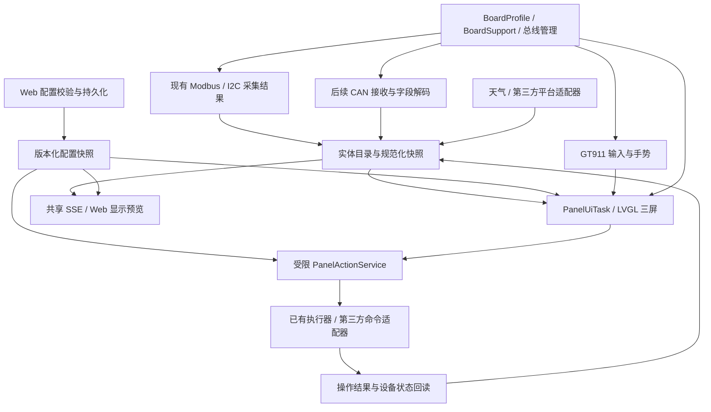
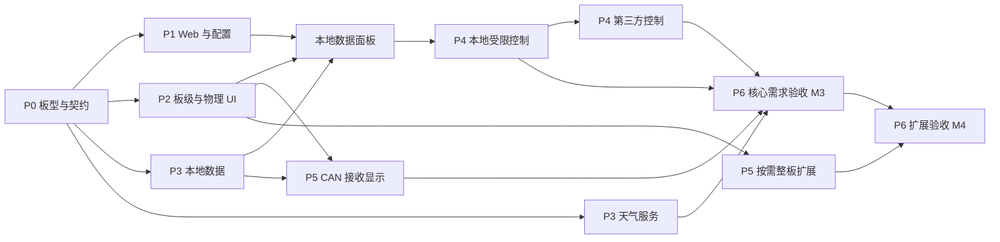

# FastBee 智能触摸面板与 Waveshare ESP32-S3-Touch-LCD-4 支持计划（已归档）

版本：历史评审稿 v1.1 ｜ 日期：2026-09-16 ｜ 状态：历史技术参考，当前范围已调整

> **归档说明：不得使用本文指导当前实现、配置、部署或验收。** 当前产品名称为“设备屏幕”，内部键为 `screenPanel`；页面可增删、改名、排序和混排，当前保护上限为 8 页、24 卡。Web 使用“预览 / 配置”两个 Tab，预览与编辑共用画布。当前唯一实施依据是 [FastBee 通用屏幕与触摸交互扩展计划](generic-screen-panel-extension-plan.md)，实际状态以[实施与验证记录](screen-panel-implementation-report.md)为准。

2026-09-17 范围更新：本文件只保留历史技术评估过程。本文的指定开发板、固定三屏、“智能面板”菜单及整板外设任务均已退出当前实施范围；下文中这些名称和结构即使使用现在时，也只表示当时的方案，不代表当前功能或验收状态。

在这份 2026-09-16 历史评审稿形成时，交付只有计划文档，尚未实现固件、驱动、WebUI 或设备配置，也未构建、烧录、升级或操作设备。下文“新增”“接入”“验收”均是当时的拟议工作；不得用这段历史描述覆盖后续实施记录。

评估以当前工作区源码、用户提供的两张设备文档截图及官方资料为依据。工作区存在尚未提交的改动，后续实施应重新记录基线。厂家文档中的安装、烧录、接线和参数设置说明仅作为资料，不构成本次执行授权。

本次修订补充：Web 字段与状态表现、默认配置及保存交互样例、离线/失效引用处理、可分工任务编号和分批交付范围。未开展任何实施工作。

建议审核顺序：第 1、4、5 节确认目标及兼容范围 → 第 6 节确认界面 → 第 8～10 节确认开关、配置与控制边界 → 第 12 节确认资源 → 第 14、17 节确认阶段交付和实施前输入。实现人员可直接使用第 14.2 节任务编号分工。

## 1. 结论与建议范围

历史评审结论曾建议实现 480×480 三屏面板，并复用 FastBee 的联网、配置、Modbus、部分 I2C 采集和规则执行能力；该固定三屏结论已被通用页面模型取代。

历史首版曾拟交付天气页、采集数据页、开关与场景页，并使用“智能面板”“显示 / 配置”等名称；当前名称、Tab 和页面模型均以通用计划为准。

不能把“芯片容量足够”“板上装有某接口”和“当前固件已经支持”视为同一件事。RGB、GT911、板载辅助控制器、CAN 数据链、天气和第三方场景连接器均有新增开发；普通 I2C 接口也不等于支持所有 I2C 设备。

历史稿建议分两条并行主线推进固定三屏与整板适配；该实施顺序已被通用计划取代。

| 评审问题 | 建议结论 |
| --- | --- |
| 是否值得针对 ESP32-S3-F16R8 实现 | 值得，作为首选容量档位；还必须选择准确 PCB 型号及版本 |
| 是否可放进功能配置 | 历史建议新增 `smartPanel`；当前实际兼容键为 `screenPanel` |
| 是否可以默认生成三屏 UI | 历史建议固定三屏；当前是可增删页面和可选模板 |
| 是否能显示 Modbus、CAN、I2C | Modbus 和部分 I2C 有基础；CAN 需实现 TWAI 接收、解码及状态链 |
| 是否能显示天气、控制第三方设备和场景 | 可以，但需逐个平台实现认证、实体映射、命令及回读，不能承诺通用兼容 |
| 是否所有现有芯片环境都支持同一屏幕 | 不能；共享应用契约，物理屏幕按芯片能力、板型、PSRAM 和驱动开放 |
| 是否支持整板所有宣传能力 | 大部分可分阶段支持；版本差异、协议边界和新增硬件需求见第 3～5 节 |

## 2. 需求、证据等级与交付边界

### 2.1 用户需求对应关系

| 编号 | 需求 | 本计划对应交付 |
| --- | --- | --- |
| R01 | 天气首屏 | 城市、图标、温度、湿度、高低温、数据更新时间和缓存状态 |
| R02 | 滑动到采集数据屏 | 最多 6 张采集卡，绑定 Modbus、已支持 I2C、后续 CAN 解析字段 |
| R03 | 第三屏智能控制 | 最多 6 张控制卡，区分有状态开关和无状态场景按钮 |
| R04 | 历史 WebUI 面板菜单 | 当时拟用“显示 / 配置”两 Tab，预览、绑定、校验、保存与状态诊断 |
| R05 | 默认 UI | 三个固定页面、默认样式、占位态；示例数据不作为真实配置保存 |
| R06 | 按需启用 | 编译能力裁剪、运行配置开关、资源预检和失败降级 |
| R07 | Flash / RAM 要求 | 分别给出 Flash、内部 DRAM、PSRAM、峰值及验证门槛 |
| R08 | 结合现有固件 | 复用现有配置、鉴权、采集和执行链，补齐板级与状态分发缺口 |
| R09 | 整板能力评估 | RGB、触摸、RS485、CAN、I2C、RTC、SD、蜂鸣器、背光和电源能力矩阵 |

### 2.2 证据等级

- **源码已确认**：当前工作区存在相应实现；不等于已经在目标板实测。
- **资料已确认**：截图、官方硬件参考或官方示例说明的能力；需与实物版本匹配。
- **计划新增**：本项目尚未实现，需要开发与验收。
- **必须实测**：内存峰值、流畅度、总线并发、断电恢复及长时间稳定性。本次没有测量结果。

首版不包含自由拖拽式页面编辑器、任意脚本执行、通用 DBC 编辑器、视频播放、完整语音/音乐功能、多平台自动发现及所有厂商私有协议。默认模板和受限字段配置先形成可靠闭环。

## 3. 目标硬件与版本识别

### 3.1 两组资料对应不同硬件

早先提供的 `Touch_GT911`、`Lvgl`、`Arduino_GFX-master` 及音乐/开关示例来自 **ESP32-4848S040** 资料包。后续两张设备文档截图对应 **Waveshare ESP32-S3-Touch-LCD-4**。两者都可能使用 480×480 显示与 GT911，但不能共用引脚表、板级供电、继电器、音频或初始化假设。

本计划以后一块 Waveshare 板为主目标。旧资料包可参考交互思路；若还需要支持 ESP32-4848S040，应另建板型适配项、独立确认版本并单独验收，不能直接纳入“已兼容”。

资料确认的共性：ESP32-S3-WROOM-1-N16R8、4 英寸 **方形** 480×480 RGB 屏、触摸型号使用 GT911；板上具有 RS485、CAN、RTC、microSD 与蜂鸣器等资源。[S1][S2]

### 3.2 同名板不同版本必须分开

| 项目 | 早期/混合页面资料 | 官方维护的 V4.0 资料 | 计划处理 |
| --- | --- | --- | --- |
| 辅助控制器 | TCA9554PWR IO 扩展器 | CH32V003F4U6，I2C 地址 `0x24` | 独立 BoardSupport，禁止混用控制协议 |
| I2C | V1 辅助器件与触摸可能分总线；页面出现多组引脚 | 共享 SDA15 / SCL7 | 按版本建立统一总线所有者 |
| 背光、复位等 | 早期 EXIO 引脚开关 | CH32 提供背光、复位、蜂鸣器、电源等控制 | 不把早期 EXIO 编号直接用于 V4 |
| microSD | 早期 SPI，片选经扩展器 | 1-bit SDMMC：CLK2 / CMD1 / D0=4 | SPI 与 SDMMC 两类后端分开 |
| RTC 中断 | 旧表出现 EXIO6 | V4 通过 CH32 EXIO7 | 驱动读取方式按版本定义 |
| DC 端子 | 产品概览写 7–36 V | V4 硬件参考存在 5–36 V 描述 | 当前只记录差异，锁定实物后采用对应版本额定值 |
| 触摸装配 | Touch 与无触摸产品易混淆 | 无触摸版本名为 ESP32-S3-LCD-4 | 无 GT911 时只启用显示能力 |

官方概览和维护中的硬件参考并不完全同版。[S1][S2][S3] 本计划不据网页标题判断用户实物是 V4。建议首个驱动实现以确认后的 V4 为基线；若用户实物是 V1～V3，则替换首个板级驱动任务，应用层计划保持不变。

实施前的硬件记录：PCB 型号/丝印版本、Touch 装配情况、模组 N16R8 标识、对应原理图和官方示例版本、供电方式、所接外设。记录可进入未来的板型说明，现阶段不因此阻塞计划审核。

### 3.3 引脚证据与资源约束

以下按证据来源区分，**不是当前固件配置，也不是接线操作指令**。V4 官方硬件参考已明确列出的接口如下；落驱动前仍须匹配实物。[S3]

| 资源 | V4 硬件参考映射 | 必须处理的约束 |
| --- | --- | --- |
| GT911 / CH32 / RTC / 扩展 I2C | SDA15、SCL7；CH32 `0x24`；RTC `0x51` | 统一频率、锁、超时、恢复和地址冲突检测 |
| RS485 | TX44 / RX43，板载 SP3485 | 采用对应版本的自动方向控制方案，不能套现有 ECM50 引脚 |
| CAN | TX6 / RX0，板载 TJA1051 | GPIO0 是启动配置引脚，核验复位/下载共存；外部终端电阻另核对 |
| microSD | SDMMC CLK2 / CMD1 / D0=4 | 使用 1-bit 模式；不可沿用早期 SPI CS 逻辑 |

以下来自用户截图/混合版本概览，是 **待按 V4 原理图及对应示例逐项复核的线索**，不归入本次已确认的 V4 引脚表。[S1]

| 资源 | 概览资料中的映射 | 实施前核对点 |
| --- | --- | --- |
| GT911 中断 | INT16 | 装配、有效电平、辅助器件复位时序 |
| USB | D−19 / D+20 | 对应版本连接方式及保留资源 |
| LCD 串行初始化 | SDA1 / SCL2 / CS42 | 与 SD 的 GPIO1/2 复用、初始化顺序和释放方式 |
| RGB 同步 | HSYNC38 / VSYNC39 / DE40 / PCLK41 | 准确版本时序、极性及板级线路 |
| RGB 数据 | R：46/3/8/18/17；G：14/13/12/11/10/9；B：5/45/48/47/21 | 数据位序和实际布线，不能拼接早期与 V4 表格 |

Waveshare 板型即使关闭显示，固定接到 LCD、辅助器件、USB 等的引脚也不会自动变成安全的通用 IO。历史稿使用的 `smartPanel` 名称已废弃，但“资源规划必须描述整板接线”的约束仍有效。

## 4. 整板能力支持矩阵

| 能力 | 当前 FastBee 基础 | 拟支持范围 | 阶段 / 限制 |
| --- | --- | --- | --- |
| Wi-Fi、Web、MQTT、设备配置 | 已有实现 | 直接复用连接、状态与管理能力 | P0～P6 回归，不重复建立网络栈 |
| RGB 480×480 显示 | 现有 LCDManager 为 U8g2 小屏 | 新建 RGB 显示后端、LVGL 三屏 UI | P2；与原小屏功能并存，不能直接替换 |
| GT911 电容触摸 | 未集成目标板驱动 | 点击、左右滑动、唤醒、锁定 | P2；首版单指交互，硬件多点能力不等于手势全支持 |
| CH32 / TCA9554 | 未集成对应 BoardSupport | 复位、背光和必要板级控制 | P2 只实现锁定的一个版本；另一版本独立估算和验收 |
| RS485 / Modbus RTU | 有管理、读写、轮询、分发基础 | 适配固定 UART 引脚和方向，复用采集与受限写入 | P2 验证硬件，P3/P4 接入业务 |
| CAN / TWAI | 有 CAN 类型枚举，无完整驱动数据链 | 经典 CAN 接收、过滤、字段解码与显示 | P5；S3 不支持 CAN FD，见第 11 节 |
| 外部 I2C 采集 | 有 AHT20、SHT3x、BH1750、BMP280、MPU6050 等部分驱动 | 按已编译/已配置驱动输出规范化读数 | P3；新增芯片仍需驱动，不能重复初始化共享 Wire |
| PCF85063 RTC | 未确认目标 RTC 集成 | 时间读取、NTP 校时回写、掉电后时间有效性 | P5；无效 RTC 不能假装系统时间可信 |
| microSD | 存在通用 SDCardManager 基础 | 板型后端、挂载状态、有限历史数据导出 | P5；V4 SDMMC 需新增适配，不把卡作为启动依赖 |
| 蜂鸣器 | 缺少本板控制适配 | 可关闭的点击/告警短音 | P5；不是扬声器，不承诺语音、音乐或解码能力 |
| 背光/息屏 | 缺少本板适配 | 亮度、空闲息屏、唤醒第一触保护 | P2；息屏默认只关背光，不强制深睡眠 |
| 电池/充电/电源辅助 | 与版本相关，当前无完整集成证据 | 电压/充电状态诊断，验证后再做低电量策略 | P5 可选；电压不等于准确剩余电量百分比 |
| USB 下载、OTA | 固件已有相关基础 | 保留下载入口、双分区升级及配置兼容 | P2/P6；需测 RGB 与 Flash 写入的并发影响 |
| BLE | 当前已存在 BLEProvisioner 配网链路，受编译/功能开关控制 | 保持既有配网能力；如目标构建启用需验证与面板共存 | 配网不等于任意 BLE 设备网关，后者不加入面板首版 |
| 本地负载继电器 | 无证据表明本板具有该输出 | 使用第三方开关或经验证的外部 IO/RS485 设备 | 不将控制卡描述为板载市电继电器 |
| 天气、第三方开关/场景 | 缺少完整连接器 | 先一个天气服务和一个控制平台，再扩展适配器 | P3/P4；需要 API 权限、状态回读和配额约束 |

CAN/RS485 收发器不能作为电气隔离的证据。整板供电与外部负载控制是不同设计事项；当前未锁定实物版本，不声明该实物 DC 端子的可用电压范围，后续按对应版本标注核对。外观尺寸接近 86 面板也不等于适配所有底盒，安装与散热另核对。

## 5. 现有固件兼容性与构建策略

### 5.1 已确认的接入点与缺口

| 位置 | 当前事实 | 计划处理 |
| --- | --- | --- |
| `platformio.ini` | Arduino + pioarduino `55.03.38`；F16R8 为通用 N16R8 环境 | 首选保留当前框架与依赖基线；新增板型派生环境 |
| `BoardProfile` | 当前仅普中 ESP32、C6 DevKit；非 C6 分支回退普中配置 | 新增准确 Waveshare profile，禁止 S3 屏幕板使用该回退结果初始化 |
| `FeatureFlags` / `RuntimeFeatureManager` | LCD 指现有 U8g2；功能数量上限 32；资源元数据没有 PSRAM 项 | 历史拟新增 `smartPanel`；当前实现使用 `screenPanel`，详见通用计划 |
| `TaskManager` | loop 内协作调度，非专用图形任务 | LVGL 使用独立 FreeRTOS 任务，避免长期占用协作循环 |
| `ProtocolManager` | Modbus 已向 MQTT、SSE、规则分发；部分回调为 setter 单消费者 | 用有限订阅/快照扩展，不能覆盖当前回调导致既有链路失效 |
| `PeriphExec` | 有异步执行、operationId、部分传感器结果缓存 | 复用结果与受限动作入口，屏幕不直接执行任意规则 |
| `SensorDriverCache` | 缓存驱动实例，读取可能真正访问总线 | 不能把它当作全局实时数据快照；数据适配层读取已发布结果 |
| `ConfigStorage` | 已有临时文件、校验和回退；缓存选项可能延迟持久化 | 面板配置显式选择持久写入策略，返回成功需有持久化语义 |
| WebUI 构建 | 页面按能力打包、懒加载、有 gzip/节点数质量门槛 | 新页面遵循能力 manifest 和生命周期，不塞入启动主包 |

现有 `esp32s3-F16R8` 还被 ECM50-A 等设备使用，现有端口、引脚及示例必须保留。用户当前连接的设备不能凭 F16R8 环境名认定为 Waveshare。

### 5.2 推荐构建组织

1. 保留统一业务源代码，芯片差异收口于 ChipConfig / ResourceProfile / 构建能力；板级固定线路收口于 BoardProfile / BoardSupport，遵循现有通用架构校验。
2. 新增明确的板型发布环境，例如 `esp32s3-waveshare-touch-lcd-4-v4`，复用 F16R8 公共定义并覆盖板型、驱动、能力及上传选择；此名称须在实物版本确认后确定。
3. 通用 F16R8 不自动包含或启动物理面板。独立的 Waveshare 无面板裁剪构建仍保留其板型和必要板级管理，供只使用 RS485/CAN 等场景。
4. 面板专用构建才编入 LVGL、目标显示/触摸资源与 Web 页面；编译能力和运行启用分别表达。其他硬件的业务逻辑不增加散落的板型宏。
5. 新增环境纳入构建矩阵、制品标识和板型匹配校验，避免通用 OTA 或人工选择时把错误 PCB 的固件当作兼容版本。

编译隔离从 P0/P2 开始验证：首次引入依赖或公共头文件时，至少构建新增屏幕目标及受影响的既有代表环境，检查无面板构建的依赖、链接 map 与 Web manifest 中没有意外的面板资产。P6 再完成约定的完整构建矩阵。既有基线若已失败，分别记录原有问题与面板引入的问题，不把无关重构纳入本次计划。

### 5.3 跨平台支持范围

| 现有容量/芯片档位 | 三屏物理 RGB 面板 | 可复用的业务能力 | 发布策略 |
| --- | --- | --- | --- |
| ESP32-S3 F16R8 + 已验证屏幕 PCB | 主支持目标 | 全部已实现的数据/控制适配 | 独立板型环境，默认功能关闭、配置保留 |
| ESP32-S3 F8R8 | 有 PSRAM 但空间受限，条件支持 | 相同模型与 UI | 当前每个 OTA 槽 3.5 MiB，必须先裁剪并测量，不能直接承诺装下 |
| ESP32-S3 F8R0 / 无 PSRAM | 首版不支持该 RGB 面板组合 | 现有数据采集、协议、Web | 默认不编物理面板，后续小屏路线另评估 |
| 经典 ESP32 F8R8 | 不能直接复用 S3 RGB 驱动 | 数据源和动作契约可复用 | SPI 等其他屏幕需独立后端及资源验证 |
| ESP32 F4R0 / F8R0、C3 F4R0、C6 F4R0 / F8R0 | 不作为本板物理 UI 目标 | 可继续作为采集/执行节点 | 默认裁剪面板及页面；小容量不承担同套资源 |
| `native` / 浏览器离线环境 | 无物理驱动 | schema、状态机、默认预览和失败分支验证 | 测试桩，不能宣称目标硬件验收 |

### 5.4 LVGL 与显示依赖路线

首选在当前 Arduino/IDF 基线上验证官方匹配版本的 V4 示例和公开 `esp_lcd` 接口，固定依赖。首轮可用 LVGL 8.4.x 做候选，验证通过后锁定；仓库当前没有 LVGL 集成，不把“保留原 LVGL 版本”当作前提。

若匹配板型的官方驱动依赖另一个受支持版本，P0 兼容试验后统一调整该候选。不要同时引入 v8/v9 API，也不要把旧 ESP32-4848S040 Arduino_GFX 对私有 IDF 结构的访问带入新固件。

仅当当前核心出现可复现兼容问题时，评估只升级 Waveshare 环境并跑公共组件回归；纯 ESP-IDF managed BSP 作为后备路线。官方 BSP README 的版本对应说明本身需核对，不能简单选择“最新包”。[S2][S4]

需要启用 PSRAM XIP、RGB ISR IRAM-safe 或 cache line 等编译期能力时，仍基于 pioarduino 提供的官方 Arduino-ESP32 / ESP-IDF SDK，在隔离目录按目标 `sdkconfig` 重编官方源码组件。此流程不是修改、升级或私有分叉 SDK，也不覆盖 PlatformIO 的共享 SDK 安装。为当前 PlatformIO/pioarduino 完整重编路径加入的 builder 适配和 diagnostics log-wrapper 条件补丁只属于构建兼容层，不改变显示、触摸或板级硬件逻辑；所有隔离改动必须有摘要和恢复检查。

## 6. 默认三屏 UI 与 WebUI

### 6.1 物理屏幕默认布局

逻辑画布固定为 480×480，三个主页面左右滑动、不循环，底部圆点显示当前位置。首版顺序固定“天气 → 采集 → 控制”；可配置默认打开页，不提供自由页面排序和无限新增页面。

```text
┌──────────── 天气 ────────────┐  ┌─────────── 采集数据 ──────────┐  ┌─────────── 智能控制 ──────────┐
│ 城市                  时间   │  │ 设备/分组              时间   │  │ 房间/分组              时间   │
│          天气图标            │  │ ┌─────────┐ ┌─────────┐     │  │ ┌─────────┐ ┌─────────┐     │
│           26°               │  │ │ 温度     │ │ 湿度     │     │  │ │ 客厅灯   │ │ 风机     │     │
│     多云  体感 27°          │  │ │ 26.2 °C │ │ 58 %    │     │  │ │ 开/关/未知│ │ 开/关/未知│     │
│     22°～29°  湿度58%      │  │ ├─────────┤ ├─────────┤     │  │ ├─────────┤ ├─────────┤     │
│ 城市未绑定时显示配置引导     │  │ │ 电能     │ │ CAN 温度 │     │  │ │ 开关3    │ │ 开关4    │     │
│ 上次更新/缓存/离线提示       │  │ ├─────────┤ ├─────────┤     │  │ ├─────────┤ ├─────────┤     │
│                             │  │ │ 数据5    │ │ 数据6    │     │  │ │ 回家场景 │ │ 离家场景 │     │
│          ● ○ ○              │  │ └─────────┘ └─────────┘     │  │ └─────────┘ └─────────┘     │
│                             │  │           ○ ● ○             │  │           ○ ○ ●             │
└─────────────────────────────┘  └─────────────────────────────┘  └─────────────────────────────┘
```

以上数值、实体名称和卡片仅为布局示意。实际默认配置使用空绑定：天气提示“请配置城市与天气服务”，采集提示“请添加数据项”，控制提示“请添加开关或场景”；禁止把假设备 ID、示例值或演示动作写成真实来源。

| 页面 | 默认信息 | 配置内容 | 行为约束 |
| --- | --- | --- | --- |
| 天气 | 城市、图标、当前/体感温度、高低温、湿度、更新时间 | 已配置服务引用、城市/位置引用、单位、刷新周期 | 一页一个城市；未提供字段显示缺省符，不伪造 |
| 采集 | 2 列 × 最多 3 行 | 数据引用、名称、单位显示、精度、阈值颜色、顺序 | 首版最多 6 项；数据状态与数值同时可见 |
| 控制 | 2 列 × 最多 3 行 | 开关/场景引用、名称、图标、顺序、确认策略 | 最多 6 项，默认模板可演示 4 开关 + 2 场景；无授权绑定不可执行 |

### 6.2 触摸和显示规则

- 物理主要点击目标至少 56×56 逻辑像素；Web 交互目标至少 44×44。标题建议控制在 10～12 个汉字以内，最终以字体测量、两行上限和 UTF-8 字节限制共同校验。
- 滑动与点击必须仲裁：初始位移阈值可设 28 px，由实机调整；一旦识别滑动即取消按钮点击，抬手且未越过阈值才触发点击。1000 次滑动验收不得出现误执行。
- 息屏后第一触只唤醒；锁定状态下保留查看与解锁提示，不执行控制。亮度建议默认 70%，息屏默认 120 秒，均为可审核默认值。
- 采集默认每秒从快照刷新一次，有变化才改控件；物理刷新目标 20～30 fps，性能评估接受按负载降至 15～25 fps，不承诺 60 fps。
- 数值缺失显示“—”，过期保留最后值并标时间；错误、离线、未绑定不能用数值 0 替代。开关未知不能画成“关”。
- 场景为按钮，显示执行中和最近结果；不做开/关状态。开关命令处理中显示等待，最终状态来自设备/平台回读。
- 字体采用中文子集、数字及有限图标；天气图标按规范化天气代码映射本地资源，首版不下载任意图片。

### 6.3 历史 WebUI：“智能面板”两个顶层 Tab

历史稿建议把该菜单放在“设备大屏”之后；当前菜单名和位置不沿用本段。

| Tab | 内容 | 可执行操作 |
| --- | --- | --- |
| 显示 | 480×480 等比例预览，三页切换，已保存/草稿标识，板型/功能/数据状态 | 查看、滑动、方向按钮、键盘左右切页；预览中的开关和场景不触发真实命令 |
| 配置 | 基础显示参数、天气绑定、采集卡、控制卡、校验与保存 | 选择已授权来源，调整字段/顺序，保存草稿；恢复默认只修改草稿，保存后才生效 |

历史稿的“配置”内部拟采用分组或折叠区域，不增加第三个顶层 Tab；账号/Token 等连接器设置使用独立受保护流程，面板中只选择连接器和实体引用。

Web 与 LVGL 共享 schema、页面结构、状态模型、颜色/字号等设计约定；分别实现 HTML/CSS 与 LVGL 渲染，不宣称复用 DOM 或完全像素一致。Web 预览须明确“预览”，硬件未接入时不得显示“屏幕已运行”。

页面须正确接入 `state.js` 的 pageMapping、标题、模块映射、PageLoader 逻辑 pageId 和重挂载；离开页面清理计时器、事件、订阅、请求，复用现有 request governor 与共享 SSE。禁止新页面自行持续轮询多条接口。

保存前展示字段错误；来源被删除、能力未编译、超出卡片数量时禁止保存为可执行绑定。多人/多窗口编辑冲突保留草稿，通过刷新差异后重试；不能静默覆盖。

首个配置里程碑提供完整三屏模板和保存回读，但状态注明“预览与配置已支持，物理驱动尚未接入”。此时不展示会被理解为已运行的硬件功能开关。

### 6.4 配置 Tab 的字段及默认值

| 配置分组 | 首版字段与建议默认值 | 校验与交互 |
| --- | --- | --- |
| 基础显示 | 内置默认主题、亮度 70%、空闲息屏 120 秒、默认天气页、控制锁定关闭 | 亮度 1～100%；息屏 0 表示常亮，否则 30～3600 秒；默认页仅三选一 |
| 天气 | 已配置连接器、城市/位置、摄氏度、刷新 900 秒 | 600～1800 秒且满足供应商配额；服务与位置须成对绑定或同时为空 |
| 采集项 | 来源选择器、名称、显示单位、精度、阈值颜色、排序 | 0～6 项；数值精度 0～3，布尔/枚举不显示精度选项；单位优先来自源，不进行任意数值换算 |
| 控制项 | 开关/场景、动作引用、状态引用、名称、有限图标、确认策略、排序 | 0～6 项；开关必须有回读；场景默认二次确认，已明确允许的普通开关默认直接设为目标状态 |
| 保存区 | 校验摘要、保存、撤销未保存修改、恢复默认 | 不自动保存；按钮显示草稿/已保存/待应用，恢复默认仍需保存 |

“控制锁定”首版是由已认证的 Web 配置管理的控制禁用开关，不引入新的现场 PIN 系统。屏上显示“控制已锁定，请在 Web 配置中解除”，仍可查看和切页。确认弹窗只确认当前这一次动作，不解除锁定，也不能绕过动作白名单。

选择来源时先选择类型，再选择已配置设备/连接器及字段；空目录说明如何前往现有采集或连接器配置。页面不能让用户在每张卡上重新填写总线引脚、Token 或协议报文。显示文字用纯文本渲染，不允许来源名称或天气描述注入 HTML。

“显示”Tab 顶部给出板型、功能与驱动状态、activeRevision、savedRevision 和最近状态更新时间。硬件已运行时默认查看“当前运行”；尚未运行时显示“已保存配置预览”并注明未运行；有未保存修改时可选择“草稿预览”。savedRevision 与 activeRevision 不同时，不能将已保存预览标成当前物理画面。示例数据与真实缓存分开；API 或 SSE 暂不可用时保留最后一次状态和时间，不改变配置。

### 6.5 功能状态与页面表现

| 场景 | 功能配置 / 菜单表现 | 历史面板页面及物理屏 |
| --- | --- | --- |
| 未编译面板能力 | 不展示可启用开关，或给出明确“此固件未包含”说明；不打包对应页面 | 不动态下载驱动，不将缺失接口当作网络错误重试 |
| P1 仅配置预览版本 | 按预览能力提供入口，标“配置预览”；不显示已运行开关 | 可审阅模板和保存草稿配置，物理运行状态为“尚未支持” |
| 已编译且关闭 | 功能配置保留设置/启用入口，侧栏可隐藏 | 由设置入口访问时允许提前配置，保存不自动启用硬件 |
| 已保存启用/关闭，待重启 | 分别显示当前运行状态与下次启动意图 | 提示重启后生效，不把当前仍亮着的屏幕标为已关闭 |
| 启用且正常 | 显示运行状态及设置入口 | 三屏按缓存和来源状态更新；断网不阻止本地页使用 |
| 启用但板型/PSRAM/驱动失败 | 菜单保留，功能页给出原因 | 显示故障及恢复建议，仍可改配置/关闭功能，不自动清除绑定 |
| 某来源离线或令牌失效 | 面板功能仍可处于运行状态 | 只对受影响卡片标离线/错误；真实状态未知的开关不能假显示关闭 |

编译能力、用户意图、实际运行状态和来源质量是四个不同维度。前端不能仅凭一个 `active=false` 就隐藏所有诊断信息，也不能仅凭接口返回 200 就显示“硬件正常”。

## 7. 软件架构与任务模型



该结构新增的是有界的面板订阅与规范化结果层，不要求先重写所有协议系统。按已绑定项保存快照，逐步提供可复用实体目录；初版不复制全部总线流量、全部历史或全部配置树。

| 模块 | 职责 | 明确不承担的工作 |
| --- | --- | --- |
| BoardProfile / PanelBoardSupport | 固定资源、硬件版本、初始化和板级故障诊断 | 天气、页面或业务规则 |
| SmartPanelManager | 生命周期、资源预检、任务管理、降级状态 | 在 loop 中长时间绘制 |
| PanelUiTask / 页面渲染器 | LVGL 对象、样式、导航、显示快照、手势 | HTTPS、文件写入、同步传感器读或复杂 JSON 解析 |
| EntityCatalog / PanelStateStore | 类型、单位、时间、质量、有限订阅与快照 | 自动扫描并导入所有未知外设 |
| 数据适配器 | 接入已有 Modbus/I2C 结果和后续 CAN 解码 | 为每一张卡另起一个重复轮询 |
| WeatherProvider / 平台连接器 | 网络拉取、认证、退避、归一化、状态回读 | 将凭据传给 LVGL 或前端预览 |
| PanelActionService | 校验允许的操作、去重、排队、结果跟踪 | 任意规则 ID、系统指令或通用 URL 执行 |
| SmartPanelConfigStore / 路由 | schema、版本、引用校验、持久化、应用结果 | 仅因 JSON 能解析就接受配置 |

所有 LVGL 调用由单一任务拥有。[S7] 建议初始栈 10～12 KiB、低优先级，在允许固定核心的 S3 构建中评估 core1；最终以 high-water、延迟与现有任务负载决定。handler 以 5～10 ms 节拍评估，不用忙等待。

输入、状态变更和命令均用有界队列；高频数值更新合并为最新值，命令不能被当作数值更新丢弃。天气与 TLS 在受控工作任务处理，网络任务不能持有 UI 或 I2C 锁等待。

## 8. 功能配置、启动与关闭

### 8.1 一项可见功能，两个资源维度

历史稿曾拟在“功能配置”增加“智能面板”并使用 `smartPanel`；该键已废弃，当前兼容键为 `screenPanel`。其余离线展示原则由通用计划重新定义。

| 维度 | 表达的事实 | 影响 |
| --- | --- | --- |
| 编译能力 | 固件是否包含面板、某驱动和 Web 资源 | 影响 Flash 和资源包；未编译能力不能靠运行开关补齐 |
| 板型能力 | PCB/版本/触摸装配及可用总线 | 决定可以初始化的硬件，不随页面开关改变 |
| 用户意图 `userEnabled` | 用户希望是否启用 | 持久保存，不因故障偷偷改成关闭 |
| 实际状态 `active` | 当前是否成功运行 | 由初始化、资源和健康状态决定 |
| 降级原因 / `restartRequired` | 为何未运行或为何尚待应用 | Web 可诊断，不能只显示一个真假值 |

首个物理版本采用“保存启用/关闭意图，重启后应用”，以避免初期热拆 RGB、PSRAM 和共享 I2C 的风险。运行中修改后同时报告当前状态、下次启动状态和需重启；不能立即假称屏幕已停止。亮度、页面绑定等经验证的轻量配置可以走任务内热应用。

后续只有验证驱动停止、DMA 回收、锁顺序和反复启停之后，才开放真正的热启停。面板初始化失败应释放已申请资源，保持 Web、联网及既有采集服务可用。

默认关闭仍保留不依赖互联网的首次启用路径：复用现有本地配网 AP 与提前启动的 Web 服务，在本地完成账户/功能配置，启用面板并重启。P2 必须验收“没有路由器凭据、没有天气账号”的首次配置流程；若目标构建裁掉 AP 或 Web，则不能发布成依赖该流程的默认关闭制品。首版不额外开发触摸输入 Wi-Fi 密码界面，也不自动打开面板来代替用户选择。

### 8.2 启动顺序与降级

1. 读取编译板型及必要板级支持，建立总线所有权和保留引脚。
2. 读取功能意图、面板 schema 与配置版本；损坏配置回到最后有效代或空绑定默认模板。
3. 核验 PSRAM、内部堆余量、最大可分配块、必需辅助控制器与驱动能力。
4. 只对准确板型进行安全初始化；分配缓冲、创建 UI/输入任务，发布能力与运行状态。
5. 按绑定建立数据订阅；网络来源各自等待联网、时间同步和认证，不能阻塞物理 UI。
6. 显示/触摸失败则发布具体原因；数据源失败只影响对应卡片。保留用户配置及诊断入口。

历史稿提出功能已编译且用户启用、但运行失败时仍保留诊断入口；当前“设备屏幕”的具体显示规则以通用计划和实现记录为准。

关闭面板释放其帧缓冲、LVGL、触摸轮询和专属刷新任务，撤销自己的数据订阅。共享 Modbus、I2C、MQTT、RTC 等如仍有其他使用方则继续工作；采用引用计数或明确所有权，不能把“关闭面板”等同于“关闭全部协议”。

`FeatureMeta` 保留原 `ramB` 和 `estimateRamB()` 的既有通用 RAM 估算语义，不直接重解释为内部 RAM。新增明确的 `dramB` / `psramB` 及最低空闲量、峰值/连续块要求，由新资源接口分别返回；面板资源预检使用新字段，避免把 PSRAM 需求算进内部堆或对旧值重复累加。P0 明确旧特性缺少分项值时的兼容规则及 API 版本迁移，现有特性的行为先保持。检查 32 项注册容量、状态数组和位图；一个可见功能优先，避免不断追加子开关耗尽容量。

### 8.3 无外网也能验收的最小版本

P3/P4 分别拆成本地部分与云端部分：先使已配置的 Modbus/I2C 数据、允许的本地规则及有回读的开关可用，再接天气和远程平台。网络连接、天气账户或第三方账户未就绪，只阻塞相应适配器的验收，不阻塞三屏壳体、本地数据显示和本地动作状态机。

离线启动的完成条件：启用面板后无 STA 凭据也能启动与切页；本地已配置采集继续更新；天气显示未配置/缓存/离线之一；第三方控制不可用且不排队；本地 Web 配置路径仍可访问。RTC 未校准时使用相对更新时间，本地画面不等待 NTP。

## 9. 配置、实体与持久化契约

### 9.1 配置存储

拟新增托管文件 `/config/smart_panel.json`，只存布局与引用。功能开关仍由功能配置统一管理；PCB 型号不允许从这个页面随意输入 GPIO 替换。

| 字段组 | 建议内容 | 约束 |
| --- | --- | --- |
| 版本 | 整数 `schemaVersion`、不透明字符串 `revision` | 服务端维护 revision；不支持未来 schema 时保留文件并停止应用 |
| 显示 | 亮度、息屏秒数、默认页、面板锁定、主题标识 | 历史首版曾固定三屏；当前已改为可配置页面；仍不接受任意渲染脚本或外部资源 URL |
| 天气 | `connectorRef`、`locationRef`、单位、刷新间隔 | 一个服务/城市，凭据独立 |
| 采集项 | 稳定卡片 ID、`entityRef`、标题、显示单位、精度、样式阈值 | 最多 6；引用必须匹配可读标量类型 |
| 控制项 | 稳定卡片 ID、`actionRef`、`stateRef`、类型、标题、确认策略 | 最多 6；开关必须绑定真实回读来源，场景可不含 stateRef；状态/命令来源需可关联 |

配置上限建议为服务端规范化后持久保存的 **12 KiB JSON（12,288 字节）**；HTTP 请求体另限 **16 KiB**，容纳 expectedRevision 等外层字段，解析前即可拒绝超限。嵌套深度和各数组另设上限。标题建议最多 48 UTF-8 字节，合法字符按显示能力校验；不能只限制字节而忽略布局。拒绝未知可执行字段、非法数值、重复 ID 与超限卡片，不能静默截断。

服务端从白名单字段重建规范化配置，不直接保存客户端原始 JSON。本地卡片 ID 建议限制为 `[A-Za-z0-9_-]{1,40}`，显示单位最多 12 UTF-8 字节；adapter/type 来自编译能力白名单，entityRef/actionRef/stateRef 由目录选择。URL、MQTT Topic、寄存器地址、CAN ID、原始 payload 和脚本属于来源适配器的管理范围，不写入面板布局。

`null` 是规范化配置中唯一的未绑定引用值，卡片未绑定时不可执行；不能把不存在的非空实体 ID 当作已绑定成功。已保存实体后续被删除时，保留卡片并标失效，禁用执行，提示重新选择。

### 9.2 统一实体与状态

实体目录按能力提供稳定 ID、来源、数据类型、单位、可读/可写/场景属性、状态回读能力与配置代号。面板不保存来源完整协议报文；Modbus/CAN 解码和量纲转换只在适配层执行一次，显示精度不改变用于控制的原始值。

| 状态字段 | 目的 |
| --- | --- |
| `value` / `reportedState` | 最近真实值或权威回读，允许为空 |
| `quality` | `waiting / valid / stale / offline / error / unsupported` |
| `sampledAt`、`receivedAt`、`ageMs` | 区分采样时间、接收时间和本机单调时钟计算的数据年龄 |
| `sourceRevision` / `sequence` | 识别来源变更和事件顺序，重连后可请求全量快照 |
| `operationId` / `lastResult` | 跟踪动作，不用数值变化猜测场景是否成功 |

系统时间未同步时显示相对年龄，不输出看似真实的日历时间。MQTT retained 或第三方缓存重放必须保留原始时间语义，不能仅凭“刚收到”变成新鲜数据。

建议内存中只订阅面板需要的实体，上限 24 项；快照序列化上限 16 KiB；实体目录分页返回，初始每页最多 24 条。6 张卡的上限与底层订阅上限不同，后者给开关状态及运行结果预留空间。

### 9.3 保存、应用与恢复

保存事务建议顺序：鉴权与开发者模式 → 限长解析 → schema/引用/能力校验 → 在提交锁内再次核对 expectedRevision 和 expectedCatalogRevision → 资源预检并预先构造候选运行快照 → 临时文件持久写与验证 → 原子替换有效代并回读校验 → 向运行任务提交不可变配置快照。提交串行化，每次生成新的服务端 revision 令牌，不在持有配置锁时等待网络或总线操作。

`ConfigStorage` 当前可在缓存选项启用时延迟写入非关键配置。面板需显式持久写入策略，不能把“进入写缓存”当成已落盘成功；复用现有 temp/backup/回退能力并针对断电恢复验证。

返回值区分 `saved`、`applied`、`restartRequired` 和 `degradedReason`，并报告 savedRevision/activeRevision。提交落盘前失败保留旧文件和旧运行快照；已落盘但硬件应用失败时明确报告“已保存，未成功应用”，保留旧运行快照或进入可诊断降级，不对用户显示完全成功，也不能假称持久提交尚未发生。

并发保存返回 409；恢复默认先恢复草稿，保存后生成新 revision；损坏主文件按已验证的代际规则恢复。恢复出厂要同时清除面板各代配置和对应连接器秘密，不留下旧 Token 或回退文件重新激活配置。

导出可将面板非秘密配置加入显式白名单。通用文件导入若识别为此托管文件，应返回托管配置提示并走同一专用校验路径，不能直接覆盖文件绕过 schema；恢复工具、配置名称映射和清理逻辑同时更新。

### 9.4 凭据边界

API key、Token、密码、原始认证头不存入面板布局。连接器凭据独立保存，前端只见“已配置”与脱敏状态；更新区分保留/替换/清除，普通导出、日志、SSE 和诊断不返回秘密。

这不代表现有 Flash 自动具备静态加密。是否启用安全启动、Flash/NVS 加密属于独立部署能力，不在未实现时承诺。面板新增代码至少遵循现有鉴权与秘密处理方式。

### 9.5 默认配置示例与引用校验

下面是未来有效配置的示例结构，仅存在于本计划，未生成设备 JSON 文件。文档版本 v1.1 与配置 schema 无关，首版 `schemaVersion` 仍为整数 `1`。`revision` 为服务端字段，示例令牌不能用于实际请求。

```json
{
  "schemaVersion": 1,
  "revision": "sp:example-current",
  "display": {
    "theme": "default",
    "brightnessPercent": 70,
    "idleSleepSeconds": 120,
    "defaultPage": "weather",
    "lockControls": false
  },
  "weather": {
    "connectorRef": null,
    "locationRef": null,
    "temperatureUnit": "celsius",
    "refreshSeconds": 900
  },
  "data": { "items": [] },
  "control": { "items": [] }
}
```

三页顺序、分辨率和 2×3 上限为首版模板常量，不写入可由客户端任意修改的 pageOrder。实际卡片字段建议如下，引用均从目录获取，不使用示例名称当真实设备 ID。

| 卡片类型 | 必需业务字段 | 可选显示字段 / 服务器补齐信息 |
| --- | --- | --- |
| 采集 | `id`、`entityRef`、`title` | `displayUnit`、`precision`、`thresholds`；服务器补齐实体类型/定义版本 |
| 开关 | `id`、`kind=switch`、`actionRef`、`stateRef`、`title` | `icon`、`confirmPolicy`；服务器补齐动作/状态定义版本并核验属于同一受控实体 |
| 场景 | `id`、`kind=scene`、`actionRef`、`title` | `icon`、`confirmPolicy`，不要求开关 stateRef；服务器记录动作定义版本 |

`schemaVersion` 只随数据结构不兼容变更升级。`revision` 表示配置提交身份，采用新的不透明令牌，避免简单计数在恢复默认或回退后重复；保存、专用导入、恢复默认、恢复出厂及提升备份为有效代时都产生新身份。客户端仅回传外层 expectedRevision，不写配置内部 revision。启动无文件时由加载流程建立默认配置和编辑基线，GET 不负责创建文件；未持久保存的默认状态明确标 `configStatus=defaulted`，不能报告已保存成功。

实体目录另有 `catalogRevision`，仅在来源/实体定义变化时更新，不因每次读数、在线状态或天气刷新而变化。每项有 `definitionRevision`；保存时固化相应引用定义，执行动作时再核验，防止同一 ID 被删除重建或改成不同动作后继续执行旧绑定。来源变化不应偷偷把一个温度卡重新指向另一只传感器。

| 校验情况 | 保存时处理 | 已保存配置启动/运行时处理 |
| --- | --- | --- |
| JSON 无法解析 / 超长 | 400 / 413 | 由加载恢复流程检查有效代，不直接应用 |
| schema、类型、范围或重复 ID 错误 | 422，给字段位置 | 使用已验证的有效代或空绑定默认，并报告配置状态 |
| 引用存在且类型匹配，来源暂离线 | 允许保存，标离线及不可执行原因 | 保留绑定/最后值，来源恢复后重新同步 |
| 非空引用不存在、类型不匹配、能力未编译或动作不允许 | 422；重新选择或置为 null | 保留原配置；标 `bindingStatus=missing/changed/unsupported/forbidden`，禁用相应动作，不自动回退整份配置 |
| 编辑期间目录定义变化 | 409，保留草稿并更新目录 | 不自动改绑；重新审核选中的引用 |
| 文件 schema 高于固件支持 | 拒绝不兼容导入 | 保留文件，报告 `unsupported_schema`；不当成损坏文件覆盖为默认 |

配置结构合法、引用定义合法与来源在线分别判定。启动恢复只针对存储或 schema 的有效性；短时离线、Token 过期或来源被删除，不触发恢复出厂或备份覆盖。

## 10. API、权限与操作结果

以下路径为拟定契约，最终与现有路由命名规范统一；一期只交付配置/预览必需接口。

| 拟定接口 | 阶段 | 权限与行为 |
| --- | --- | --- |
| `GET /api/smart-panel/capabilities` | P1 | 登录认证；板型、已编译能力、支持阶段、限额、硬件状态 |
| `GET /api/smart-panel/config` | P1 | 登录认证；已保存配置、revision、应用状态，不返回凭据 |
| `POST /api/smart-panel/preflight` | P1 | 认证 + 开发者模式；只校验引用/资源，不写盘、不操作硬件 |
| `POST /api/smart-panel/config` | P1 | 认证 + 开发者模式；expectedRevision、完整校验及持久化 |
| `GET /api/smart-panel/entities` | P1 基础 / P3 完整 | 登录认证；只列可引用的已配置实体，分页、标能力和不可用原因 |
| `GET /api/smart-panel/state` | P3 | 登录认证；首次全量/事件丢失后恢复，其余复用现有 SSE |
| 共享 SSE 的面板状态事件 | P3/P4 | 复用认证连接、序号和退出清理；限速合并，不暴露原始秘密 |
| `GET /api/smart-panel/operations/{id}` | P4 | 登录认证；有限结果窗口，输出接受/执行/结果及原因 |

首版不提供可从预览点击触发真实设备的 Web 动作接口。物理触摸通过内部 `PanelActionService` 调用执行器，不向设备自身 HTTP API 发请求。以后若明确增加 Web 控制，应单独设计认证、许可、限速与审计，不暗中改变预览含义。

当前 `/api/periph-exec/run` 已有认证及开发者模式门禁。不能把面板接入方式设计成绕过该路由任意执行规则；新的内部入口只允许被管理页面明确绑定、经过类型和权限校验的普通动作。

| 类别 | 允许方式 | 禁止/限制 |
| --- | --- | --- |
| 开关 | 明确设为 ON/OFF，绑定实体及真实回读来源 | 来源暂不可用时显示未知/禁用或等待；根本没有回读能力的实体不能配置成有状态开关 |
| 场景 | allowlist 的场景引用与固定参数 | 任意脚本、重启、OTA、恢复出厂、任意 URL/系统命令不作为面板动作 |
| 现有规则 | 验证规则结构、类别和 revision 后执行 | 绑定后规则被改成危险操作时必须重新校验并拒绝执行 |
| Modbus / 后续 CAN 写入 | 来源定义的受限动作参数 | 不从触摸页面构造任意寄存器写入或任意 CAN 帧 |

操作生命周期：`accepted → executing → succeeded / failed / timeout / outcome_unknown`。HTTP 202、MQTT 发布成功或串口发送成功只代表相应阶段成功，不能直接显示被控设备已完成。关联回读受目标状态、操作时间和可用关联 ID 约束；无结果查询能力的场景只能显示“已受理，结果不可确认”。

建议初始同时执行 1 个面板动作，待执行队列最多 4 个、最近结果最多 16 个；同一按钮忙时禁用。使用有限有效期的 requestId 去重；超时后不自动重发可能已经生效的场景。离线不缓存待联网自动补发，重启后不恢复待执行命令，不承诺跨平台严格 exactly-once。

错误建议：400 结构错误、401 未认证、403 权限/能力禁止、409 revision 或来源变更、413 超限、422 字段/引用非法、429 限速、503 当前资源/服务不可用。字段级错误给出位置和原因，响应不夹带凭据。

### 10.1 读取接口与保存交互样例

所有 GET 接口只读内存中的目录、配置或运行快照：不扫描 I2C、不触发 Modbus/CAN 采集、不请求天气、不启动第三方动作，也不创建默认文件、提升备份、递增版本或重新应用配置。相关状态可报告 `recovered/defaulted/unsupported_schema`，实际恢复由启动加载或明确的提交流程执行。

preflight 和保存使用相同结构/引用/资源校验；preflight 结果不是长期有效的执行许可，提交时仍检查配置和目录版本。下面示例表示保存一份空绑定配置；运行时令牌必须从当前 GET 结果取得，示例不是调用指令。

```json
{
  "expectedRevision": "sp:example-current",
  "expectedCatalogRevision": "cat:example-current",
  "config": {
    "schemaVersion": 1,
    "display": {
      "theme": "default",
      "brightnessPercent": 70,
      "idleSleepSeconds": 120,
      "defaultPage": "weather",
      "lockControls": false
    },
    "weather": {
      "connectorRef": null,
      "locationRef": null,
      "temperatureUnit": "celsius",
      "refreshSeconds": 900
    },
    "data": { "items": [] },
    "control": { "items": [] }
  }
}
```

保存响应通过 `saved` 表示持久化是否完成，通过 `apply.status` 表示配置应用结果，两者不能互相替代。如下样例表示已经保存，但 UI 任务还未确认应用；前端应保留“等待应用”，通过现有请求调度/SSE 获取后续状态，不自动重复提交。

```json
{
  "saved": true,
  "savedRevision": "sp:example-next",
  "catalogRevision": "cat:example-current",
  "apply": {
    "status": "pending",
    "activeRevision": "sp:example-current",
    "restartRequired": false,
    "reason": null
  }
}
```

| 提交/应用结果 | 建议 HTTP 与响应 | 前端文案与后续 |
| --- | --- | --- |
| 提交前失败 | 对应 4xx/5xx；`saved=false`，既有 saved/active 不变 | 显示错误、保留草稿；网络断开导致结果不明时先查询 revision，不盲目覆盖 |
| 落盘且已应用 | 200；`saved=true`、`apply.status=applied`，两个 revision 相同 | 已保存并应用 |
| 落盘、等待 UI 确认 | 202；`saved=true`、`apply.status=pending` | 已保存，等待应用；超时转为有原因的失败状态 |
| 落盘、需要重启 | 200；`apply.status=restart_required`、`restartRequired=true` | 已保存，重启后生效；保留当前运行 revision |
| 落盘、应用失败 | 200；`saved=true`、`apply.status=failed`，active 保持旧代或为空 | 已保存，应用失败；显示原因，不能只看 HTTP 200 报完全成功 |
| 配置应用成功，天气等来源离线 | `apply.status=applied`，另报运行质量 | 已应用，部分来源离线；不把普通来源故障当保存失败 |
| 功能关闭时提前保存配置 | 200；`saved=true`、`apply.status=inactive`，不创建 UI 任务 | 已保存，面板未启用；启用/重启流程仍由功能配置负责 |

恢复和保存流程要明确持久提交点：提交后即使硬件应用失败，也不能返回含糊的普通保存失败引导客户端反复提交。若连接在提交前后中断，客户端重新读取版本与配置确认结果，不因没有收到响应就重试动作或覆盖配置。

## 11. 数据源与第三方平台接入

### 11.1 Modbus

从已有轮询/执行结果及 `dispatchModbusData()` 接入，保留 MQTT、SSE、规则的现有分发。采用多观察者或共享结果快照，不能用新的 callback setter 覆盖原消费者。

数据卡引用已配置的从站、采集项和解析字段，不重复维护同一寄存器表；设置采样周期的是采集配置，面板只决定显示刷新与过期阈值。错误码、CRC/超时、最后成功时间纳入 quality。

RS485 UART44/43 与当前其他设备示例引脚分别配置，资源规划避免串口重复占用。受限写操作须规定从站、地址、允许值域及回读方式，显示值的四舍五入不影响写入数据。

### 11.2 I2C

V4 触摸、CH32 和 RTC 与外部传感器共享总线，必须先收口总线生命周期、锁、速率、短超时和恢复策略。禁止每个驱动自行反复 `Wire.begin()/end()` 改掉面板连接。

利用现有采集执行与已发布结果，不在 LVGL 回调直接 `readChannel()`。传感器拔出或超时应更新对应实体状态，不能长期占锁让触摸和背光一起失效；触摸与必要板级控制有调度预算，低速传感器分批采集。

目录只出现当前已编译驱动、成功配置并有可读通道的来源。未知芯片可提示“需新增驱动”，不能把扫描到地址等同于已经支持数据读取。

### 11.3 CAN

ESP32-S3 TWAI 支持经典 CAN 标准/扩展 ID，不能收发 CAN FD。[S6] 板载 TJA1051 解决物理收发，仍需软件驱动、速率、过滤、收发队列、总线错误状态和字段解析。

首阶段做接收显示：明确波特率、11/29 位 ID、DLC、掩码、接收队列上限、丢帧计数、bus-off 与限次恢复；初始烟测采用 listen-only，正式模式是否应答由网络设计确认。

字段映射先支持明确定义的固定字节偏移、长度、大小端、有符号/无符号、比例和偏移；对帧长不足、溢出、非有限值做质量标记。通用 DBC、位域/复用信号和所有车型协议不在首版，后续单独扩展。

每卡绑定解码后的实体，UI 不逐帧解析和保存原始报文。CAN 完成接收验收后才在目录开放可选项；仅有枚举时显示尚未支持。发送控制作为 P5 的独立扩展门槛，需明确协议和允许帧集合，不自动开放任意写入。

### 11.4 天气

先选一个有明确 API 文档、认证方式和使用额度的天气服务；城市、位置编码和单位由该适配器规范化。建议默认刷新 15 分钟、允许范围 10～30 分钟，并服从实际服务配额。

采用 HTTPS CA 校验、时间同步、连接/读取超时、有限响应体、流式/筛选 JSON、重试退避。一次只启动有限的 TLS 请求，避免与其他 HTTPS 操作叠加抢占内部内存。不要通过关闭证书校验实现所谓兼容。

规范化输出天气代码、温度、湿度、高低温、观测时间与服务状态；401/403、配额限制、超时、字段缺失分别报告。默认只保留最新缓存，不每分钟写 Flash；如要求重启后仍可见，使用限频持久缓存并标注最后更新时间。

### 11.5 第三方开关与场景

先交付一个参考控制平台，而不是直接宣布兼容所有平台。可在审核时选择 Home Assistant 的公开 API/MQTT 实体，或用户已有平台的 HTTPS/MQTT 服务；本计划不预设已有账号、Token、Topic 或 API 权限。

每个连接器需具备：实体枚举/受控登记、命令映射、真实状态订阅或查询、可用性、认证失效、超时、速率限制和重连。对于只能发送命令、不能回读状态的平台，不开放有状态开关，只开放被平台明确声明并获准绑定的场景动作；目录和 UI 必须体现结果不可确认等能力限制。

MQTT 接入复用现有连接与分发能力，在需要时加明确的多订阅通道，不能替换 FastBee 平台消息回调。HTTPS 采用固定适配器与管理端审核的目标服务，面板 JSON 不允许塞入任意 URL、Header 或执行模板。

同一个物理开关的触摸、本地规则、第三方平台与 Web 管理状态应汇合到一个状态来源；外部有人操作后，面板必须跟随回读更新，不以本地记忆长期覆盖实际设备。

## 12. Flash、RAM、PSRAM 与性能预算

### 12.1 当前可确认的 Flash 基线

当前 `partitions/16MB.csv` 的 app0/app1 各为 `0x700000`，即 **7 MiB**；LittleFS 使用名为 `spiffs` 的 `0x1F0000` 分区，即 **1.9375 MiB**。16 MB 是整颗 Flash 容量，不能拿全部容量作为单个 OTA 固件预算。

评估期间只读观察到 `.pio/build/esp32s3-F16R8/firmware.bin` 的大小为 3,338,000 字节，约 3.183 MiB。构建目录可能被其他工作更新，此数字仅作历史观察快照，**不是本次对当前未提交源码重新构建的结果**，也不是可发布的 Waveshare 面板基线。以该大小做算术参考，距离 7 MiB 槽约有 3.817 MiB；后续基线需记录源码版本、环境、配置、制品 hash 与采集时间后再校准。

8 MB 分区每个 OTA 槽为 3.5 MiB，因此即使有 8 MB PSRAM，也可能先受应用分区限制。不能为塞入面板直接取消现有双 OTA 保障。

### 12.2 图形缓冲的可计算部分

| 项目 | 计算 | 用途 / 分配位置 |
| --- | --- | --- |
| 单 RGB565 全屏帧 | 480 × 480 × 2 = 460,800 B = **450 KiB** | RGB 扫描 framebuffer，优先 PSRAM |
| 两个 RGB565 全屏帧 | 921,600 B = **900 KiB** | 可选双帧同步方案，增加带宽与生命周期复杂度 |
| 40 行局部绘制缓冲 | 480 × 40 × 2 = **37.5 KiB** | LVGL partial draw，位置由所选驱动路径决定 |
| 两个 40 行局部缓冲 | **75 KiB** | 适合候选单帧 + 双 partial 方案 |
| 两个 10 行 bounce 缓冲 | 480 × 10 × 2 × 2 = **18.75 KiB** | 可选内部 DRAM 中转路径，还要计入驱动/DMA 开销 |

三个页面不是三块 framebuffer。页面控件与当前画面共享显示驱动缓冲，不应为“天气/数据/控制各一屏”无条件申请三张整屏图像。

候选基线是单 PSRAM 全帧 + 双 partial draw；若撕裂、Flash 写入或带宽验证要求双帧/bounce，则明确改变方案并重算。partial、双帧和 bounce 是不同层次的策略，不能把所有候选都机械相加，也不能遗漏选定方案实际同时存在的内存。[S5]

### 12.3 生产版规划范围，尚未实测

| 资源 | 初始规划 | 说明 |
| --- | --- | --- |
| 固件 Flash 增量 | **0.8～2.0 MiB** | 覆盖 LVGL/驱动、三屏、有限中文资源、基础数据/连接器；精简演示可能更小，不据此承诺发布体积 |
| PSRAM 稳态增量 | **约 1～2 MiB** | 含选定图形方案、UI 对象与有限缓存；项目层先为面板预留 **2～3 MiB** 余量 |
| 内部 DRAM 稳态增量 | **约 48～96 KiB** | 任务栈、同步、DMA/bounce 候选和无法迁入 PSRAM 的对象，需 map 与运行测量 |
| HTTPS 单次瞬态余量 | **另预留约 40～100 KiB 内部 DRAM** | TLS/证书/JSON 的实际值随库、端点和缓冲改变；按并发峰值单独验证 |
| 配置与状态 | 持久配置 ≤12 KiB；请求体/状态序列化各 ≤16 KiB；有界订阅/队列 | JSON 字节数不等于解析树大小，必须核算解析/复制峰值 |
| Web 新增 gzip 资源 | 暂定目标 **≤24 KiB**，专用能力预算 | 不含完整图表/编辑器库；以构建报告调整并说明差值 |
| 中文字体和图标 | 子集 + 少量本地图标 | 完整中文字库/大背景图可增加数 MiB，需另立预算，不能藏进上述范围 |

上述区间是工程规划，不是最低保证或当前设备的剩余内存。512 KiB 级片内 SRAM 中已有系统、网络和固件占用，不能把芯片总 RAM 当作可自由分配堆；PSRAM 也不能替代所有 DMA、栈和网络路径的内部内存。

按既有 3.183 MiB 制品作示意，增加 0.8～2.0 MiB 后约 3.98～5.18 MiB，具备落入 7 MiB OTA 槽的可能性；最终由准确板型、相同配置的前后构建和 map 差值决定。此估算不用于放行 F8R8 或未测量的全功能组合。

### 12.4 验收资源门槛

- 建议面板发布固件不超过单 OTA 槽 85%，F16R8 约 5.95 MiB，保留约 1 MiB 以上增长空间；不得仅依赖链接成功。
- 以相同构建与业务负载测开/关面板差值：启动峰值、联网/TLS 峰值、打开 Web 页面、配置保存、OTA、总线并发和长时运行。
- 初始观测目标：业务稳态空闲内部堆至少 64 KiB、最大连续内部块至少 32 KiB；这些只是初始门槛，若实际 TLS/DMA 所需块更大则提高，不可拿稳态门槛替代峰值验证。
- 记录 PSRAM 总量/空闲量/最大块、内部 RAM 对应指标、任务栈 high-water、队列高水位、分配失败、帧率、输入延迟与看门狗事件。
- 分配不足时禁用/降级面板或拒绝新增绑定，优先保持当前核心采集和联网；不无限重试申请大块内存。
- 初始目标为轻量动画、约 1 Hz 数据变化下的可用触摸响应；屏幕资料中的某个示例帧率不是 FastBee 并发负载的承诺。

运行开关关闭可以省工作 RAM、PSRAM 和 CPU，**不能回收已编入的 Flash**；编译排除才能省固件及 Web 资产。浏览器 DOM 和预览布局消耗的是客户端内存，设备仍承担文件服务、配置解析和接口响应开销。

### 12.5 Web 资源门槛

当前质量门槛包含：总 gzip 279 KiB、启动 66 KiB、单资源 26 KiB、运行模块 16 KiB、gzip 文件 53、总 HTML 节点 3100、单页 920。新页面会影响数量和总体预算，不能只加文件后跳过校验。

保留无面板构建原预算；为面板能力新增有限且可说明的预算差值、必要文件数与节点额度。面板模块懒加载，启动包除最小导航元数据外不增长；运行配置的开关不得决定编译时是否打包资源。

LittleFS 同时承载 Web、配置和其他文件，按实际 gzip manifest 与空间报告核算，并保留配置原子替换及恢复空间。大字体首选受控编译资源；SD 卡不作为基本三屏启动和配置保存的前提。

## 13. 故障、恢复与整机稳定性

| 情况 | 预期表现 | 恢复要求 |
| --- | --- | --- |
| 板型不匹配 / PSRAM 缺失 | 不初始化猜测引脚，报告不可用原因 | Web 和现有核心服务继续启动 |
| CH32 / 共享 I2C 故障 | 联合报告背光/复位/触摸相关板级错误 | 有限重试和总线恢复，禁止无休止复位辅助器件 |
| 传感器拔出 / Modbus 超时 | 仅相应卡片错误/过期 | 采集层控制退避，不能卡住 UI |
| 天气或平台断网 | 保留旧值和时间，控制不可用 | 联网后重新同步状态，不补发历史命令 |
| 开关超时但可能已执行 | 显示结果未知，避免伪报失败后自动重试 | 查询/等待权威状态，用户可明确重新操作 |
| 配置写入中断电 | 恢复有效代或空绑定默认配置 | 不应用半份配置，不遗留秘密回退文件 |
| Flash/NVS 写入、OTA | 页面可限帧/暂停动画并给升级状态 | 验证 RGB DMA/cache 带宽、无花屏死锁、升级后配置迁移 |
| 低电压、快速重启 | 板级初始化失败可诊断 | 核验准确版本的电源时序，不以无限重启掩盖问题 |
| SD 缺失/拔出/损坏 | 基本三屏正常，历史功能显示不可用 | 文件句柄/队列有界，不持续阻塞主任务 |
| RTC 时间失效 | 相对更新时间可用，网络认证等待可信时间 | NTP 同步后恢复，不能用未知 RTC 时间绕过 TLS 校验 |

沿用已支持的稳定 Flash/PSRAM 时钟与官方匹配时序，不复制资料中的实验性超频设置。深度睡眠会影响实时总线和控制可达性，首版息屏仅管理背光；如后续需要电池省电，再单独评估联网、唤醒和实时性取舍。

## 14. 分阶段实施与并行任务

以下为审核后的拟实施安排，不是本次执行记录。所有估算按 **人日**，含针对新增能力的验证；不把多人并行简单视作按人数等比缩短。硬件样品、第三方账号、现场协议和失败修复可能增加日历时间。

| 阶段 | 工作包 | 产出与门槛 | 估算 |
| --- | --- | --- | --- |
| P0 基线与契约 | 精确板型、引脚/能力表、现有构建/资源基线、schema/API/状态机、依赖兼容试验 | 确定首个硬件版本与框架路径；冻结三屏上限和执行边界 | 2～4 人日 |
| P1 默认 UI 与配置 | Web 两 Tab、三屏预览、草稿、校验、持久化、恢复与菜单能力 | 无真实动作也能完成保存/回读/冲突/错误预览；标明仅配置阶段 | 4～6 人日 |
| P2 板级与物理 UI | BoardProfile、辅助器件、共享 I2C、RGB/GT911、LVGL、功能/资源预算 | 实板三屏可滑动、唤醒无误操作、失败可诊断；轻量配置可应用 | 6～10 人日 |
| P3 数据与天气 | 有界实体/快照、Modbus、已支持 I2C、一个天气服务、共享状态分发 | 三屏中天气/数据真实可见，过期/离线/源删除状态正确 | 4～7 人日 |
| P4 开关与场景 | 受限动作、已有规则适配、一个第三方控制平台、状态回读 | 物理开关/场景闭环，操作 ID、去重、未知结果和断网处理 | 5～8 人日 |
| P5 整板扩展 | CAN 接收解码、RTC、SD 后端、蜂鸣器、版本相关电源诊断 | 各能力单独验收后开放配置，详见下表 | 6～11 人日 |
| P6 集成与发布准备 | 资源/OTA/总线并发、回归矩阵、24/72 小时稳定性、使用说明 | 实测报告、限制清单、准确板型制品和回退路径 | 4～6 人日 |

总规划约 **31～52 人日**。其中 P5 可按需要拆分，不能因为尚未完成 SD/电池诊断而延迟已验证的天气、数据和智能控制阶段版。本需求已包含 CAN 数据显示，因此完整交付必须包括 CAN 接收/解码子项；较早阶段版若尚未包含 CAN，须明确标注范围，不能据此宣称全部完成。

| 并行任务组 | 可独立推进内容 | 汇合条件 |
| --- | --- | --- |
| A：板级/图形 | P0 兼容验证 → P2 总线、驱动、LVGL、内存 | 用统一 schema/view-model 接 P1/P3；硬件风险尽早暴露 |
| B：配置/API | P0 契约 → P1 配置校验、存储、恢复、能力接口 | 字段与版本固定后供 Web 和物理 UI 使用 |
| C：WebUI | P1 离线默认 UI、Tab、草稿和错误态、资源包 | 使用契约和测试数据并行；再接 B 的真实 API |
| D：数据/控制 | P0 来源审查 → P3/P4 适配器与动作状态机 | 依赖实体/配置契约；最终在 A 的实板上验证 |



### 14.1 P5 的明确拆分

| 子项 | 优先级 | 交付范围 | 估算 |
| --- | --- | --- | --- |
| CAN 接收/解码/显示 | 高，属于用户提出的数据需求 | TWAI、过滤、字段映射、丢帧和 bus-off、采集页绑定 | 3～5 人日 |
| RTC + 蜂鸣器 | 中 | 时间有效性、校时、短音和禁用开关 | 1～2 人日 |
| microSD | 中，按是否需要历史数据启用 | 准确后端、挂载/拔卡、有限数据导出 | 1～2 人日 |
| 电池/电源诊断 | 条件项 | 按实际版本读取可得状态，不承诺准确 SOC | 1～2 人日 |

CAN 任意发送、完整 DBC、深睡眠策略、第二块屏幕 PCB 和额外第三方平台需单独估算，不包含在上述数字中。若 P0 发现必须迁移框架或补辅助芯片协议，重新评估相关阶段，不隐去成本。

### 14.2 可分工任务清单

任务编号用于未来工作单和评审追踪，状态均为“计划”。下表是 P0～P6 的拆分，不额外叠加人日。A/B/C/D 是第 14 节的职责组，可由实际人数合并；当前并行评估不代表这些实施任务已开工。

| 编号 | 阶段 / 负责组 | 前置条件 | 可独立评审的交付与完成条件 |
| --- | --- | --- | --- |
| SP-01 | P0 / A | 准确实物信息可取得 | 板型记录：PCB/SKU/触摸装配、原理图及示例版本、引脚证据、供电标注；未确认前不提交具体板级初始化 |
| SP-02 | P0 / B+D | 当前源码可读取 | schema、实体 ID、API、操作状态和限额约定；明确无网络场景和单平台验收样例 |
| SP-03 | P0/P2 / A | SP-01、现有基线 | 专用构建/板型/制品 ID，封住目标误用普中回退的路径；首次依赖接入即验证无面板构建隔离 |
| SP-04 | P0/P1/P2 / A+B+C | 对应阶段可构建 | 同源码/配置的 bin、map、Web manifest、Flash/DRAM/PSRAM 基线及差值；超门槛先解决再加功能 |
| SP-05 | P1 / B | SP-02 | schema 解析/规范化、目录接口与能力接口；GET 无总线/网络采集副作用，边界错误明确 |
| SP-06 | P1 / B | SP-05 | revision 冲突、立即持久写、saved/applied 区分、代际恢复、托管导入与秘密排除 |
| SP-07 | P1 / C | SP-02，可用样例 | 两 Tab、默认三屏、空绑定、离线/错误/等待态、卡片上限、输入校验；预览零真实动作 |
| SP-08 | P1 / C+B | SP-05～SP-07 | 接真实配置接口，草稿/保存/冲突与页生命周期验证；资源懒加载和专用预算达标 |
| SP-09 | P2 / A | SP-01、SP-03 | BoardSupport 与共享 I2C 生命周期；辅助器件、触摸复位、背光和总线异常可诊断，不覆盖其他设备 GPIO |
| SP-10 | P2 / A | SP-09 | 静态显示、GT911、内存策略和驱动兼容验证；失败时可恢复到已知正常固件，准确记录实测版本 |
| SP-11 | P2 / A+C | SP-10、SP-02 | LVGL 三屏、点击/滑动仲裁、息屏/锁定；1000 次滑动零误动作，所有 LVGL 调用收口 |
| SP-12 | P2 / A+B | SP-06、SP-11 | 功能开关、分项内存预检、待重启/降级状态、无外网首次配置；关闭不停止共享采集 |
| SP-13 | P3 本地 / D | SP-02、现有采集路径 | 有界快照、Modbus/I2C 适配、时间/质量；原 MQTT/SSE/规则分发保持有效，不重复采样 |
| SP-14 | P4 本地 / D+B | SP-13、受限动作契约 | 普通规则/本地开关白名单与结果链；规则改变后重新校验，不允许任意系统动作 |
| SP-15 | P3 云端 / D | SP-02、选定服务及测试权限 | 一个 WeatherProvider，认证/限额/缓存/过期/断网回归；资源报告含 HTTPS 峰值 |
| SP-16 | P4 云端 / D | SP-14、选定平台及测试实体 | 一个第三方连接器，开关权威回读、场景结果语义、去重/超时/未知结果；禁止离线重放 |
| SP-17 | P5 CAN / A+D | SP-09、SP-13、已知报文协议 | TWAI 接收、过滤/解码、质量/丢帧/bus-off；真实 CAN 字段可从目录绑定到采集页 |
| SP-18 | P5 其他 / A | SP-09、扩展范围确定 | RTC/蜂鸣器/SD/电源诊断按能力分别验收；可拆工作单，某扩展失败不阻塞基本三屏 |
| SP-19 | P6 / A+B+C+D | 本批功能任务完成 | 权限/持久化/并发/OTA/全矩阵回归及资源报告，24/72 小时稳定性结果；问题与限制列明 |
| SP-20 | P6 / B+C | SP-19 | 使用说明、已支持 PCB/平台/字段、首配/恢复路径、升级兼容与制品标识；只标记已验收能力 |

首次实板板级验证依赖 SP-01 的型号证据；电源/触摸/辅助器件 smoke 属于 SP-09/SP-10 的实施验收，不要求为批准本计划先操作设备。物理驱动未通过时，Web 与契约工作仍可继续，但不能以浏览器预览替代 P2 完成。

### 14.3 建议分批交付

| 交付批次 | 最小完成集合 | 可以声明的结果 | 尚不能声明 |
| --- | --- | --- | --- |
| M1 配置评审版 | SP-02、SP-05～SP-08，相关 SP-04 | 默认 UI 与配置保存/回读可评审，三屏预览完整 | 物理屏幕、真实天气/远程控制已支持 |
| M2 本地面板版 | M1 + SP-01、SP-03、SP-09～SP-14、对应资源/集成验证 | 准确板型上可滑动、显示本地数据、执行已绑定普通本地动作，无外网可用 | 第三方天气/平台、CAN 或未验收整板扩展已支持 |
| M3 本需求完整核心版 | M2 + SP-15～SP-17 + SP-19～SP-20 | 天气、Modbus/I2C/CAN 采集显示、一个第三方平台的开关/场景形成闭环 | 所有平台、CAN FD/任意 CAN 写、所有屏幕 PCB 通用兼容 |
| M4 按需整板扩展版 | M3 + 选定 SP-18 子项及相应复测 | 逐项发布 RTC/SD/蜂鸣器/电源诊断能力 | 未实测的版本相关电源功能、准确电池 SOC 或语音/音乐 |

M1/M2 可用于提前评审，但本需求已明确要求天气、第三方智能控制及 CAN 显示，只有 M3 完成才能称为核心需求已交付。31～52 人日仍是第 14 节包含 P5 扩展的总规划；分批是调整验收顺序，不重复计费或承诺确定日期。

并行时先固定 SP-02，B/C 用样例推进，A 做板级验证，D 可实现纯数据/动作状态逻辑；真实总线和平台验收等对应依赖就绪后再做。修改 `platformio.ini`、功能注册、路由注册、`state.js`、公共配置存储等交叉文件时指定一个集成人，避免多个工作单同时改同一区域。

### 14.4 每阶段交接证据

每个任务的完成记录至少包括：变更范围、对应需求/任务编号、依赖版本、适用板型、验证环境与结果、资源差值、剩余限制。纯契约/UI任务可用离线证据；硬件/平台任务必须补对应实测，缺少实测不得标为设备已支持。

P1 检查 Web/LittleFS；P2 检查 framebuffer、DMA、内部堆和启动峰值；P3/P4 每新增连接器检查 TLS 与 JSON 峰值；P5 检查总线吞吐、队列与异常恢复；P6 检查组合峰值和长时稳定性。这样资源问题在引入阶段解决，而不是全部留到发布前。

## 15. 测试与验收清单

本次仅做文档完整性检查。以下测试是未来实施门槛，不能理解为已经通过。

| 验收项 | 方法/环境 | 通过条件 |
| --- | --- | --- |
| 配置 schema | native/离线测试 | 空绑定、12,288/12,289 字节边界、16 KiB 请求限制、6+1 卡、非法数值/引用、未来版本、重复 ID 都有确定结果 |
| 持久化 | 配置存储测试 + 实机断电 | 落盘语义、主文件损坏、备份恢复、409 冲突和恢复出厂不丢边界 |
| 配置版本与应用 | native/API 故障注入 | 旧页面跨恢复默认/回退不能误覆盖；pending/failed/inactive/restart_required 文案正确，来源离线不触发配置恢复 |
| 只读接口 | API 与适配器调用记录 | GET 无默认写盘、总线扫描/采集、天气请求或动作执行副作用 |
| 权限与动作范围 | API/执行器测试 | 未认证不可读，配置需要管理门禁；任意系统规则/危险修改不可从面板执行 |
| Web 桌面与移动 | 1440、390、360 宽度浏览器 | 两 Tab、等比例预览、编辑/保存/离开草稿流程完整，无横向溢出 |
| Web 生命周期 | 重复进入/退出 20 次 | 订阅/计时器不累加，旧请求不污染新页，预览点击零真实动作 |
| Web 构建能力 | 现有 profile/资源质量门槛 | 无面板构建不带页面/字体；面板构建的新增预算有报告且懒加载生效 |
| RGB 与触摸 | 准确版本实板 | 冷/热/快速复位、边角触摸、方向、背光与唤醒第一触正确 |
| 首次配置与离线启动 | 无 STA 凭据/无天气账号的实板 | 可由本地 AP/Web 配置并启用；启用后本地数据/控制可用，云端不可用不阻塞 UI |
| 手势控制 | 实板 1000 次滑动、按钮边缘/快速点击 | 零滑动误执行，忙状态不重复排队 |
| Modbus / I2C | 已配置设备 + 断线/拔出 | 原 MQTT/SSE/规则不丢分发，单传感器故障不阻塞触摸 |
| CAN | 台架已知报文、总线故障、不同 ID/DLC | 解码大小端/符号正确，过滤有效，溢出可见，bus-off 有界恢复 |
| 天气 | 模拟响应 + 一个真实服务 | 认证失败、限额、断网、缺字段、缓存/过期和恢复显示正确 |
| 第三方开关/场景 | 一个参考平台 + 故障注入 | 发布不等于完成、回读不伪造、外部状态可同步、离线不重放 |
| 并发与资源 | MQTT + Wi-Fi + Web + Modbus/I2C + UI + TLS | 测内部/PSRAM 峰值、连续块、栈/队列，无长期单调泄漏与 WDT |
| Flash 写入与 OTA | NVS/配置写入、双 OTA 升级、失败/回退 | 无 RGB 锁死或资源释放错误，镜像/配置兼容可诊断 |
| 整板扩展 | RTC 失效、SD 缺失/拔卡、蜂鸣器禁用、电压读取 | 扩展失败不影响基本三屏和核心协议 |
| 跨环境回归 | 现有构建矩阵及新增板型环境 | 无面板目标无新增驱动依赖和 GPIO 行为变化，不要求无能力目标运行屏幕 |
| 稳定性 | 24 小时基础负载 + 72 小时发布负载 | 无异常重启/看门狗、内存持续下降和动作状态卡死，形成实测报告 |

桌面/native 测试只能验证契约和业务状态机，不能代替 RGB、DMA、共享 I2C、Flash cache 和电源时序的实板验证。基准负载需记录波特率、采样周期、实体数、天气周期、网络条件，避免只给一个脱离条件的“通过”。

## 16. 预计涉及的文件与集成位置

下表是实施影响面，**不是已修改文件清单**。新文件名称可在 P0 调整，避免与已有组件重复。

| 范围 | 现有位置 / 拟新增位置 | 计划改动 |
| --- | --- | --- |
| 构建与能力 | `platformio.ini`、`include/core/FeatureFlags.h`、`ChipConfig.h`、`ResourceProfile.h` | 独立板型环境、面板依赖和编译能力 |
| 板级资源 | `include/core/BoardProfile.h`、`src/core/BoardProfile.cpp`、`PeripheralResourcePlanner` | 新板型、版本、固定线路与共享总线约束 |
| 功能生命周期 | `include/core/RuntimeFeatureManager.h`、对应 cpp、框架初始化 | 一个开关、PSRAM/内部 RAM 预算、状态和重启语义 |
| 物理面板 | 拟新增 `include/panel/`、`src/panel/` | BoardSupport、显示/触摸、SmartPanelManager、LVGL 页面与输入 |
| 数据/控制 | `ProtocolManager`、`PeriphExecManager` 及拟新增实体/适配器层 | 不覆盖回调的结果分发、有界快照、受限动作和回读 |
| 总线/扩展 | 现有 I2C 访问与 SD 管理；拟新增 TWAI/RTC 适配 | 板级总线所有权、CAN 接收解码、准确 SD 后端 |
| 配置 | `ConfigStorage`、拟新增 SmartPanelConfigStore | schema、持久写、revision 和恢复 |
| API | 拟新增 SmartPanelRouteHandler；现有路由注册与 WebHandlerContext | 能力/config/entities/state，鉴权、限长与统一错误 |
| 配置转移 | `SystemRouteHandler`、`scripts/sanitize-config-export.js`、恢复/默认配置入口 | 白名单、托管导入、秘密排除和全代清理 |
| Web 菜单与页面 | `web-src/index.html`、`web-src/js/state.js`；拟新增 `pages/smart-panel.html`、`modules/runtime/smart-panel.js`、专用 CSS | 两 Tab、预览、草稿/保存和生命周期 |
| Web 打包 | `scripts/web-profile.js`、`scripts/build-web-modules.js`、`scripts/web-quality-gate.js` | 页面能力、懒加载、限定资源预算 |
| 测试与文档 | 现有 native/browser/build 验证目录；后续板型使用说明 | 按上表验收补测试，不把只镜像实现的测试当作覆盖 |

现有工作区中的未提交改动属于当前开发基线，不因面板计划整理而清理或覆盖。正式实施先记录这些改动与相关验证状态，只对面板所需交叉点作局部整合，不把整个系统重构变成前置条件。

## 17. 审核建议与待确认项

### 17.1 建议采用的默认决策

- 主目标为准确版本的 Waveshare Touch 板，容量为 F16R8；V4 是候选首个实现版本，实物确认后锁定。
- 三个固定主页面，采集最多 6 项、控制最多 6 项；Web 两个顶层 Tab，预览无真实控制。
- 内置轻量中文 UI，天气默认 15 分钟刷新，采集显示默认 1 Hz，不重复创建采集轮询。
- 一个可见功能开关，首次启用/关闭重启生效；普通 F16R8 不自动变成屏幕固件。
- 保留当前 Arduino 路线，先做兼容性验证，再决定依赖或目标环境升级。
- 先打通一个天气服务和一个第三方控制平台，CAN 接收/字段显示进入明确后续工作包。
- 保留双 OTA、核心采集和 Web 管理；显示或扩展故障允许降级而不是拖垮整机。

### 17.2 实施前需锁定的信息

| 信息 | 为什么影响实施 | 可继续的独立工作 |
| --- | --- | --- |
| 实物 PCB 版本、Touch 装配 | 决定 CH32/TCA9554、总线/SD 后端及驱动 | schema、默认 UI、API/状态模型可先评审 |
| 是否还要求 ESP32-4848S040 | 决定第二套 BoardSupport 和验证成本 | 当前 Waveshare 计划不受阻 |
| 天气供应商、城市、API 权限 | 决定认证、字段、配额与缓存策略 | 先做规范化 WeatherProvider 契约 |
| 第三方控制平台及示例实体 | 决定场景语义、命令方式和回读能力 | 先做操作状态机和受限动作契约 |
| Modbus/I2C/CAN 实际字段 | 决定数据映射、频率、告警与总线负载 | 先做空绑定默认模板和已支持来源目录 |
| CAN 波特率/协议、只读或需写入 | 决定接收解码与发送验收范围 | 默认计划只开放接收显示 |
| 供电、是否用电池/SD/RTC | 决定扩展优先级及断电/省电测试 | 基础背光息屏与网络面板路线可继续 |
| 是否需要现场锁定/动作确认 | 决定解锁与敏感动作交互 | 默认唤醒第一触不执行，场景支持确认标记 |

审核可先确认第 17.1 节的范围与阶段；缺少的硬件/平台细节在对应实施工作包开始前收敛。本计划不将这些待确认项冒充已有支持，也不要求为生成计划先进行设备接线或固件修改。

## 18. 依据与参考资料

### 18.1 当前工作区依据

以下链接均指当前存在的文件，行号以评估时版本为准；未提交变更可能使后续行号移动。

- [platformio.ini：现有构建及 F16R8 环境](D:/project/gitee/FastBee-Arduino/platformio.ini:436)
- [16 MB 分区：双 7 MiB OTA 槽](D:/project/gitee/FastBee-Arduino/partitions/16MB.csv)
- [8 MB 分区：双 3.5 MiB OTA 槽](D:/project/gitee/FastBee-Arduino/partitions/8MB.csv)
- [BoardProfile：当前板型与选择分支](D:/project/gitee/FastBee-Arduino/src/core/BoardProfile.cpp:125)
- [RuntimeFeatureManager：资源元数据与功能容量](D:/project/gitee/FastBee-Arduino/include/core/RuntimeFeatureManager.h:116)
- [WiFiManager：本地配网 AP](D:/project/gitee/FastBee-Arduino/src/network/WiFiManager.cpp:165)
- [FastBeeFramework：Web 提前启动](D:/project/gitee/FastBee-Arduino/src/core/FastBeeFramework.cpp:371)
- [BLEProvisioner：现有蓝牙配网实现](D:/project/gitee/FastBee-Arduino/src/network/BLEProvisioner.cpp)
- [LCDManager：当前小屏实现](D:/project/gitee/FastBee-Arduino/src/peripherals/LCDManager.cpp)
- [ProtocolManager：Modbus 结果分发](D:/project/gitee/FastBee-Arduino/src/protocols/ProtocolManager.cpp:984)
- [SensorDriverCache：驱动缓存](D:/project/gitee/FastBee-Arduino/include/core/SensorDriverCache.h)
- [PeriphExecRouteHandler：执行接口权限](D:/project/gitee/FastBee-Arduino/src/network/handlers/PeriphExecRouteHandler.cpp:1131)
- [ConfigStorage：配置保存与回退](D:/project/gitee/FastBee-Arduino/src/systems/ConfigStorage.cpp)
- [SystemRouteHandler：配置转移与白名单](D:/project/gitee/FastBee-Arduino/src/network/handlers/SystemRouteHandler.cpp)
- [Web 状态与页面加载](D:/project/gitee/FastBee-Arduino/web-src/js/state.js)
- [Web 能力资源配置](D:/project/gitee/FastBee-Arduino/scripts/web-profile.js)
- [Web 资源质量门槛](D:/project/gitee/FastBee-Arduino/scripts/web-quality-gate.js:23)
- [通用架构校验规则](D:/project/gitee/FastBee-Arduino/scripts/validate-generic-architecture.js)

### 18.2 用户提供资料

- [设备文档长图一](C:/Users/kerwin/AppData/Local/Temp/codex-clipboard-dbde41cd-e316-4e10-af7b-440e04402b30.jpg)
- [设备文档长图二](C:/Users/kerwin/AppData/Local/Temp/codex-clipboard-b71a3f88-c127-4bd9-9131-216b5d12a571.jpg)
- [旧 ESP32-4848S040 Arduino 示例与库目录](C:/Users/kerwin/Downloads/20250222117844900103168/4.0inch_ESP32-4848S040/1-Demo/Demo_Arduino/)

截图位于临时目录，可能后续被系统清理；关键型号与版本冲突已在本文记录，硬件实施以准确版本的原始官方资料和实物核验为准。

### 18.3 官方来源

查阅日期：2026-09-16。下列资料用于硬件事实及架构原则，依赖版本必须在 P0 按项目实际锁定。

- **[S1]** [Waveshare 中文设备概览](https://docs.waveshare.net/ESP32-S3-Touch-LCD-4/)：与用户截图对应的功能与接口资料，注意混合版本说明。
- **[S2]** [Waveshare 官方维护仓库](https://github.com/waveshareteam/ESP32-S3-Touch-LCD-4)：当前示例、版本与板级适配依据。
- **[S3]** [官方 Hardware Reference](https://github.com/waveshareteam/ESP32-S3-Touch-LCD-4/blob/main/hardware/HARDWARE_REFERENCE.md)：V4 辅助控制器、共享 I2C、SDMMC 等版本差异。
- **[S4]** [Espressif Component Registry 中的 Waveshare BSP](https://components.espressif.com/components/waveshare/esp32_s3_touch_lcd_4/versions/3.0.0/readme)：用于核对板型和 BSP 支持范围，不直接据包号升级。
- **[S5]** [Espressif RGB LCD 驱动文档](https://docs.espressif.com/projects/esp-idf/en/stable/esp32s3/api-reference/peripherals/lcd/rgb_lcd.html)：PSRAM framebuffer、同步与 bounce buffer 概念；stable 当前版本可能高于项目所用 IDF，API 以项目实际版本为准。
- **[S6]** [ESP32-S3 TWAI 文档，IDF 5.5](https://docs.espressif.com/projects/esp-idf/en/v5.5/esp32s3/api-reference/peripherals/twai.html)：经典 CAN 能力、控制器限制与错误处理。
- **[S7]** [LVGL 线程/操作系统集成说明](https://docs.lvgl.io/9.2/porting/os.html)：图形对象并发访问原则；此页不是本计划 LVGL 8 候选的具体 API 依据。

文档交付完成的判定：需求有对应工作包、现有与新增能力明确区分、版本冲突与资源估算可追溯、默认 UI/API/生命周期/失败路径及验收条件完整；不以此文档声称固件功能已经实现。
