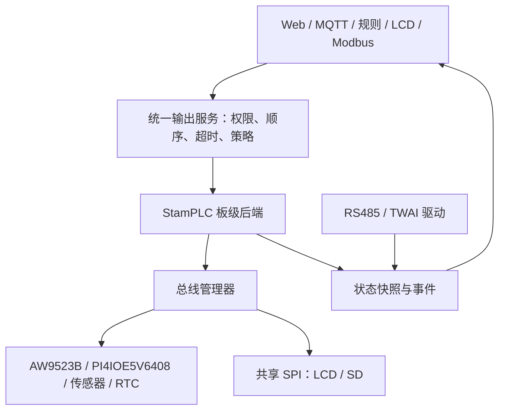

# StamPLC 资料核对记录（历史评估）

> **范围调整于 2026-09-17：当前待审核方案为 [FastBee 通用外设能力扩展计划](../generic-peripheral-extension-plan.md)。本页保留首次整板评估的资料与源码证据；下文 P1/P2、Fxx/Txx、专板环境、厂商云、Home Assistant、Modbus 从站等旧范围均不作为本次执行要求。功能取舍、任务和验收以新计划为准。**

> 评估日期：2026-09-16。对象：M5Stack StamPLC（K141 / Stamp-S3A）与当前 FastBee-Arduino 工作区。结论依据官方产品资料、官方驱动/出厂固件源码和本地代码静态审查；尚未在 StamPLC 真机上编译、烧录或测量。

[当前通用扩展计划](../generic-peripheral-extension-plan.md) · [原计划调整说明](implementation-plan.md) · [返回项目文档目录](../README.md)

## 1. 原整板评估的结论与范围（已被取代）

**可以将 StamPLC 的主要板载功能接入 FastBee；当前工程不能仅靠导入一份配置就实现完整支持。** 必须增加专用板级定义、两颗 I²C IO 扩展芯片驱动、板载传感器/RTC、彩屏、Modbus 从站及 CAN 等能力。

评估结果分为四层：

1. **板载硬件能力：有明确实现路径。** 数字输入、继电器、传感器、时钟、显示、按键、蜂鸣器、存储及两种现场总线均有厂商资料或参考实现。是否达到同时运行、可靠恢复和响应时间目标，需要真机验收。
2. **FastBee 集成：需要开发。** WiFi、MQTT、Web、规则、认证、配置管理、部分 RS485/SD/OTA 基础可以复用；硬件后端、状态模型与资源管理需要补齐。
3. **出厂体验兼容：有条件实现。** EZData 账号授权、云监控链接、Home Assistant、出厂菜单和 SD 升级应独立验收；厂商云服务的访问资格、现行 API 和完整兼容性不能由本地源码审查保证。
4. **不能承诺的范围：** 板载三色指示灯连续调光、内置 CAN-FD、将光耦数字输入直接当模拟量输入、无限制全功能并发，以及把 FastBee/UiFlow2/ESPHome/出厂固件作为一个现成固件同时运行。它们分别受硬件能力、内存或固件架构限制。

建议实施两个交付层级：

| 层级 | 交付内容 | 完成标准 |
| --- | --- | --- |
| P1：FastBee 板载功能版 | 全部主机板载接口驱动、FastBee Web/MQTT/规则、RTU 主站或从站、经典 CAN、RTC、SD 日志、已有 OTA 的板级验证 | 在约定负载下联调通过，24 小时连续运行；不以占位菜单或编译通过代替硬件验证 |
| P2：文档功能完整交付 | P1 + SD 升级、出厂交互行为兼容、EZData、Home Assistant、完整故障恢复和 72 小时压力测试 | 每项功能有验收证据；云端受阻项目明确标为阻塞，不能宣称“全部完成” |
| 可选扩展 | StamPLC AC/PoE 等另购附件和特定 Grove/EXT 设备 | 按实际附件另建清单、资源配置与测试；主机有接口不代表所有附件已支持 |

“多任务”用于并行开发和测试准备；设备固件仍应采用少量受控任务、统一总线与输出管理。不能为每路 IO 建一个独立任务。

## 2. 逐项功能评估

状态含义：**复用**表示工程已有通用实现，仍需板级验证；**补齐**表示已有部分基础；**新增**表示未发现可用的本板实现；**条件**表示依赖外部服务、附件或实际测量。以下“可行”均为工程评估，不是已完成的真机测试。

### 2.1 主机硬件与维护

| ID | 文档功能 | 工程现状 | 可行性与实施要求 | 验收任务 |
| --- | --- | --- | --- | --- |
| F01 | ESP32-S3、8MB Flash、下载启动 | 补齐：有 `esp32s3-F8R0`，无 StamPLC 板级目标 | 按无 PSRAM 设计专板环境；锁定 Flash/分区/USB/板型，实际读取芯片与存储信息 | T00–T02、T17 |
| F02 | WiFi 接入与配网 | 复用：AP/STA、网络管理、Web 已有 | 验证原生 USB 调试、2.4GHz STA、断网重连；LCD 配网入口另做 | T07、T13–T16 |
| F03 | 8 路光耦数字输入 | 新增：通用 GPIO 不等于扩展器输入 | AW9523B 通道采集、极性、去抖、质量状态、事件/规则接入；低电平/高电平接线分别测试 | T03–T04、T12、T16 |
| F04 | 4 路继电器输出 | 新增：现有 GPIO 动作不能直接控制本板 | AW9523B 输出后端；统一命令队列、通道映射、启动状态、故障策略；禁止把扩展器通道号当 ESP32 GPIO | T04、T12–T16 |
| F05 | PWR-485 电气接口 | 补齐：已有 UART、DE 和 RTU 主站 | 固定 TX/RX/DIR 资源，核验方向极性、收发切换与启动脚行为 | T02–T03、T08、T16 |
| F06 | 文档默认 Modbus RTU 从站及寄存器表 | 新增：当前发布能力是主站，从站数据源未接通 | 实现读线圈、写单/多线圈、读输入寄存器；固定字序、快照及越界响应；不能只改从站宏 | T09、T13、T16 |
| F07 | PWR-CAN | 新增：存在 CAN 类型名，未发现实际 TWAI 后端 | 使用 ESP32-S3 经典 CAN/TWAI；提供速率、过滤、收发、错误及 bus-off 恢复；上层协议需单独定义 | T10、T13、T16 |
| F08 | 1.14 英寸 ST7789 彩屏 | 新增：现有 LCDManager 主要是 U8g2，SPI 分支不完整 | 新建 ST7789/M5GFX 后端，核对可视区、偏移、旋转与背光；以分块刷新控制 RAM | T03、T06、T15 |
| F09 | A/B/C 用户按键 | 新增：经 PI4IOE5V6408 读取 | 去抖、单击/长按、菜单；按键与 RGB/背光必须共享同一扩展器实例 | T04、T07、T16 |
| F10 | 蜂鸣器 | 补齐：已有 PWM/动作基础 | 在 GPIO44 分配 LEDC 资源，非阻塞告警；限制告警占空时间并支持静音 | T07、T12、T16 |
| F11 | 面板 RGB 状态指示 | 新增：PI4IOE5V6408 三路数字输出 | 可实现颜色组合与闪烁；不承诺 PWM 连续调光或呼吸渐变 | T04、T07 |
| F12 | Stamp-S3A 模组 RGB | 补齐：已有 NeoPixel | 与面板 RGB 分开建模；GPIO38 电源使能、GPIO21 数据；实物修订匹配后绑定 | T02、T07、T16 |
| F13 | LM75 内部温度 | 新增：通用 I²C 传感器框架可复用 | 实现带符号温度读取、有效性与错误状态；它是板内温度，不自动代表外界环境温度 | T05、T13–T16 |
| F14 | INA226 电压/电流 | 新增：现有 ADC 电流算法不适用 | 读取电源测量链路；确定分流电阻、LSB、量程、单位、正负方向，实物校准 | T05、T13–T16 |
| F15 | RX8130CE RTC | 新增：现有 RTC 为 DS1302 类能力 | RTC 与系统时钟桥接、NTP 回写、失效标志、离线启动；断电保持时长以板上后备电源实测为准 | T05、T12、T16 |
| F16 | microSD 数据存储 | 补齐：已有 SDSPI/文件管理基础 | 与 LCD 共用 SPI 的管理、异步日志、卡满/拔卡处理；现有小文件接口不能代替持续日志和固件流 | T03、T11、T15–T16 |
| F17 | SD 卡固件更新 | 新增：当前 OTA 无 SD 数据源 | 增加分块读取、板型/版本/大小/摘要校验、写入非活动 OTA 分区、失败恢复 | T18、T23 |
| F18 | HY2.0 PORT.A | 补齐：通用 I²C/GPIO 驱动 | 使用独立端口资源，避免重新初始化内部 SDA13/SCL15 总线；附件型号与电平逐项验证 | T02–T03、T16 |
| F19 | HY2.0 PORT.C | 补齐：UART/GPIO 框架 | 显式登记 GPIO4/5 与可用 UART；不能与 RS485 同时占用同一个 UART 实例 | T02–T03、T08、T16 |
| F20 | GPIO.EXT / StamPLC-Bus | 补齐：缺少板内共享资源声明 | 对 I²C/SPI/IRQ/RESET/CS 进行共享或独占建模；只向用户开放实际可用资源 | T02–T03、T13、T16 |
| F21 | RESET/BOOT、恢复固件 | 补齐：通用重启/恢复路径已有 | 固件级恢复设置与恢复厂家固件区分；复位/OTA 期间输出行为要测量 | T02、T04、T17–T18 |
| F22 | 宽压供电、DIN 安装、物理端子 | 已有硬件条件，非软件新增项 | 软件可展示供电状态；供电范围、负载额定值和结构安装不能靠代码扩展 | T00、T05、T16 |

### 2.2 出厂软件体验与项目集成

| ID | 功能 | 工程现状 | 结论与交付边界 | 验收任务 |
| --- | --- | --- | --- | --- |
| F23 | Dashboard、本机 IO 状态/控制 | 补齐：有 Web，无对应机身 UI | 复用同一状态快照；显示网络/IO/传感器/故障，不维护多份独立继电器状态 | T06–T07、T13、T21 |
| F24 | LogMonitor、总线与内部状态查看 | 补齐：有日志与健康接口 | 增加 RTU/CAN/传感器/SD 状态与限频日志；日志查看不能阻塞 IO | T10–T11、T13、T21 |
| F25 | TimerRelay | 补齐：有定时与轮询规则 | 可实现周期输出；出厂演示的“退出页面/复位停止”与持久化自动规则必须分开 | T12、T21 |
| F26 | EZData 上传、远程监控与控制 | 条件：没有 EZData 客户端 | 需适配授权、令牌更新、云端命令、二维码/链接、多用户、ADVANCED HTTP API 和断线重试；FastBee MQTT 不能直接冒充 EZData | T19、T21、T23 |
| F27 | Home Assistant 集成 | 条件：有 MQTT，无发现协议实现 | FastBee 中优先 MQTT Discovery；官方 ESPHome 示例可作硬件参考，直接烧 ESPHome 会替换当前应用固件 | T20、T23 |
| F28 | Arduino / ESP-IDF / PlatformIO / UiFlow2 | 补齐：项目走 Arduino + PlatformIO | 官方支持多开发方式不意味着一次实现四套运行环境；交付固定本项目工具链，其他固件通过独立刷写切换 | T00、T02、T17 |
| F29 | FastBee MQTT、认证 Web、配置备份、OTA | 复用/补齐 | 接入板载数据与权限/错误状态；OTA 仍需核验分区大小、固件/网页配套、重启状态 | T13–T17、T23 |
| F30 | 本地规则、离线告警和定时控制 | 补齐 | 经统一 IO/时钟接口接入；断网继续执行，时钟无效时禁止误触发日历任务 | T05、T12、T16 |
| F31 | AC/PoE 与其他外接单元 | 条件：主机不自带所有附件能力 | 单列可选交付；以太网、AC 继电器、附加传感器需要实际附件及配置，不计入裸机默认能力 | T22 |
| F32 | TriggerRelay 与 SD 预设 | 补齐：有事件规则，无同名出厂演示/SD 预设流程 | 实现输入条件触发继电器、预设保存/加载及校验；演示退出/复位暂停，不能导入即自动执行 | T11–T12、T21、T23 |
| F33 | Setting 配置页 | 补齐：现有配置能力分散 | 本机查看版本、调整 Modbus 地址、时区和蜂鸣器；保存后运行状态与重启结果都一致 | T05、T07、T09、T21 |

能力清单来自 [StamPLC 产品文档](https://docs.m5stack.com/zh_CN/core/StamPLC)、[出厂使用说明](https://docs.m5stack.com/zh_CN/guide/industrial_control/stamplc/usage) 和 [官方 Home Assistant 集成说明](https://docs.m5stack.com/zh_CN/homeassistant/devices/stamplc)。可行性、任务和架构选择为本次工程判断。

## 3. 当前工程的可复用基础与真实缺口

本地基准 HEAD 为 `3af56cad2cabdd5b618eba220517f99d16a40bd8`；本次同时检查了未提交的现有工作区代码。因此仅重新检出该提交，未必能获得下表全部基础。执行 T00 时应先由集成负责人保存与核对当前基线，不能覆盖正在进行的改动。

| 代码位置 | 已核实事实 | 对实现计划的影响 |
| --- | --- | --- |
| [platformio.ini](../../platformio.ini)，`env:esp32s3-F8R0` | 已有 8MB、无 PSRAM、A/B OTA；该环境当前绑定的 COM7 属于已有部署对象 | 可复用能力配置；不能把 COM7 或其配置直接当 StamPLC |
| [BoardProfile.h](../../include/core/BoardProfile.h)、[BoardProfile.cpp](../../src/core/BoardProfile.cpp) | 只有普中 ESP32 与 C6 板型；编译选择未覆盖 S3 | 新增 StamPLC 板型、资源所有权与启动脚策略 |
| [PeripheralRouteHandler.cpp](../../src/network/handlers/PeripheralRouteHandler.cpp) | `compiledBoardProfileSupported()` 当前只开放 ESP32/C6；S3 未提供完整板级预检 | 同步支持开关、芯片信息、预检 API；不能只增加枚举 |
| [PeripheralManagerIo.cpp](../../src/core/PeripheralManagerIo.cpp)、[PeripheralTypes.h](../../include/core/PeripheralTypes.h) | 工业 DI/DO 基础仍以直接 GPIO 为主 | 增加扩展器后端及稳定通道 ID，保持旧配置兼容 |
| [PeripheralResourcePlanner.cpp](../../src/core/PeripheralResourcePlanner.cpp) | 有总线/引脚规划基础，缺少本板 LCD/SD/IO 扩展器的共同资源描述 | 补充共享总线、独占片选、复位/IRQ 及启动脚受控例外 |
| [LCDManager.cpp](../../src/peripherals/LCDManager.cpp) | 现有 SPI 显示分支明确未完整实现 | `FASTBEE_ENABLE_LCD=1` 不能作为彩屏已支持的证据 |
| [DriverRegistry.h](../../include/core/DriverRegistry.h)、[SensorDriverCache.h](../../include/core/SensorDriverCache.h) | 驱动注册容量 8；缓存实际容量 6；当前已注册多种 I²C 传感器 | 新增 LM75/INA226 时要核验注册/缓存容量；RTC 用独立时钟接口，避免无依据扩大常驻 RAM |
| [RuntimeFeatureManager.cpp](../../src/core/RuntimeFeatureManager.cpp)、[ModbusHandler.cpp](../../src/protocols/ModbusHandler.cpp) | 发布基线关闭从站，数据源未接通；主站有实际实现 | 新建从站服务及运行时状态；不能单纯开启旧宏宣称兼容 |
| [SDCardManager.h](../../include/peripherals/SDCardManager.h)、[SDCardManager.cpp](../../src/peripherals/SDCardManager.cpp) | 有 SDSPI 和文件基础；文件 API 有 16KB 级限制 | SD 日志与 SD OTA 要使用受控流接口，不能一次读整个固件 |
| [PeriphExecManager.cpp](../../src/core/PeriphExecManager.cpp)、[TimeUtils.cpp](../../src/utils/TimeUtils.cpp) | 日历定时依赖系统时间，未见 RX8130→系统时钟桥接 | RTC 驱动完成后还需接通系统时钟与规则调度 |
| [WebMemoryGuard.h](../../include/network/WebMemoryGuard.h) | 默认无 PSRAM Web 护栏条件覆盖 ESP32/C3/C6，未包含 S3 | 专板应显式验证并启用适当护栏，不能假定已有保护自动覆盖 |
| [HealthMonitor.cpp](../../src/systems/HealthMonitor.cpp) | 存在 `downgradeMqttsToMqtt()` 内存降级路径 | T15 核验并调整 StamPLC 策略；TLS内存不足应退避/报告，不自动切换明文控制链路 |
| [deploy-config-bundle.ps1](../../scripts/deploy-config-bundle.ps1) | 通用 S3 保留脚包含 GPIO0；简单重复脚检查会拒绝总线共享 | StamPLC RS485 TX0 与共享总线需板级授权模型，不能全局放开禁用脚 |
| [kill-stale-processes.py](../../scripts/kill-stale-processes.py)、[deploy.ps1](../../scripts/deploy.ps1) | 清理逻辑可能结束同机其他编译器/PlatformIO 进程 | 现阶段单机编译/烧录串行；并行编译须隔离机器或先修进程所有权 |

对 `src/include/web-src` 的关键词与调用链审查，未发现本板 AW9523B、PI4IOE5V6408、LM75、INA226、RX8130 的可用实现，也未发现 TWAI 驱动、EZData 或 Home Assistant Discovery。未把 README 宣传条目、枚举名字或测试中的镜像算法计为已实现能力。

## 4. 硬件资源与容易出错的映射

下表用于设计和核验；执行前应与实际硬件修订版、官方驱动常量及原理图再次对齐。

| 资源 | 引脚 / 地址 | 所有者与共享约束 |
| --- | --- | --- |
| 内部 I²C | SDA13 / SCL15 | 单一总线管理器；所有板载 I²C 器件共享 |
| 内部 IRQ / RESET | GPIO14 / GPIO3 | 多器件共享；中断只通知工作任务，不能在 ISR 中做 I²C；复位由板级管理器独占 |
| AW9523B | `0x59` | DO：P0_0…P0_3；DI：P0_4…P0_7、P1_4…P1_7；有效极性先测量 |
| PI4IOE5V6408 | `0x43` | A/B/C：P2/P1/P0；面板 R/G/B：P6/P5/P4；背光：P7 |
| 电源/温度/RTC | `0x40` / `0x48` / `0x32` | INA226 / LM75 / RX8130CE；传感器告警与 RTC IRQ 要分辨来源 |
| 共用 SPI | SCK7 / MOSI8 / MISO9 | LCD、SD 与 EXT 必须有统一的主机/事务管理，不能独立重复 `begin/end` |
| LCD | CS12 / DC6 / RESET3 | RGB565 有效区 135×240；厂家参考 offset 52/40、rotation offset 1；RESET 与 IO 扩展器共用 |
| microSD | CS10 | 采用 SDSPI；不是把卡槽按 SDMMC 接线使用 |
| PWR-485 | TX0 / RX39 / DIR46 | GPIO0 与启动功能相关；按厂商板级设计受控启用，不能被通用 GPIO 动作占用 |
| PWR-CAN | TX42 / RX43 | 使用 TWAI；调试串口若使用默认 UART0 TX43，会与 CAN 冲突 |
| 蜂鸣器 | GPIO44 | 独占 LEDC 资源；默认 UART0 RX44 也需避让 |
| PORT.A | GPIO2 / GPIO1 | 可作外部 I²C/GPIO，独立于内部 SDA13/SCL15 |
| PORT.C | GPIO5 / GPIO4 | 依实际用途注册 UART/GPIO，不默认推断附件 TX/RX |
| EXT | 共用 I²C/SPI/IRQ/RESET、CS11、GPIO40/41 | 不是一组全部空闲 GPIO；扩展模块还会影响片选、复位及供电预算 |
| Stamp RGB | 电源 GPIO38 / 数据 GPIO21 | WS2812B，可控制颜色/亮度；与 PI4IOE5V6408 面板 RGB 分开 |

映射参考 [产品管脚表](https://docs.m5stack.com/zh_CN/core/StamPLC)、[M5StamPLC 驱动源码](https://github.com/m5stack/M5StamPLC) 与 [ESP32-S3 GPIO 文档](https://docs.espressif.com/projects/esp-idf/en/v5.5.2/esp32s3/api-reference/peripherals/gpio.html)。GPIO0/3/46 涉及启动配置，不应照搬其他 ESP32 型号的引脚黑名单。

特别注意：

- 产品页“光耦输出”是光耦向 MCU/扩展器提供的输出，不是额外 8 路用户可控数字输出；主机用户 IO 仍为 8 入、4 路继电器。
- 两种 RGB 是不同电路。面板三色灯只做开关/组合色；Stamp 模组的可编程 RGB 独立处理。不能把两者都当成同一 NeoPixel。
- LCD 重新初始化可能牵动 GPIO3；运行时随意复位显示器可能同时复位 IO。LCD/SD/RTC/传感器驱动不能各自拥有全板初始化权。
- PWR-CAN/PWR-485 的电源输出与输入电源相连；供电预算与附件电压范围属于设备选型条件，不是通信协议能解决的问题。
- CAN/485 有终端电阻接入开关，测试时记录开关位置、总线两端终端和节点数；不能默认所有节点都打开终端。
- INA226 测的是指定供电路径，不代表每路继电器负载电流，更不是交流功率计。
- Home Assistant 示例中的 LCD 最小参数与产品有效分辨率存在差别，实施以厂商面板配置和真机测试卡为准。

电气验收采用产品额定边界：主电源 DC 6–36V@1A、数字输入 DC 5–36V、继电器 AC 5A@250V / DC 5A@28V、整机工作温度 0–40°C。继电器额定值不能当作所有感性负载都可直接按该电流切换的保证；初轮按低压台架验证。官方扩展口约 4.8V@700mA 为列出的测试条件，不能据此假设多个端口可各自同时提供该电流。见 [产品规格与供电说明](https://docs.m5stack.com/zh_CN/core/StamPLC)。

## 5. 建议架构与接口约定

### 5.1 专板环境与板级适配

拟新增构建环境 **`esp32s3-stamplc-F8R0`**，从现有 S3-F8R0 的公共配置复用工具链和 8MB 分区，但有独立的板型标识、总线资源、内存配置与发布产物目录。该名称和下列接口都是计划项，当前尚不存在。

新增环境必须同步部署脚本白名单、构建矩阵校验、Web 构建特性识别、产物元数据、配置校验与设备识别；不能只改 `platformio.ini`。原型阶段可作为专用环境登记，正式发布时再加入发布清单及其校验，避免绕过现有门禁。

建议新增 `include/boards/stamplc/`、`src/boards/stamplc/`，封装总线、两颗扩展器、板载遥测、时钟与状态快照。优先复用官方底层实现或成熟驱动，通过适配层接入；先验证内存、总线、错误返回和初始化行为，再决定引入整个 M5StamPLC/M5Unified 还是抽取必要模块。依赖应固定提交/版本并保留许可信息。

### 5.2 IO 路由与状态模型

计划中的统一接口：

- `readInput(channel)` / `writeRelay(channel, value, source, requestId)`：显式通道，不编码为物理 GPIO。
- `getSnapshot()`：包含 DI、DO 命令/锁存状态、按钮、温度、电源、RTC、总线健康、时间戳、质量和序列号。
- `setIndicator(color)` / `setBacklight(on)` / `beep(pattern)`：能力明确，面板指示灯不暴露无效的亮度字段。
- `readRtc()` / `setRtc()` / `clockStatus()`：向现有系统时间服务提供时间与可信状态。

继电器应区分 `requested`、`latchState`、`quality`；扩展器寄存器回读只能证明锁存状态，不能证明机械触点已闭合。输入和传感器读取失败不得伪装成有效的 0。API 可用 `value: null` 配合 `quality/errorCode/updatedAt` 表达失败。

建议配置新增后端/通道字段，例如 `backend=stamplc_aw9523`、`channel=1`、`direction=input|output`；最终字段和类型编号由 T01 冻结。旧直接 GPIO 配置维持原语义，不能把普通 `pins:[1]` 悄悄解释成“继电器 1”。

### 5.3 总线与任务策略

内部 I²C、外部 PORT.A I²C、共享 SPI、RS485 UART、PORT.C UART、TWAI 与 LEDC 分别登记所有权。已有资源规划通过后，硬件层仍需事务互斥与生命周期引用计数；配置预检不能代替运行期互斥。

优先在现有任务框架中增加板级轮询/工作单元。建议起始参数为：DI/按钮扫描 10ms、去抖 20ms、板载遥测 1s、LCD 局部刷新 5Hz、日志后台批量写入。参数属于待验证目标；不要宣称 10ms 扫描等于 10ms 端到端硬实时。

SPI 事务按设备重新设置模式/频率/CS；LCD 分块释放总线，SD 卡写入禁止长时间占有显示任务。多个 RTOS 任务不得各自创建指向同一组引脚的独立 SPI 主机。

### 5.4 输出与故障行为

首次启动采用继电器全关的明确策略；后续可配置行为必须受统一服务约束。远程 API、Modbus、规则与物理按键同时操作时，按提交顺序及已声明的优先策略处理，提供命令来源与最终状态，避免多个模块互相覆盖。

I²C 总线失联时，软件可能无法立即改变已吸合继电器。计划要求停止新控制、标记状态未知、告警并执行已验证的恢复流程；不能承诺单靠软件保证触点必然断开。若业务要求失联必断，应另加硬件切断/反馈措施，并单独验收。

## 6. Modbus 兼容范围

官方产品页给出的地址为 **协议零基地址**，不能在 UI 和线路上混用 `40001/30001` 展示编号。

| 数据区 | 地址 | 数量 | 约定数据 | 计划处理方式 |
| --- | --- | --- | --- | --- |
| Coils | 0–3 | 4 bit | 继电器 1–4 | FC01 只读；FC05/FC15 通过统一输出服务写入 |
| Input Registers | 0–7 | 8 × uint16 | 输入 1–8，逻辑 0/1 | FC04，读取同一次 IO 快照 |
| Input Registers | 8–9 | 2 × uint16 | 温度 FLOAT32 | FC04；单位、字序、异常值行为固化 |
| Input Registers | 10–11 | 2 × uint16 | 母线电压 FLOAT32 | FC04；与 Web/MQTT 相同采样快照 |
| Input Registers | 12–13 | 2 × uint16 | 分流电流 FLOAT32 | FC04；首先确认官方单位与字序 |

公开 UserDemo 源码的默认值已核实为：**站号 1、UART1、115200、8N1、FLOAT32 高字在前**；温度/电压/电流按 °C/V/A 处理。例：25.0 对应寄存器 `0x41C8, 0x0000`。最新 Arduino 库存在 `enableModbusSlave` 配置且默认关闭，不能把 Arduino 库默认行为与出厂 UserDemo 混同。

源码证据见 [串口配置](https://github.com/m5stack/M5StamPLC-UserDemo/blob/87def4f7889f1a76aa3b3898ef2f2b2a482bb4ff/platforms/esp32s3/sdkconfig#L489)、[浮点拆字](https://github.com/m5stack/M5StamPLC-UserDemo/blob/87def4f7889f1a76aa3b3898ef2f2b2a482bb4ff/platforms/esp32s3/main/hal_stamplc/components/hal_modbus.cpp#L50) 和 [电流显示单位](https://github.com/m5stack/M5StamPLC-UserDemo/blob/87def4f7889f1a76aa3b3898ef2f2b2a482bb4ff/app/apps/app_log_monitor/view/panels/panels.cpp#L185)。这不等同于已核验当前 Easyloader 二进制或手中设备版本；T09 仍需抓帧对照。

精确兼容测试还必须固定：DIR 电平、帧内字节序、分段/跨段读取、非法地址、广播写、超时及 CRC 错误。官方输入位于 FC04 Input Registers，不能用 FC02 Discrete Inputs 代替。

同一 PWR-485 口第一版按 **RTU 主站或 RTU 从站二选一** 配置。不能同时运行两套任务争用 UART，也不把多主冲突当作可支持场景；若需要同时提供外部主站采集与被控从站，必须安排第二物理接口/网关并重新分配 UART。

官方演示存在应修正的边界：线圈读写事件都进入相同的输出更新逻辑，读请求可能将旧缓存回写；输入寄存器分成四段，并在读取事件后才更新，结合其锁定的 esp-modbus 实现，跨段读取 0–13 不能一次完成，首读也可能使用旧值。新实现采用响应前已刷新的连续 14 寄存器快照，保证读操作不写输出。见 [UserDemo 事件处理](https://github.com/m5stack/M5StamPLC-UserDemo/blob/87def4f7889f1a76aa3b3898ef2f2b2a482bb4ff/platforms/esp32s3/main/hal_stamplc/components/hal_modbus.cpp#L142)、[依赖的数据区匹配](https://github.com/espressif/esp-modbus/blob/v1.0.17/freemodbus/common/esp_modbus_slave.c#L41) 与 [响应复制顺序](https://github.com/espressif/esp-modbus/blob/v1.0.17/freemodbus/common/esp_modbus_slave.c#L283)。修正点应形成兼容差异记录并纳入 T09。

## 7. 内存、存储与同时运行的边界

主机以 **8MB Flash、无 PSRAM** 为实施基线。8MB 是程序/文件存储，不是可供任务、TLS 与画面随意分配的运行内存；不能套用 F8R8/F16R8 的资源预算。

| 项目 | 已知量 / 建议预算 | 验证方法 |
| --- | --- | --- |
| 现有 8MB 分区 | 每个应用槽 `0x380000` = 3.5MiB；LittleFS `0xF0000` = 960KiB | 检查最终固件、网页、配置占用；保留升级与配置写入余量 |
| 完整 RGB565 画面 | 135×240×2 = 64,800 bytes；双缓冲 129,600 bytes | 默认采用直接绘制或小块缓冲，不默认整屏双缓冲 |
| 建议显示块 | 240×16×2 = 7,680 bytes | 记录 DMA/普通 DRAM 来源和最大连续块需求 |
| 新增板级常驻预算 | 初始目标 ≤24KiB，另单列库初始化、任务栈、SPI/DMA 和网络峰值 | T15 按链接映射与实际堆差值核验；超预算先调整结构 |
| SD 日志缓冲 | 初始 4–8KiB 有界队列/缓冲 | 卡慢/卡满时限流，报告丢弃计数，不能无限缓存 |
| RTU/CAN | 使用有界帧队列与快照 | 记录峰值、溢出、超时、恢复，不按消息数无限分配 |
| Web/MQTT/TLS | 复用 MemoryBudget，再测专板并发峰值 | 无 PSRAM TLS 现有准入线为 free DRAM 52,224 bytes、最大连续块 17,408 bytes；不是已测得的余量 |
| 初始运行负载 | 1 个浏览器、1 路 MQTT、8DI/4DO、1 个 RTU 角色、CAN、5Hz LCD、1Hz 传感器、1Hz SD 日志 | P1 验收基线；更多页面、TLS/EZData 同时握手属于 P2 专项 |

原始常量见 [MemoryBudget.h](../../include/core/MemoryBudget.h) 与 [8MB 分区](../../partitions/8MB.csv)。表中的新增资源预算和负载为本计划设定，不是厂商性能指标。

功能优先级：板级 IO 与输出策略 > 现场总线/本地规则 > 网络控制 > 显示/诊断/日志 > 额外云端会话。内存保护不得悄悄删除主机固定 IO，也不能为节省内存自动把 TLS 控制链路改成明文。出现资源不足时，应明确拒绝可选功能并展示原因。

**“所有功能能分别实现”不等于“所有重型功能能无限并发”。** 单机同时启用 MQTT TLS、EZData HTTPS、多个 Web 客户端和高频 SD 写入是否可用，必须经 T15/T23 给出有界并发配置；必要时串行握手、限流或采用外部网关。只有满足同一约定负载的实测，才可对外宣称该组合受支持。

## 8. 不能靠固件消除的限制

| 条件 | 结论 |
| --- | --- |
| 面板 RGB 的亮度渐变 | 官方给的是三通道开关能力；本计划不承诺连续 PWM 调光 |
| 内置 CAN-FD | ESP32-S3 原生 TWAI 不支持；若需要，增加外部控制器/收发器并重新评估 SPI 资源 |
| 8 路光耦输入变成 0–10V / 4–20mA AI | 输入是数字量；需要外加模拟前端/采集模块，不能改配置即可获得模拟量 |
| 高速计数、运动控制或确定性 PLC 周期 | 通过扩展器、共享总线、WiFi/RTOS 的实现不能自动满足这类指标；须另行定义与验证 |
| 继电器额定电流与温度范围 | 保持厂商规格边界，软件不能扩大接点能力、散热条件或产品工作环境范围 |
| RTC 长期断电保持 | 芯片支持后备并不代表成品具有指定时长的备份；先确认电路、后备源和实测 |
| EZData 自动生成厂商控制页 | 依赖厂商服务、账号和接口；自建一个 FastBee 页面不算完成这一项 |
| 任意 Grove/EXT、AC/PoE 附件全兼容 | 接口存在不足以证明兼容；必须按实际附件评估电压、协议、地址和资源冲突 |

CAN 边界依据 [Espressif TWAI 文档](https://docs.espressif.com/projects/esp-idf/en/v5.5.2/esp32s3/api-reference/peripherals/twai.html) 与 [CAN-FD 官方说明](https://docs.espressif.com/projects/esp-faq/en/latest/software-framework/peripherals/twai.html)。

## 9. 开发前必须关闭的不确定项

| ID | 不确定项 | 处理任务 | 放行证据 |
| --- | --- | --- | --- |
| U01 | 实际硬件修订、芯片/Flash/PSRAM、USB/端口识别 | T00/T02 | 实物型号、读芯片结果、连接清单 |
| U02 | 官方库与当前 Arduino/ESP-IDF 工具链组合 | T02 | 锁定版本的最小编译和启动日志 |
| U03 | IO 极性、复位/上电瞬态、I²C 故障后锁存行为 | T03/T04/T16 | 逻辑分析/低压负载记录 |
| U04 | INA226 分流参数、量程、实际供电测量路径 | T05 | 原理图核对与参考表计测量 |
| U05 | RTC 后备源、有效位、断电保持与充电配置 | T05 | 供电电路确认及断电试验 |
| U06 | LCD 旋转/偏移、SD 与显示实际共享事务 | T06/T11/T15 | 测试卡、并发读写、长时间日志 |
| U07 | 实际出厂二进制与已核对源码的参数、单位/字序及跨段行为是否一致 | T09 | 厂家固件版本、对照抓帧、固定测试向量 |
| U08 | CAN 收发器、终端电阻、接线及现场协议 | T10 | 第二节点/分析仪双向帧及错误恢复 |
| U09 | EZData 现行 API/账号授权与双云内存峰值 | T19/T23 | 真实服务接入与控制往返；不能凭编译通过关闭 |
| U10 | 无 PSRAM 下 P1/P2 组合的最坏内存水位 | T15/T23 | free/min/largest internal heap、栈水位、功能状态与压力记录 |

U01–U03 未关闭前不连接实际生产负载。此处是具体硬件验收门槛；本次任务只形成评估和执行文档，没有执行设备写入。

## 10. 资料与证据基准

资料核对时间为 2026-09-16。网页可能更新，实施时应记录实际采用版本。

| 编号 | 资料 | 用途 |
| --- | --- | --- |
| S01 | [StamPLC 官方产品页](https://docs.m5stack.com/zh_CN/core/StamPLC) | 功能、引脚、规格、寄存器表和原理图入口 |
| S02 | [StamPLC 出厂使用说明](https://docs.m5stack.com/zh_CN/guide/industrial_control/stamplc/usage) | Dashboard、EZData、LogMonitor、TimerRelay 与配置体验 |
| S03 | [官方 Arduino 库](https://github.com/m5stack/M5StamPLC/tree/c5d54a3a8ab83dcb94ca119b5bd555c55ef4e22a) | 板级驱动与初始化；本次核对提交固定 |
| S04 | [官方 UserDemo](https://github.com/m5stack/M5StamPLC-UserDemo/tree/87def4f7889f1a76aa3b3898ef2f2b2a482bb4ff) | 出厂功能与 Modbus/EZData 参考；本次核对提交固定 |
| S05 | [官方 Home Assistant 示例](https://docs.m5stack.com/zh_CN/homeassistant/devices/stamplc) | 芯片组件、初始化依赖与可选 AC/PoE 扩展 |
| S06 | [Stamp-S3A 模组文档](https://docs.m5stack.com/en/core/Stamp-S3A) | 模组资源及独立可编程 RGB |
| S07 | [ESP32-S3 GPIO](https://docs.espressif.com/projects/esp-idf/en/v5.5.2/esp32s3/api-reference/peripherals/gpio.html) | 启动脚、USB 和 GPIO 占用规则 |
| S08 | [ESP32-S3 TWAI](https://docs.espressif.com/projects/esp-idf/en/v5.5.2/esp32s3/api-reference/peripherals/twai.html) | 经典 CAN、收发与错误恢复边界 |
| S09 | [本地执行计划](implementation-plan.md) | 任务、估算、依赖、验收与交付清单 |

### 10.1 不宜直接照搬的官方实现

| 已核对事实 | 对应源码 | 执行要求 |
| --- | --- | --- |
| `begin()` 会释放/重建内部 I²C、初始化继电器全关；内部使用 M5 I²C 类 | [M5StamPLC.cpp](https://github.com/m5stack/M5StamPLC/blob/c5d54a3a8ab83dcb94ca119b5bd555c55ef4e22a/src/M5StamPLC.cpp#L19) | 不与 Wire 各自接管同一控制器，不在普通读取/显示恢复时反复调用 |
| RTC 初始化启用后备充电相关位 | [rx8130.cpp](https://github.com/m5stack/M5StamPLC/blob/c5d54a3a8ab83dcb94ca119b5bd555c55ef4e22a/src/utils/rx8130/rx8130.cpp#L84) | 按实际后备器件决定配置；未知时不直接复制充电默认 |
| 公开出厂分区仅启用 factory，未找到 SD 固件更新完整路径 | [partitions.csv](https://github.com/m5stack/M5StamPLC-UserDemo/blob/87def4f7889f1a76aa3b3898ef2f2b2a482bb4ff/platforms/esp32s3/partitions.csv#L3) | SD OTA 按新增功能实现，采用本项目经验证的升级/恢复策略 |
| 出厂 SD 挂载允许失败后格式化 | [hal_sd_card.cpp](https://github.com/m5stack/M5StamPLC-UserDemo/blob/87def4f7889f1a76aa3b3898ef2f2b2a482bb4ff/platforms/esp32s3/main/hal_stamplc/components/hal_sd_card.cpp#L30) | 新实现默认不自动格式化用户卡 |
| CAN 监控处理可回送非 RTR 收到帧 | [hal_can.cpp](https://github.com/m5stack/M5StamPLC-UserDemo/blob/87def4f7889f1a76aa3b3898ef2f2b2a482bb4ff/platforms/esp32s3/main/hal_stamplc/components/hal_can.cpp#L104) | 监听默认只读；回环只允许显式台架模式 |
| Modbus 在文件配置加载前启动 | [hal_stamplc.h](https://github.com/m5stack/M5StamPLC-UserDemo/blob/87def4f7889f1a76aa3b3898ef2f2b2a482bb4ff/platforms/esp32s3/main/hal_stamplc/hal_stamplc.h#L16) | 先加载配置再启动协议，单独测试站号保存/重启生效 |
| LCD 使用小屏有效区与特定偏移，共享 SPI | [hal_display.cpp](https://github.com/m5stack/M5StamPLC-UserDemo/blob/87def4f7889f1a76aa3b3898ef2f2b2a482bb4ff/platforms/esp32s3/main/hal_stamplc/components/hal_display.cpp#L74) | 使用厂家参考参数，并测试实际方向/边界与 SD 并发 |
| INA226 参考校准为 0.01Ω、8.192A；这是测量配置，不是整机可供电额定值 | [hal_power_monitor.cpp](https://github.com/m5stack/M5StamPLC-UserDemo/blob/87def4f7889f1a76aa3b3898ef2f2b2a482bb4ff/platforms/esp32s3/main/hal_stamplc/components/hal_power_monitor.cpp#L33) | 核对实物分流器与供电路径，按成品/附件额定条件测试，不按此数值施加整机负载 |

公开使用方式是 AP 配网和 USB 烧录；未找到完整的 USB 业务配置协议，因此没有把这项列为已有出厂软件能力。以上审查限定于所列公开源码版本，不推断所有厂家已发布固件均存在同样行为。

本次已完成：官方资料与源码核对、本地静态差距分析、任务拆分和验收设计。尚未完成：本板适配代码、StamPLC 编译与真机测试、性能/电气测量、实际云服务兼容验收。
